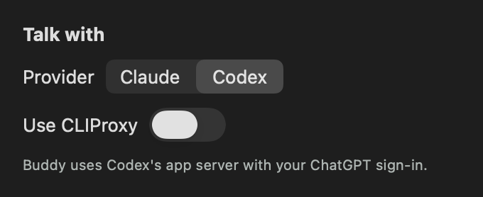

# Talk on Codex verification

Scope is issue 10. The adapter's wire protocol, fixtures and launch overrides come from the closed draft PR #45. This change rebuilds them on main's CLIProxy talk switcher (ADR 0005), so direct Codex is the counterpart of direct Claude (ADR 0006).

## Behavior

**Talk with** in settings always shows the Claude/Codex choice. With **Use CLIProxy** on, both providers still go through the hub, using the Claude CLI transport. With it off, Claude uses the Claude CLI's own login, and Codex uses a long-lived `codex app-server` on the owner's ChatGPT login. Changing either control interrupts the turn on the brain that was answering, then switches brains and warms the new one.



## Acceptance mapping

| Criterion | Implementation | Evidence |
| --- | --- | --- |
| One long-lived `codex app-server` speaking JSON-RPC, on the owner's ChatGPT login, ignoring the proxy provider in their Codex config | `CodexBrain` hosts `CodexStream` in a `ChildProcess`. `CodexLaunch.talk` passes `-c model_provider="openai"` and removes `OPENAI_*` and `CODEX_*` variables except `CODEX_HOME`. An account that isn't `chatgpt` fails the turn as signed out. | `talkUsesTheOwnersChatGPTSignInWithoutTheirProxyHooksPluginsOrTools` and `recordedStartupSignsInThenStartsAThreadWithoutTheOwnersToolsHoweverTheOutputIsSplit`. The live test ran with the owner's config, which sets `model_provider = "cliproxy"`. |
| One thread per conversation with slim base instructions of our own. Screenshots go in as temporary images deleted after the turn | Each thread is `ephemeral`, with `baseInstructions` set to `TalkInstructions.system`, a read-only sandbox, approval `never`, and the owner's MCP servers off. `resetProvider` calls `endConversation`, which starts a fresh thread on the same process; Claude's `endConversation` ends its process. The stream primes each thread's first turn with the recent turns. Screenshots are `localImage` files in `$TMPDIR/Buddy Codex screenshots`, deleted when the turn ends or the process stops. The folder is emptied at launch. | `newConversationKeepsTheProcessAndPrimesItsFreshThreadAgain`, `onlyEachThreadsFirstTurnCarriesTheRecentTurns`, `recordedTurnsReplayThroughAProcessWithEachScreenshotOnDiskOnlyDuringItsTurn` and `stoppingMidTurnFailsItAndDeletesItsScreenshot`. |
| Text deltas flow into the same beat pipeline; interruption maps to the turn interrupt | `item/agentMessage/delta` becomes `ProviderEvent.textDelta`. Cancel sends `turn/interrupt`, and the next turn waits for the interrupted one to complete. | `cancelledTurnIsInterruptedAndTheNextTurnWaitsForItToEnd` (replayed from a real interruption), `turnCancelledBeforeCodexAcceptsItIsInterruptedOnceItIs` and `eachAgentMessageInATurnStartsOnItsOwnLine`. |
| Usage is read from the account rate-limit request and its update notifications | `account/rateLimits/read` and `account/rateLimits/updated` become `.usage`, with windows matched by 300 and 10,080 minutes. `ProviderUsage` windows are now optional, because the owner's plan reports only a 7-day window. | The recorded turns emit `.usage(codexWeeklyUsage)`. |
| The menu lets the owner choose Claude or Codex for talk | The Provider control sits above the proxy toggle. `TalkConnections.talkCLI` picks the brain, and the engine learns it through `talkCLIChosen` so failure notices name Codex. | `TalkConnectionsTests` (app), `chosenCLINamesTheNextFailure` and `agentRunFailureNamesClaudeCodeWhileCodexAnswersTalk`. The panel harness below. |
| Adapter tests replay a recorded JSON-RPC exchange; an opt-in live smoke test runs one tiny real turn | Three fixtures recorded from `codex app-server` 0.166.0 in PR #45 and sanitized there. The installed CLI is still 0.166.0. | `CodexStreamTests`, `CodexBrainTests`, and `BUDDY_LIVE_CODEX=1 swift test --package-path BuddyCore --filter liveCodex`. |
| Manual check: the same question on both providers points at the same place | | See "Same question on both providers" below. |
| Logic is covered by Swift Testing tests in BuddyCore through the engine's public interface, with literal expected values | Engine notices through `BuddyEngine.handle`. The protocol through `CodexStream`'s public outputs and process behaviour through `CodexBrain`, as the Claude adapter is tested. | All expectations are literals. |

## Commands

Run on macOS 26 with Codex CLI 0.166.0 and Claude Code 2.1.316.

```sh
swift test --package-path BuddyCore
# 225 tests in 25 suites passed; liveClaude and liveCodex skipped.

BUDDY_LIVE_CODEX=1 swift test --package-path BuddyCore --filter liveCodex
# liveCodexAnswersATinyTurnFromAnEmptyFolder passed after 3.5 s.

xcodebuild -project Buddy.xcodeproj -scheme Buddy -configuration Debug \
  -destination 'platform=macOS,arch=arm64' -derivedDataPath /tmp/buddy-ci-issue10 \
  CODE_SIGNING_ALLOWED=NO COMPILER_INDEX_STORE_ENABLE=NO test
```

## Same question on both providers

A throwaway harness outside the repo wired `BuddyEngine` to the real direct `ClaudeBrain` and `CodexBrain` from this branch. Each brain was warmed for 4 seconds, then asked "What do I click to keep my changes?" with the same synthetic 1280 × 800 Save dialog on a 1440 × 900-point display. The image's SHA-256 is `7a55022f…4c529`, the same one PR #45 used. The Save button's centre is pixel 860, 515.

| Step | Claude (direct) | Codex (app server) |
| --- | --- | --- |
| Reply | `[POINT:859,515:Save button] Click the blue Save button on the right to keep your changes to Budget.numbers.` | `[POINT:860,515:Save] Click Save to keep your changes.` |
| First `textDelta` | 987 ms | 2,088 ms |
| `completed` | 1,303 ms | 2,375 ms |
| `point` effect | 966.375, 320.625 | 967.5, 320.625 |

Both point inside the Save button, one pixel apart. Afterwards, both working folders and the screenshot folder were empty.

## Panel

A second harness compiled the app's own `TalkConnectionsView` and `TalkConnections` against an isolated defaults suite with no hub. It started with direct Claude and clicked the Codex segment through AppKit. `talkCLI` became `codex`, the model fell back to `gpt-6.1-sol`, and `onChange` fired once. Turning the proxy on returned `talkCLI` to `claudeCode`. The image above is that render.

## Owner's in-app check

These need the signed build in place of the owner's Buddy. They are smoke checks of the wiring covered above.

1. Turn **Use CLIProxy** off, choose Codex, and ask about something on screen. The buddy answers and points at it.
2. Ask the same question with Claude chosen. Both point at the same place.
3. Press push-to-talk during a Codex reply. Speech stops, and the next question is answered.
4. Say "new conversation", then ask "what did I just ask?". Codex doesn't know.
5. After a few turns, `ls "$TMPDIR/Buddy Codex screenshots"` is empty.

## Limits

- Buddy keeps the owner's Codex home for the sign-in, so Codex still reads `~/.codex/AGENTS.md` on each fresh thread. The base instructions are Buddy's, but they aren't the only instructions the model sees. ADR 0006 records this and the tools no override removes.
- Codex reports usage as soon as its process starts, before any turn has a handler, so that first figure is dropped. The engine ignores usage until issue 11.
- If the owner's Codex config selects a `profile` with its own `model_provider`, the `-c model_provider="openai"` override has not been checked against it. The owner's current config has no profile.
- A screenshot outlives its turn only if Buddy crashes during it. The next launch empties the folder.
