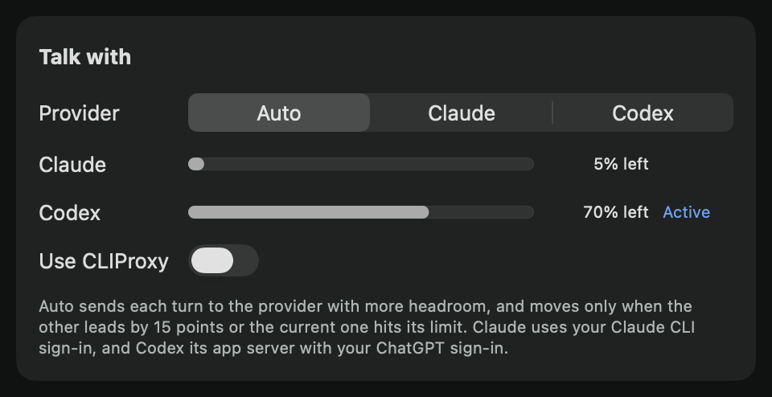

# Route turns by headroom verification

Scope is issue 11. With direct sign-ins (CLIProxy off), the engine sends each talk turn to the provider with more headroom. Through CLIProxy it records no usage and never routes (ADR 0005).

## Behavior

`ProviderRouter.route` in `BuddyCore/Sources/BuddyCore/Headroom.swift` is a pure function of the current provider, the owner's choice, the saved snapshots and the time.

- **Headroom** is 1 minus the higher of the 5-hour and 7-day utilizations. A window whose reset has passed counts as unused, and an empty snapshot is unknown.
- **Forced choice:** a forced Claude or Codex always wins.
- **Limit reached:** a provider at its limit hands the turn to one that isn't.
- **Margin:** otherwise the turn moves only when the other provider leads by at least 15 points.
- **Ties and unknown usage:** the turn stays where it is.

The engine routes at launch, when the owner changes the choice, between turns when usage is reported or a window resets, and as each turn starts. So the provider marked Active is where the next turn goes. A report during a turn waits for the next one.

A refusal for the usage limit marks that provider's fullest live window full. If nothing was heard yet, the same turn is re-sent to the other provider. Leaving a provider starts its next conversation fresh, and the provider the turn arrives at is primed with the conversation's recent turns.



## Acceptance mapping

| Criterion | Implementation | Evidence |
| --- | --- | --- |
| The router is a pure BuddyCore function | `ProviderRouter.route` | `HeadroomTests` drive it through `BuddyEngine.handle` |
| Headroom is 1 minus the higher of the 5-hour and 7-day utilizations | `ProviderUsage.headroom(at:)` | `headroomIsOneMinusTheHigherWindow` |
| A turn stays unless the other provider leads by at least 15 points | `ProviderRouter.margin` | `turnLeavesOnlyWhenTheOtherProviderLeadsByFifteenPoints` (14 points stays, 15 moves) and `tieStaysOnWhicheverProviderIsCurrent` |
| A limit-reached event switches immediately | `ClaudeStream` maps the assistant `rate_limit`/`billing_error` errors to `.limitReached`, and counts a `rejected` window as full. `CodexStream` does the same for `usageLimitExceeded`. The engine re-sends the turn. | `reachedLimitSwitchesAtOnceEvenToAProviderWithLessHeadroom`, `turnRefusedForTheLimitGoesToTheOtherProvider`, `refusalOnBothProvidersEndsTheTurnWithANotice`, `refusalAfterTheReplyStartedTalkingIsNotAskedAgain`. The live run below hit Claude's real limit. |
| A manual override always wins | `ProviderChoice.forced` | `forcedProviderAlwaysWins`. The live clicks below. |
| Snapshots persist, and a passed reset counts as unused | `saveUsage` writes `usageSnapshotsV1`, and `CompanionManager` loads it into the engine | `savedSnapshotsReadBackTheSame`, `latestSnapshotIsSavedOnlyWhenItChanges` and `windowWhoseResetHasPassedCountsAsUnused`. In the live run, a second manager loaded the same snapshots. |
| A moved conversation is primed with its recent turns | `leaveProvider` ends the left brain's conversation; `TurnRequest.recentTurns` primes the next | `conversationThatMovesIsPrimedWithItsRecentTurns`. The live run answered a follow-up after each move. |
| The menu shows both headrooms, the active provider, and Auto / Claude / Codex | `TalkConnectionsView` headroom rows and picker. The engine routes between turns, so Active is current before any turn. | `launchAndReportsBetweenTurnsMoveToWhereTheNextTurnGoes` and `resetPassingWhileIdleMovesAtOnce`. The image above, taken in the signed build before any turn |
| Tests use literal snapshots for the margin, ties, a limit switch, the override, a stale snapshot and unknown usage | `HeadroomTests.swift`, 17 tests | `unknownUsageNeverShowsALead` and the tests above |
| Manual check: a low Claude snapshot sends the next turn to Codex | | The live run below, turn 1 |

## Commands

Run on macOS 26.6.2 with Codex CLI 0.166.0 and Claude Code 2.1.316, on the PR's final head, with main `08741ca` merged in.

```sh
swift test --package-path BuddyCore
# Test run with 434 tests in 42 suites passed.

xcodebuild -project Buddy.xcodeproj -scheme Buddy -configuration Debug \
  -destination 'platform=macOS,arch=arm64' -derivedDataPath /tmp/buddy-build test
# Test run with 19 tests in 9 suites passed. ** TEST SUCCEEDED **
```

## Live run in the signed app

A temporary Swift Testing probe ran on `e893e2e` inside the signed Debug build (`dev.steven.buddy`, Apple Development identity, `-derivedDataPath /tmp/buddy-build`). Later commits only rename a helper and split a test. The probe was never committed. It set the app's real `CompanionManager` up as follows:

- History and profile files in a temporary folder.
- An isolated defaults suite, with spoken replies off.
- A saved Claude snapshot of 5-hour 95% (reset an hour out) and 7-day 40%.
- `talkConnectionV1` briefly set to direct sign-ins on Auto.

The owner's `talkConnectionV1` and `talkPicksV1` were saved first and restored afterwards. An export of `dev.steven.buddy` taken after the runs matched the earlier one key for key. The owner's own Buddy kept running throughout and logged only its clock ticks.

The manager started both real brains. The probe opened the text box the way the Control double-tap does, typed each question, and let the app capture the real screens. `TalkConnectionsView` was hosted in a floating non-activating panel. The probe checked that this panel was the topmost window at each spot, then posted real mouse clicks with `CGEvent`.

| Step | Result |
| --- | --- |
| Startup | The engine launched on Claude, because Codex's usage was still unknown. Codex's real startup report reached it through `CodexBrain.onUsage`: 7-day 30%, headroom 0.70 against Claude's saved 0.05. `usageReported -> saveUsage, leaveProvider` moved to Codex before any turn, and the panel marked Codex **Active** (the image above). Three seconds of idle clock ticks moved nothing. |
| Turn 1: "Say the single word saffron." | `screensCaptured -> sendTurn`, on Codex. Codex answered `saffron`. |
| Between turns, Claude made roomy (`usageReported`, headroom 0.95) | `usageReported -> saveUsage, leaveProvider` moved to Claude at once. |
| Turn 2: "What single word did you say in your previous reply? Answer with only that word." | `screensCaptured -> sendTurn`, on Claude. Claude's real usage report had its 5-hour window full, and the reply failed for the limit: `provider.failed -> saveUsage, leaveProvider, sendTurn` re-sent the same turn to Codex. Codex was now in a fresh conversation and answered `saffron` from the recent turns it was primed with. No notice was shown. |
| Clicks on Claude, Codex, then Auto | Each click set `selection.choice`, `state.talkSetup` and `state.provider` to match: claude/claude, codex/codex, then auto with Codex kept, since Claude was at its limit. |
| Relaunch | A second `CompanionManager` on the same suite loaded the same snapshots (Claude's 5-hour window full, and Codex's 7-day window at 30%) and started on Codex. |

The effect lines come from the app's `turn-timing` log, read with `/usr/bin/log stream --level debug`.

Earlier runs gave the same results. Three ran on `befe406`, which routed only as each turn started, so the moves came at `screensCaptured`. One ran on `453f0b1`, before clock ticks routed. The first of them asked for `ready`. Claude still had room then, and Claude's fresh process answered `ready` to the same follow-up, so the earlier turns reached Claude too. That run also showed Claude's real report arriving through `ClaudeBrain.onUsage` with its 5-hour window at 99%.

The probe's own turns were small. Claude's 5-hour window was already at 99% of the owner's limit when the runs started.

## Owner's check

Nothing here needs the owner. The probe used the permissions the signed build already had, and no prompt appeared. The owner's Buddy uses CLIProxy, which this change leaves as it was. Auto routing appears only after **Use CLIProxy** is turned off.
