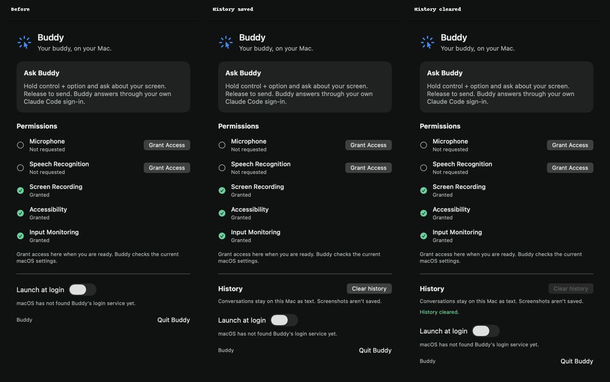

# Conversations and saved history verification

Scope is issue 12, against the conversation and history requirements of the project spec.

## Acceptance mapping

| Criterion | Implementation and evidence |
| --- | --- |
| End after ten idle minutes or "new conversation"; the next turn has a fresh provider session | `BuddyEngine` checks its injected clock on ticks and before push-to-talk. Exactly 600 idle seconds ends and saves the conversation, then resets the provider. Idle starts after speech finishes or work stops. A standalone command is consumed before capture, with case, whitespace and terminal punctuation normalized. Tests cover 599/600 seconds, delayed ticks, long speech and listening, interruption, failure, clock rollback, command variants and ordinary mentions. |
| Save only the transcript and tag-stripped reply in Application Support; never screenshots | `ConversationHistory` contains only conversation timestamps and `TurnRecord` strings. The engine emits `saveHistory`; `HistoryStore` atomically writes `Application Support/Buddy/history.json`. The saved-contents engine test asserts the complete literal JSON after a turn containing screenshot bytes and a POINT tag. A native file-adapter check also persisted a turn with an image sentinel and verified exact transcript/reply fields, with neither the sentinel nor POINT tag in the file. |
| Survive relaunch and prime the same conversation | The store loads before the first turn. Requests carry the active conversation's last ten completed turns in chronological order. Ended or expired conversations never prime a new one. `ClaudeBrain` includes that text only on the first message to each process, including a prewarmed or unexpectedly restarted process. Engine tests cover restore, boundaries, selection, order and retention; provider tests inspect the literal wire messages across cold, warm, stopped and exited processes. |
| Clear history in settings | The existing panel has an accessible Clear history button. The engine stops active work, cancels capture, resets the provider and waits for deletion before reporting success. Callback generations reject old ears, capture, speech and provider events. Engine tests cover active and late events, pending deletion, visible failures and retry. Native checks verified real file deletion and settings success/error states. |
| Follow-up after relaunch is understood | Passed with two separate native harness processes using the production engine, file adapter and real Claude adapter. Details below. |
| New policy tested through BuddyCore's public engine interface | `ConversationTests` drives `handle` and reads public state/effects with literal expected values and a fake clock. `ClaudeBrainTests` separately covers its public provider boundary. No test needs a privacy grant or a provider login unless explicitly run as a live harness. |

## Automated checks

The initial regression ran against the unchanged engine and exited 1. `newConversationCommandDoesNotCaptureTheScreen` observed `captureScreens` and `.capturing(transcript: "New conversation!")` for the command. The final test asserts the exact reset and notice effects.

Commands run with Xcode 26.6 and Swift 6.3.3:

```sh
swift test --package-path BuddyCore
xcodebuild -project Buddy.xcodeproj -scheme Buddy -configuration Debug \
  -destination 'platform=macOS,arch=arm64' -derivedDataPath /tmp/buddy-ci-issue12 \
  CODE_SIGNING_ALLOWED=NO COMPILER_INDEX_STORE_ENABLE=NO test
```

The final core run passed 77 tests. The unsigned app test run passed the three surviving upstream permission-helper tests. There were no Swift warnings.

## Native runtime checks

A temporary Swift executable used the current BuddyCore package and copied the app's actual Swift sources, excluding `BuddyApp.swift`. Its history paths were under `/tmp/buddy-issue12-*`; it never opened the owner's saved history, started the microphone, or captured a display. The owner's running Buddy app stayed running.

Two separate executable invocations exercised a relaunch:

1. The first engine sent "For this conversation, remember that my paper kite is named Copper Finch. Reply with only Understood." through the real `ClaudeBrain`, with no captures. The request had zero priming turns. Claude answered "Understood." The engine's effects saved the conversation through `HistoryStore`, then the process exited.
2. A second executable loaded the same file into a fresh engine and started a fresh Claude process. "What is my paper kite named? Answer with only its name." carried one priming turn. Claude answered "Copper Finch". The file then contained both completed text turns in one conversation.

The native storage check also verified:

- Missing history loads empty, and clearing a missing file succeeds.
- Invalid JSON survives both a failed load and an attempted save. The settings error remains visible until explicit clear succeeds.
- Clear deletes the file and permits later saves. Setting the temporary parent directory to mode `0555` makes deletion fail; settings report the failure, retain the file, and allow a successful retry after restoring mode `0755`.
- A completed synthetic reply with `[POINT:2,3:file]` persists as "Here is the file." The screenshot sentinel is absent from the saved bytes.

The actual `CompanionPanelView` was rendered in a native `NSHostingView` at its 380-point width. Saved history enables the control. Successful clear disables it and shows "History cleared." Content heights were 647 and 668 points, within the usual 710-point menu panel. The comparison shows the baseline, saved history, and successful clear:



## Limits and rollback

The real-provider check used typed synthetic events and immediate speech-completion events in the harness. It proves persistence and fresh-process follow-up understanding. It does not exercise spoken transcription or physically quit and reopen the installed app. Those unchanged adapters remain covered by the earlier turn verification; the owner can repeat the same two questions across an app relaunch.

History retains every completed provider reply until cleared, even if speech playback is interrupted afterwards. Failed or interrupted streams add no partial record. Each save rewrites the text snapshot synchronously. This keeps the initial personal-use implementation small but may need revisiting if a large history makes saves slow. Only the most recent ten turns prime a fresh provider process; summaries and profile policy belong to later issues.

Reverting restores the previous in-memory store and launch-wide provider session. The text file remains on disk and is ignored by the old app. Clear history permanently removes the saved history file; reverting code cannot restore deleted text. The new model has no earlier persistent format to migrate.
