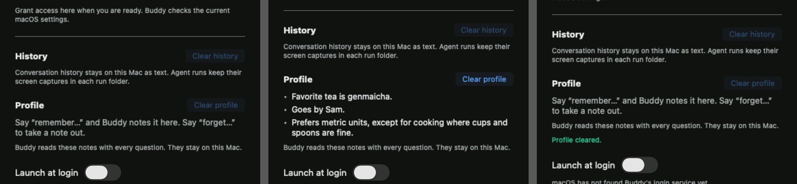

# Profile: remember and forget verification

Scope is issue 14, against the profile requirements of the project spec.

## Acceptance mapping

| Criterion | Implementation and evidence |
| --- | --- |
| Remember and forget beats edit a small local Markdown profile | `BeatParser` reads `[REMEMBER:note]` and `[FORGET:note]` anywhere in a line, like the annotation tags from issue 8, and also on a line with no words. A note may hold colons but no bracket. A malformed tag is cut and ignored. The engine applies a talk reply's edits as the line is parsed and emits `saveProfile` only when the notes changed. Remembering an existing note and forgetting a missing one change nothing. Notes match regardless of case, spacing and final punctuation. `ProfileStore` writes `Application Support/Buddy/profile.md` as a `# About you` heading and one bullet per note. Agent run beats never edit it. |
| The profile is in every turn, and "what do you remember about me" is answered from it | `TurnRequest` carries the profile. Its content starts with the notes, or with a sentence saying the profile is empty. `ClaudeBrain` and `CodexStream` strip recent exchanges from a warm Claude process's or Codex thread's turns, but keep the profile. `TalkInstructions` teaches the two tags and tells Buddy to answer questions about the owner from the profile alone. |
| Settings shows the profile and can clear it | A **Profile** section lists the notes with selectable text, or explains how to add one. **Clear profile** deletes the file and reports success or a failure. An unreadable file, or one a failed clear left behind, is kept and blocks saves. Its error shows until a clear succeeds. |
| Tests: beats add and remove notes, and the profile is in the turn payload | `ProfileTests` (11 tests) drives `BuddyEngine.handle` with literal expected effects and request content. `ClaudeBrainTests.aWarmProcessStillReceivesTheProfileEveryTurn`, `CodexStreamTests.onlyEachThreadsFirstTurnCarriesTheRecentTurnsButEveryTurnCarriesTheProfile` and `CodexBrainTests` check the literal wire messages of warm turns. App tests cover the Markdown file, an unreadable file, a failed clear and a manager that loads the profile on relaunch. |
| Manual check: remember a preference, relaunch, and ask | Passed through separate processes using the production engine, `ProfileStore` and the real Claude adapter. The installed app wasn't relaunched by hand. Details below. |
| Logic tested in BuddyCore through the engine's public interface | Everything except the Markdown round trip goes through `handle` and public state. The round trip is checked on the public `Profile` type that the store uses. |

Four mutations were each confirmed to fail the new tests. These were an engine that ignored edits, a turn request without the profile, a warm Claude process that dropped it, and a warm Codex thread that dropped it.

## Automated checks

Commands run with Xcode 26.6:

```sh
swift test --package-path BuddyCore
xcodebuild -project Buddy.xcodeproj -scheme Buddy -configuration Debug \
  -destination 'platform=macOS,arch=arm64' -derivedDataPath /tmp/buddy-ci-issue14 \
  CODE_SIGNING_ALLOWED=NO COMPILER_INDEX_STORE_ENABLE=NO test
```

After merging main's annotation beats, run offers and Talk on Codex, the core run passed 274 tests and the app run passed 12.

## Real Claude across launches

A temporary executable linked this branch's BuddyCore and a copy of `Buddy/ProfileStore.swift`. Each invocation was a fresh process with a fresh engine, empty history and a new `claude -p` process started by `ClaudeLaunch.talk`. The profile file was under `/tmp`. Speech events were answered at once, and nothing was captured or heard.

1. "Remember that my favorite tea is genmaicha." The request carried the empty-profile sentence. Buddy said "Got it, I'll remember that your favorite tea is genmaicha." and the file became `- Favorite tea is genmaicha.`
2. A new process asked "What do you remember about me?" The request carried that note, and Buddy answered "The only thing I remember about you is that your favorite tea is genmaicha."
3. "Remember that I go by Sam." added `- Goes by Sam.`
4. "Forget my favorite tea." left only `- Goes by Sam.`, and Buddy said "Done, I've forgotten your favorite tea."
5. A new process asked again, and Buddy answered "All I've got is that you go by Sam."

No tag was spoken in any of these runs.

After merging main's annotation beats, the sequence was repeated on the final combined prompt with a note that holds a colon. "Remember that my standup is at 9:15 every weekday." saved `- Standup is at 9:15 every weekday.` Then "Remember that I go by Sam." and "Forget my standup time." left only `- Goes by Sam.` A new process asked "What do you remember about me?" and Buddy answered "All I've got is that you go by Sam." After the prompt's tag rule was reworded to cover POINT again, a last pair of runs remembered "Has a standup at 9:15 every weekday." A new process recalled it: "I remember that you have a standup at 9:15 every weekday." Main's run offers and Talk on Codex were merged after that, so the live checks were repeated on main, below.

## Real Claude and Codex on main

After this issue merged, the live checks ran against main at `826273d`, which also holds run offers, Talk on Codex and conversation summaries. There, `swift test --package-path BuddyCore` passed 314 tests. The same temporary executable now took the talk CLI, a profile path and one or more questions. Questions in one invocation shared one engine, so later turns went to a warm Claude process or Codex thread.

Claude, a new process for each question:

1. "Remember that my standup is at 9:15 every weekday." saved `- Standup is at 9:15 every weekday.`
2. "Remember that I go by Sam." added `- Goes by Sam.`
3. "Forget my standup time." left only `- Goes by Sam.`, and Buddy said "Done, Sam, I've forgotten your standup time."
4. "What do you remember about me?" carried that note, and Buddy answered "All I have is that you go by Sam. You haven't asked me to remember anything else yet."

Claude, all four questions in one warm process:

1. "Remember that my favorite tea is genmaicha." saved `- Favorite tea is genmaicha.`
2. "What do you remember about me?" got "All I have is that your favorite tea is genmaicha."
3. "Forget my favorite tea." left the file with only its `# About you` heading.
4. The same question again carried the empty-profile sentence, and Buddy answered "You haven't asked me to remember anything about you yet."

Codex ran the same two sequences. Fresh processes saved `- Has standup at 9:15 every weekday.`, added Sam, forgot the standup and answered "You've asked me to remember that you go by Sam." One warm thread saved the tea, answered "Your favorite tea is genmaicha.", emptied the profile on the forget and then answered "You haven't asked me to remember anything yet."

No tag was spoken in any of these runs. The repo's opt-in smoke tests passed too. `BUDDY_LIVE_CLAUDE=1 swift test --package-path BuddyCore --filter liveClaude` passed its 3 tests, and `BUDDY_LIVE_CODEX=1 swift test --package-path BuddyCore --filter liveCodex` passed its 1.

## Settings

The real `CompanionPanelView` was rendered in an `NSHostingView` at its 380-point width, from managers with an empty profile, three notes, and after **Clear profile**:



## Limits and rollback

The relaunch check used the same production pieces as the app but not the installed app, the ears or the voice. To repeat it by hand, say "remember that I like metric units", quit and reopen Buddy, then ask "what do you remember about me?"

The model decides when to tag a note. A forget only works when it copies a note's text, which the profile in each turn makes possible. A tag that names a note that isn't there is ignored.

Agent run briefs don't carry the profile yet. The project spec puts it in the brief, but this issue doesn't ask for it.

Reverting the code leaves `profile.md` on disk, and the old app ignores it. Clearing the profile deletes the file for good.
