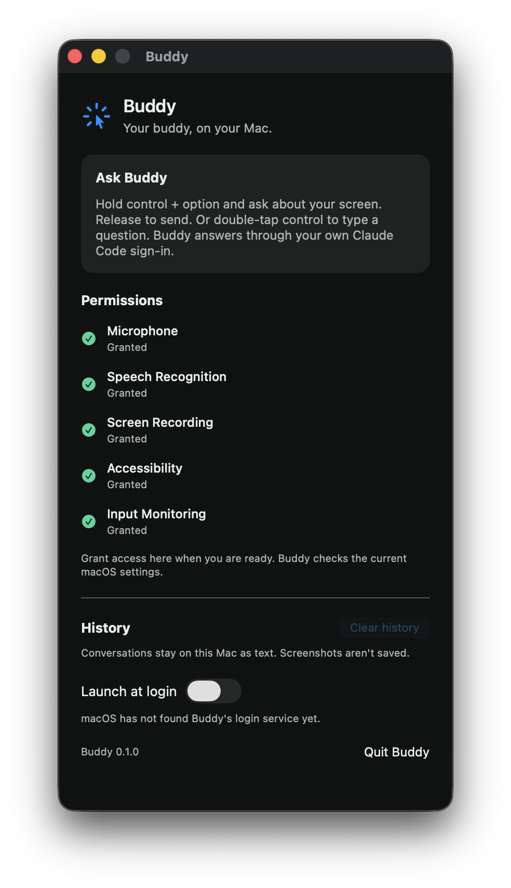

# Dock app follow-up

Steven changed the app-shell preference on 2026-11-01: Buddy should run from the macOS Dock and have no menu bar item. This replaces user story 5 and the menu-bar settings location in the project spec. The text-box acceptance criteria in issue 15 still apply.

## Behavior and evidence

| Requirement | Implementation | Verification |
| --- | --- | --- |
| Buddy appears in the macOS Dock without a status item | `LSUIElement` removed; `BuddyAppDelegate` selects `.regular`; `MenuBarPanelManager` removed | The previously installed app reported activation policy 1, accessory. The new signed installed app reports 0, regular. No status item is created. |
| Settings opens on launch | One retained `SettingsWindowController` hosts the existing settings content in a normal titled window | The installed app has one visible window named Buddy at normal window level. Screenshot below. |
| Closing settings keeps Buddy running | The delegate returns false from `applicationShouldTerminateAfterLastWindowClosed` | Pressed the installed app's native close button through Accessibility. The window list became empty while the same process stayed alive. |
| Clicking the Dock icon reopens settings | `applicationShouldHandleReopen` shows the retained controller | Sent Launch Services reopen to the installed app after closing its window. One settings window returned without a duplicate process. The controller fixture also verified retention of the same native window. |
| Reopening restores minimized settings | `showSettings` deminiaturizes before showing | Minimized the installed window through its Accessibility attribute. Launch Services reopen restored it and cleared the minimized state. |
| Standard settings and quit controls remain available | SwiftUI supplies the app and Edit menus; the Settings command opens the retained controller | Read the installed app's native menu. Settings, Quit Buddy, and Edit are present. The existing Quit Buddy button remains in the settings content. |
| Settings fits shorter screens | The initial height is capped to the visible display; content stays in a scroll view | Rendered the production controller, settings view, and design system with a fixture manager at 710 and 460 points tall. Inspected both renders and the bottom of the scrolled 460-point window. The lower settings remain reachable. |

The fixture manager performs no I/O. Its invisible verification window did not change the owner's foreground app. The separate installed-app check used only Buddy's existing Accessibility access, window close/minimize controls, menu inspection, and Launch Services reopen. It sent no question, opened no microphone, and requested no screen capture from Buddy. The screenshot below was captured directly from Buddy's settings window, without other app contents.



## Build and integration checks

Merged `main` at `4200a78a105164f900c6bc2ddd585497e68a4170`, preserving the neural voice and typed turns. Three typed-turn expectations now include the explicit Apple fallback voice required by the merged speech effect.

```sh
swift test --package-path BuddyCore
# 102 tests passed.

xcodebuild -project Buddy.xcodeproj -scheme Buddy -configuration Debug \
  -destination 'platform=macOS,arch=arm64' -derivedDataPath /tmp/buddy-issue15-dock-ci \
  CODE_SIGNING_ALLOWED=NO COMPILER_INDEX_STORE_ENABLE=NO test
# Three app tests passed; TEST SUCCEEDED.

xcodebuild -project Buddy.xcodeproj -scheme Buddy -configuration Debug \
  -destination 'platform=macOS,arch=arm64' -derivedDataPath /tmp/buddy-build-15 build
# Signed Debug build succeeded.

codesign --verify --deep --strict /tmp/buddy-build-15/Build/Products/Debug/Buddy.app
codesign --verify --deep --strict ~/Applications/Buddy.app
# Both succeeded. Bundle identifier remains dev.steven.buddy.
```

No Swift compiler warnings were found. Xcode printed its metadata-extraction warning because the app has no AppIntents dependency.

The signed build was installed at the existing `~/Applications/Buddy.app` path after a normal quit. The previous app was preserved under `/tmp/buddy-issue15-dock-verify/previous/Buddy.app`. All five permission rows in the installed build still read Granted. The app was left running with settings open. Login registration was not changed.

## Held-input review fix

The final Spec review found that a non-modifier key held before the first Control tap could still open the text box. Key-down notifications alone did not describe whether a previously pressed key was still held. Each modifier event now samples the system's current non-modifier key and mouse-button state and passes `otherInputHeld` to the engine. The detector rejects that input without retaining key identifiers or depending on a key-up event, including when monitoring starts after the key was pressed. Modifier keys and Caps Lock are excluded from this additional snapshot.

`anInputHeldBeforeTheFirstTapPreventsTheShortcut` drives the public engine with an input held through both taps, or released during the first tap, and asserts no opening effects. A subsequent clean double-tap still opens. Removing the new held-input guard in an isolated package copy makes the regression fail. No synthetic key presses were posted to the owner's desktop for this check.

## Still to test

The [original owner checks](issue-15.md#owner-checks) for typing a question, hearing a spoken answer with a point, and dismissing the text box remain open. The Dock checks do not replace them.
