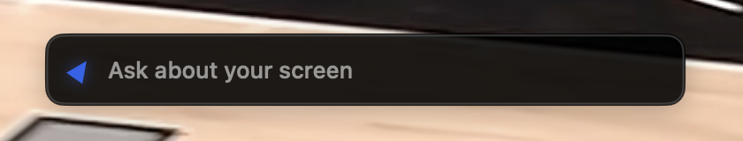

# Text box verification

The current build also includes the owner's requested [Dock app follow-up](issue-15-dock.md), with updated build results and native window checks. The text-box owner checks below still remain open.

Scope is issue 15, against user story 13, item 6 of the Turn lifecycle, and the hotkey defaults in the project spec.

## Acceptance mapping

| Acceptance criterion | Implementation and evidence |
| --- | --- |
| Double-tapping Control opens the text box. Enter sends a typed turn with a screen capture through the same pipeline, and Esc closes it | The event tap passes `modifiersChanged` (the held modifiers and the event's own timestamp) and `keyOrButtonPressed` to the engine. A double-tap moves the turn to the new `typing` phase and emits `clearOverlay, showTextBox`. `textBoxSubmitted` trims the text and, if anything is left, emits `hideTextBox, showBuddy, captureScreens`. From `capturing` on, the turn is the spoken turn. Since merging #41, both kinds of question go through one `ask` path, so a typed "new conversation" ends the conversation as a spoken one does. Opening the box goes through the same `beginTurn` as a push-to-talk press: it checks the 10-minute idle boundary and counts as activity. It stays shut while history is being cleared. An open box with nothing sent is idle time, so a box left open for ten minutes ends the conversation on the next clock tick. Return checks again, so a question typed into a forgotten box starts a new conversation. The typed turn also carries the conversation's recent turns. Tests: `openingTheTextBoxChecksExpiryLikeAPress`, `aTextBoxLeftOpenForTenMinutesEndsTheConversation`, `typingNewConversationEndsTheConversationWithoutCapturing` and `theTextBoxStaysClosedWhileHistoryIsBeingCleared`. Esc reaches the tap as `interrupted`, which closes the box through the stop effects. The field's own exit command and a click away send `textBoxDismissed`. Tests: `doubleTappingControlOpensTheTextBox`, `enterSendsTheTrimmedQuestionAndCapturesTheScreens` and `escapeOrClickingAwayClosesTheTextBoxWithoutAsking`. On the signed build, a posted double-tap logged `modifiersChanged -> clearOverlay, showTextBox`, and the box appeared (image below). Typing into it, Return and Esc were not run on the Mac (see the runtime attempt). |
| The reply is spoken and its beats shown exactly as for a voice turn | `typedQuestionIsAnsweredLikeASpokenOne` runs the scripted brain from `fakeBrainRunsAFullScriptedTurn` behind a typed question. It asserts the same literal `sendTurn`, `speak`, `saveHistory`, `point(1293.75, 886.5)`, `speak` and `clearOverlay` effects. The ears never start. |
| The double-tap detector lives in BuddyCore. Tests cover the timing window and ignore taps combined with other keys | `DoubleTap` in `DoubleTap.swift` has three states: `ready(lastTap)`, `pressed(since, lastTap)` and `spoiled`. A tap starts with nothing held, holds only Control and lets go within 400 ms. The second tap must start within 400 ms of the first ending, and the double-tap fires as it ends. `eachTapAndTheGapBetweenThemMustFitTheWindow` puts 400 and 401 ms on each tap and on the gap, plus a 2 s gap. `tapsCombinedWithOtherKeysDoNotCount` covers a key during the first tap, a key between taps, a click during the second, Shift added to a tap, Shift held through both, push-to-talk released Option first, and Option tapped twice. Each case then checks that a clean double-tap still opens the box. |
| Manual check: a typed question gets a spoken answer with a point | Not run. The owner was using the Mac (see below). Left to the owner as check 1. |
| Logic added here is covered by Swift Testing tests in BuddyCore through the engine's public interface, with literal expected values | `DoubleTap` is internal and reached only through `BuddyEngine.handle`. 14 new tests, two of them parameterized over 15 cases. A mutation sweep of the merged code made 23 changes, each run on a copy of `BuddyCore`:
- the detector: widened the window, made either limit exclusive, dropped the hold or gap limit, ignored keys, clicks or other modifiers, counted a press made while spoiled, let a third tap fire again
- opening: stopped the double-tap from closing the box, dropped `clearOverlay` on open, opened while history was clearing, dropped the idle boundary or the activity from `beginTurn`
- submitting: skipped the trim, sent empty questions, sent a question with no provider, skipped the boundary check on Return, sent a typed "new conversation" to Claude as a question
- expiry and closing: never expired a conversation while the box was open, dismissed outside `typing`, left the box open when a turn stopped

All 23 failed at least one test. |

Commands run on macOS 26.6.2 with Xcode 26.6, Swift 6.3.3 and Claude Code 2.1.316:

```sh
swift test --package-path BuddyCore
xcodebuild -project Buddy.xcodeproj -scheme Buddy -configuration Debug \
  -destination 'platform=macOS,arch=arm64' -derivedDataPath /tmp/buddy-ci \
  CODE_SIGNING_ALLOWED=NO COMPILER_INDEX_STORE_ENABLE=NO test
xcodebuild -project Buddy.xcodeproj -scheme Buddy -configuration Debug \
  -destination 'platform=macOS,arch=arm64' -derivedDataPath /tmp/buddy-build-15 build
```

After merging `main` with #41 and the review fixes, `swift test` passed 91 tests and the unsigned `xcodebuild test` passed the three upstream tests. The signed Debug build had no Swift warnings and kept `dev.steven.buddy` with the Apple Development identity. Before the merge, the branch passed 68 tests.

## Facts the detector relies on

- A listen-only session tap on this Mac read `CGEvent.timestamp` as uptime in nanoseconds. It matched `clock_gettime_nsec_np(CLOCK_UPTIME_RAW)`, not mach ticks, and two flag changes posted 100 ms apart read 99.3 ms apart. A freshly created `CGEvent` reads 0 until it is posted.
- With secure input on, the tap gets modifier changes but no key presses. A helper process called `EnableSecureEventInput`, and `IsSecureEventInputEnabled` read true from a second process, so the check is system-wide. While it is on, the monitor reports each modifier change as `keyOrButtonPressed`. Two quick Control+C presses then can't pass for a double-tap. This path wasn't exercised on the running app.
- The project already excludes Buddy's own windows from `DisplayCapture`, and the box is hidden before `captureScreens`, so a typed turn's screenshot shows the owner's app.

## Runtime attempt

The plan was a scripted run on the signed build. The owner's Buddy would be quit and this build launched, with a scratch TextEdit page in front. Each posted key would first check that the box or the scratch page had the keyboard. The script waited until the Mac had seen no keyboard or mouse input for two minutes. It ran at 00:46.

- The posted double-tap opened the box. The engine logged `modifiersChanged -> clearOverlay, showTextBox`, and the screenshot showed it:

  

- The Accessibility check found no focused element anywhere, so the script stopped before typing anything. For a non-activating panel, that answer doesn't say whether the box had the keyboard. A later run needs another check, such as reading the box field's own value after one key.
- The box appeared about 520 points below where the script had moved the pointer, and it opened again at the left edge after a second double-tap. The full screenshots showed the owner watching a video and then switching to another tab, so two minutes without input had not meant they were away. The likeliest reason the box appeared there is that the owner moved the pointer after the script did. That is inferred from where the boxes appeared, not measured, so placement is still unverified.
- The run had opened TextEdit over the owner's screen, and the box twice took the keyboard while they were using the Mac, from 00:46 to about 00:48. At that point the build was quit, TextEdit closed without saving and the owner's own Buddy relaunched. Debug logs aren't kept, and Buddy's Claude sessions aren't saved (`--no-session-persistence`). So whether any of the owner's typing reached the box can't be checked. Typing there followed by Return would have sent that text and a screenshot to the owner's own Claude Code, and Buddy would have answered aloud.

## Owner checks

Run these on the signed build:

1. Double-tap Control with Notes or Finder in front. Type "where is the File menu?" straight away, without clicking, and press Return. The letters appear in the box as typed. The box closes, and the buddy speaks the answer and flies to the File menu.
2. Double-tap Control, then press Esc. The box closes, and the next keys go to the app that was in front.
3. Double-tap Control, then click another window. The box closes. Double-tap twice in a row: the second double-tap closes the box.

## Limits

- The box is a single line, so a long question scrolls sideways.
- A false double-tap opens a box that takes the keyboard until Esc, a click away or another double-tap.
- While secure input is on anywhere, such as a password field or Terminal's Secure Keyboard Entry, the double-tap never fires.
- The tap doesn't watch the scroll wheel, so two quick Control-scrolls (the zoom gesture, off by default) count as a double-tap.
- Push-to-talk is still recognized in the app, while the double-tap is recognized in the engine. Configurable hotkeys (#20) are expected to move both into the engine.
- The typed question is carried as the turn's `transcript`, the field name the spoken turn already uses.
