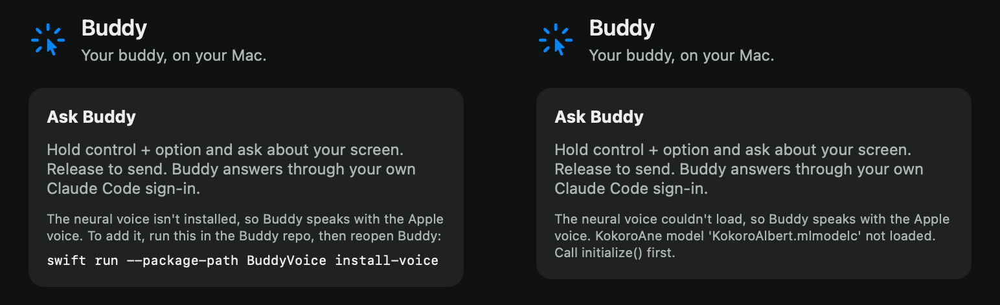

# Neural voice verification

Scope is issue 21, against the project spec.

## Acceptance mapping

| Acceptance criterion | Implementation and evidence |
| --- | --- |
| A Kokoro-class on-device voice becomes the default mouth. The ticket picks the runtime and model, and the PR records size, licence and first-line latency | Kokoro 82M with its `af_heart` voice, run on the Neural Engine by FluidAudio 0.18.0 (choice below). `NeuralVoiceMouth` speaks every reply once the voice has loaded. The files take 94.8 MB, and everything Buddy downloads is Apache-2.0. The first line of a session starts sounding 412 to 423 ms after its `speak` effect, and the first line of a later reply 150 to 253 ms after it (tables below). |
| Speech stays per line, with line start and progress reported, and interruption stops it mid-line | Each `speak` effect is one line. The mouth synthesizes the whole line, starts `AVAudioPlayer` and then reports `lineStarted`, so a line's POINT fires when its sound starts. `lineFinished` comes from the player's delegate. Interrupting 1.5 s into a playing line, and 34 ms into a line still being synthesized, both stopped it, with no callbacks afterwards. |
| If the model is missing or fails, the Apple voice speaks instead | Until the voice is `ready`, a reply speaks with the Apple voice. That covers loading, a missing file and a failed load. A line the neural voice fails is spoken again by the Apple voice, and the rest of that reply stays with the Apple voice. A missing model reported `notInstalled` in 1 ms and created no files. Corrupt weights reported `failed` in 446 ms. A line Kokoro rejected (an emoji) failed after 27 ms, and the Apple voice spoke it. The panel says why the neural voice isn't speaking (image below). |
| Tests: mouth fallback and line progress through a fake | `VoiceTests` drives the engine with a `FakeMouth` that plays both voices and fails the neural lines it is given. The tests cover: the Apple voice until the neural voice is ready; a failed neural line spoken again by the Apple voice, with its POINT firing on the Apple start; a POINT on a neural line's start; every missing or broken status; when a reply picks its voice; a failure after a line starts being ignored; a line both voices fail being skipped; and interruption before and during a neural line. `LineAudioTests` covers trimming and levelling with exact values. |
| Manual check: a side-by-side note comparing the neural and Apple voices | Measured below. The owner's listening check is in "Still to check by ear", because the agent can't hear. |
| Logic added here is covered by Swift Testing tests in BuddyCore with literal expected values | Voice choice and fallback live in `BuddyEngine` and are tested through `handle`. `LineAudio` is a public value type in BuddyCore and is tested through `readyToPlay()`. Before review, a mutation sweep made 16 changes to the new engine and `LineAudio` logic, and every mutant failed at least one test. |

Commands run on macOS 26.6.2 (Apple M5 Pro) with Xcode 26.6 and Swift 6.3.3:

```sh
swift test --package-path BuddyCore
xcodebuild -project Buddy.xcodeproj -scheme Buddy -configuration Debug \
  -destination 'platform=macOS,arch=arm64' -derivedDataPath /tmp/buddy-ci \
  CODE_SIGNING_ALLOWED=NO COMPILER_INDEX_STORE_ENABLE=NO test
xcodebuild -project Buddy.xcodeproj -scheme Buddy -configuration Debug \
  -destination 'platform=macOS,arch=arm64' -derivedDataPath /tmp/buddy-build test
```

After merging main, `swift test` passed 87 tests. Both `xcodebuild test` runs passed the three upstream tests, and the app target had no Swift warnings.

## Runtime and model

- **Model.** Kokoro 82M from [hexgrad/Kokoro-82M](https://huggingface.co/hexgrad/Kokoro-82M) is Apache-2.0 and small enough to load at launch. Its `af_heart` voice is the reference American English voice.
- **Runtime.** [FluidAudio](https://github.com/FluidInference/FluidAudio) 0.18.0 is a Swift package that runs Kokoro as seven Core ML stages on the Neural Engine. It brings its own English front end, so nothing GPL such as espeak-ng is linked:
  - the Misaki lexicon, with a BART G2P model for words outside it;
  - NeMo text normalization, so "$5" is read as "five dollars".
- **Package shape.** SwiftPM traits keep the package to `TTS` and `NemoTextProcessing`. It is pinned exactly in `BuddyVoice/Package.swift` and both `Package.resolved` files.
- **Legacy pipeline.** Buddy uses FluidAudio's default Kokoro pipeline. FluidAudio's V3 pipeline is opt-in, and its own docs keep existing callers on the legacy one.
- **Synthesis speed.** One line takes 97 to 239 ms on this Mac.

## Size and licences

| Item | Size | Licence |
| --- | --- | --- |
| `kokoro-82m-coreml/ANE`: seven `.mlmodelc` stages, `vocab.json`, `af_heart.bin` | 79 MiB | Apache-2.0 ([FluidInference/kokoro-82m-coreml](https://huggingface.co/FluidInference/kokoro-82m-coreml)), converted from Apache-2.0 [hexgrad/Kokoro-82M](https://huggingface.co/hexgrad/Kokoro-82M) |
| `kokoro`: G2P encoder and decoder, `g2p_vocab.json`, `us_lexicon_cache.json` | 11 MiB | Published in the same Apache-2.0 repository. FluidAudio documents no separate licence for them |
| All installed files | 94.8 MB (94,809,695 bytes) | |
| FluidAudio code linked into the app, including its prebuilt [text-processing-rs](https://github.com/FluidInference/text-processing-rs) 0.3.1 library for NeMo normalization | Debug app bundle grows from 2.4 MB to 34 MB | Apache-2.0. FluidAudio's `ThirdPartyLicenses/NemoTextProcessing-LICENSE.md` lists the Apache-2.0 and MIT works the library includes |

The model licences were read from each Hugging Face repository's model card metadata.

## Latency and resources

Timings come from the engine's events with the real mouths, and the line text is the same for both voices.

| Measure | Neural voice | Apple voice |
| --- | --- | --- |
| `speak` to `lineStarted`, first line of a session | 412 to 423 ms: about 240 ms of synthesis, plus about 175 ms for the first `AVAudioPlayer` start | 63 ms |
| `speak` to `lineStarted`, first line of a later reply | 150 to 253 ms | |
| Gap between lines (the next line's synthesis) | 130 to 340 ms | 1 to 2 ms |
| A four-line Finder reply, start to finish | 11.3 to 11.4 s | 10.1 s |
| Silence around the words | 35 to 40 ms before, 60 to 77 ms after | 4 to 10 ms before, 40 to 47 ms after |
| RMS loudness | −18 to −21 dBFS (−26 before `LineAudio` levelled it) | −15 to −17 dBFS |
| Load at launch | about 11 s on the first launch after each rebuild, as Core ML compiles for the Neural Engine. About 1.5 s after that | none |
| Memory | 167 MB footprint, plus a 175 MB Neural Engine peak that the footprint doesn't count | 12 MB footprint |

## Side by side

| Line | Neural | Apple |
| --- | --- | --- |
| "Open the File menu at the top left of the screen." | 2.83 s, 242 words per minute | 2.66 s, 252 words per minute |
| "Choose New Folder, or press Shift, Command and N together." | 3.23 s, 191 words per minute | 3.49 s, 174 words per minute |
| "It's the fan-shaped icon in the menu bar, next to the battery." | 3.52 s, 211 words per minute | 3.49 s, 209 words per minute |
| "That costs $5, and the update shipped on March 3rd, 2026." | 4.65 s, 145 words per minute | 4.84 s, 138 words per minute |

The two voices speak at about the same pace. These are lengths only, because the agent can't hear the difference. The WAVs are in `/tmp/nv-compare` on this Mac.

## Buddy's process stays offline

Buddy loads the voice only when every file it needs is already in `Application Support/Buddy/Voice`. It also switches off FluidAudio's `ModelHub` downloads first. That isn't enough on its own: FluidAudio 0.18.0 fetches a missing `us_lexicon_cache.json` through its `AssetDownloader`, which ignores the switch, and tries again on every line. Review found this, and `NeuralVoice.load()` now reports `notInstalled` when any of the seven stages, `vocab.json`, `af_heart.bin`, the G2P files or the lexicon is missing. `install-voice` fails if one is still missing after downloading.

Checked under `sandbox-exec` with outbound network denied, with `CFFIXED_USER_HOME` pointing at copies of the installed folder:

- Without the lexicon, `prepare` reported `notInstalled` in 1 ms. No lexicon file appeared.
- With every file, `prepare` reported `ready`, and the voice spoke.
- The system log recorded no denied network attempts from either run.

The app isn't sandboxed, so this check is what keeps it offline. The check takes the file names from FluidAudio's own constants. FluidAudio's download client is now linked into the app, though only `install-voice` uses it, so the [issue 3 note](issue-3.md) that no `URLSession` remained now says so.

## Panel

Missing voice, and a voice that failed to load:



## How it was run

The checks used a command-line harness built from the app's own sources: `CompanionManager`, the panel, the engine and both mouths. Its only differences were volume set to zero and timing prints. It ran turns, interruptions, a failing line and the side-by-side, and rendered the panel. The neural model was installed for real with `install-voice`. The owner's running Buddy wasn't replaced, so the signed app itself hasn't spoken with the neural voice yet.

## Still to check by ear

1. Run the signed build: `open /tmp/buddy-build/Build/Products/Debug/Buddy.app` (quit the installed Buddy first).
2. Ask about the screen. A turn should log `speak.neural`. Watch it with `/usr/bin/log stream --predicate 'subsystem == "dev.steven.buddy"' --level debug`.
3. Compare the voices on the same lines: run the same question before the voice loads (Apple) and after (neural), or rename the `Voice` folder and reopen to hear the Apple voice.
4. Press Esc partway through a line. The voice should stop at once.
5. Rename the `Voice` folder and reopen Buddy. The panel should give the install command, and replies should use the Apple voice.
6. Add a line to the PR saying how the two voices compare by ear.

## Limits

- The gap between lines is the next line's synthesis, 130 to 340 ms, where the Apple voice had none. Synthesizing the next line while the current one plays would hide it.
- After every rebuild the first launch takes about 11 s to load, and replies use the Apple voice until then.
- FluidAudio warns that macOS 26.4 and 26.5 carry a BNNS bug that can crash Kokoro synthesis, fixed in 26.6. It runs in Buddy's process, so such a crash would end Buddy.
- Cancelling a line stops it being played, but Kokoro finishes a synthesis already running. The next line may wait up to about 240 ms for it.
- Only a thrown error falls back. A synthesis that hung without returning would leave its line silent until push-to-talk or Esc. None hung in these runs.
- A neural line that fails while running isn't shown in the panel. One line Kokoro can't voice, such as an emoji, shouldn't turn it off for the session. The log names the error's type and case.
- The voice is chosen per reply, so a reply that starts in the Apple voice stays there even if the neural voice becomes ready during it.
- CI clones and compiles FluidAudio on every run. It builds the `BuddyVoice` library the app links, not the `install-voice` tool, and runs no BuddyVoice tests. The offline check is manual.

## Merge and rollback

This is a two-way door. Merging makes the neural voice the default whenever its files are installed, and adds FluidAudio as the project's only remote package. Without the files, Buddy behaves as before and speaks with the Apple voice. To roll back on one Mac, delete `~/Library/Application Support/Buddy/Voice`. To roll back the code, revert the commits.
