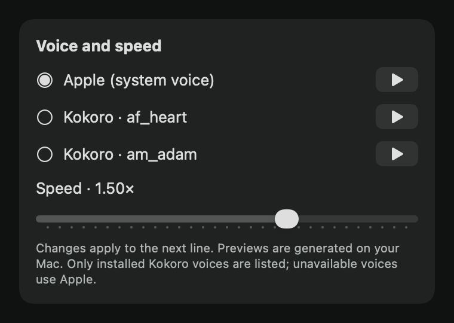

# Issue 22 verification

Voice and speed settings use the engine's `SpeechSettings`. The default remains
Kokoro `af_heart` at 1×. The picker lists known Kokoro packs already present as
`Voice/kokoro-82m-coreml/ANE/<id>.bin`, plus the Apple system voice. It does not
fetch packs or models. FluidAudio stays pinned at 0.18.0.

## Acceptance and automated evidence

| Requirement | Evidence |
| --- | --- |
| Available voices and local previews | `VoicePickerTests.previewsUseTheListedVoiceAndCurrentSpeedWithoutStartingATurn` asserts literal preview effects, availability and readiness gates. `VoicePickerAdapterTests.onlyLocalKnownPacksAreListedAndRemovalIsObserved` checks disk discovery. The opt-in fixture renders the real settings card and synthesizes installed packs without playback. |
| Speed applies to the next line | Core tests switch a queued line to Apple at 1.5× and preserve Apple fallback when only speed changes. The fixture generated the same preview with installed `af_heart` at 0.75× (3.155 s) and 1.5× (1.498 s), 24 kHz mono WAV. |
| Choices persist across launches | Literal saved JSON and a new engine are asserted in BuddyCore. `settingsPersistThroughANewManager` checks actual UserDefaults writes and a second manager using an isolated suite. |
| Added logic tested through public engine | `VoicePickerTests` sends public events and compares effects/state to literal expected values, including a settings change during failed synthesis, invalid speed and corrupt saved data. |
| Owner's next-turn listening check | Pending. Follow the steps below in a separately qualified signed app built from the PR head. No signed app was launched or installed for this issue. |

Full gates, from the issue branch:

```sh
swift test --package-path BuddyCore
xcodebuild -project Buddy.xcodeproj -scheme Buddy -configuration Debug \
  -destination 'platform=macOS,arch=arm64' -derivedDataPath /tmp/buddy-ci-22 \
  CODE_SIGNING_ALLOWED=NO COMPILER_INDEX_STORE_ENABLE=NO test
```

The full core gate passed 556 tests in 51 suites. The full unsigned app gate passed 60 tests in 21 suites. Existing opt-in tests remain disabled. No `BUDDY_LIVE_*`
environment variables were enabled, no owner voice files were changed, and the
bundle identifier, signing configuration and FluidAudio pin are unchanged.

## Agent fixture

With the required unsigned build completed, run:

```sh
BUDDY_VOICE_EVIDENCE=/tmp/issue-22-evidence \
TEST_RUNNER_BUDDY_VOICE_EVIDENCE=/tmp/issue-22-evidence \
xcodebuild -project Buddy.xcodeproj -scheme Buddy -configuration Debug \
  -destination 'platform=macOS,arch=arm64' -derivedDataPath /tmp/buddy-ci-22 \
  CODE_SIGNING_ALLOWED=NO COMPILER_INDEX_STORE_ENABLE=NO \
  -only-testing:BuddyTests/VoicePickerAdapterTests test
```

The fixture writes `settings-336.png` and `settings-380.png` from its owned
NSHostingView, and `<voice>-0.75.wav` / `<voice>-1.5.wav` for each installed Kokoro
pack. Its rendered list injects `am_adam` to exercise multiple rows; that does not
claim Adam is installed. The fixture itself never downloads a pack.

`install-voice` now also installs the six packs in `NeuralVoice.extraVoices`
(`af_bella`, `af_nicole`, `am_adam`, `am_michael`, `bf_emma`, `bm_george`, about
0.5 MB each), so the picker offers Apple plus seven Kokoro voices. After running it
on this Mac, the fixture synthesized all seven offline. Durations at 0.75× / 1.5×:
af_heart 3.15 / 1.50 s, af_bella 3.54 / 1.51 s, af_nicole 4.20 / 2.39 s, am_adam
3.01 / 1.36 s, am_michael 3.48 / 1.57 s, bf_emma 3.40 / 1.46 s, bm_george
3.81 / 1.67 s. If no pack is installed, it explicitly reports render-only evidence.
The local WAVs and screenshots are in `/tmp/issue-22-evidence`.



[The narrower 336-point card](issue-22/settings-336.png) was also inspected.

The fixture uses a unique preferences suite and task-owned history/profile paths.
It does not start the manager, call a provider, capture a display, request a
privacy permission, post global input or play sound. Regular adapter tests also
prove that a missing install rejects both load and synthesis without creating
its directory. They do not substitute for by-ear comparison or a real play-button
press. The settings bitmaps were inspected at both widths.

## Offline rule

Keep the complete preflight from [issue 21](issue-21.md). `load()` still requires
all seven stages, vocabulary, `af_heart`, G2P files and the US lexicon before
calling FluidAudio. Every synthesis now rechecks that preflight and the selected
local `.bin` before passing the voice ID to FluidAudio, because its voice-pack
loader can download missing packs even when its model download switch is off.
Known pack names come from the pinned dependency's English voice list. These
packs use the existing English frontend; this feature does not add language
selection or convert downloaded JSON packs.

An attempt to put the whole Xcode build under an outbound-denying sandbox failed
before tests because SwiftPM's nested `sandbox-exec` returned `sandbox_apply:
Operation not permitted`. That is not a passed offline synthesis check. The
successful fixture and missing-file tests are reported separately.

## Owner's signed-app check

1. Coordinate the signed-app test with the other Mac threads. Use the signed app
   qualified from this PR's exact head. Open Settings and find **Voice and speed**.
2. Confirm Apple and each installed Kokoro pack have separate select and play
   controls. While Kokoro is loading its preview button is disabled. Click
   Apple's play button, then Kokoro's when ready. Each should speak locally.
3. Choose Apple and set speed to 0.75×. Ask Buddy to say “Open the File menu at
   the top left of the screen.” Check the voice and pace by ear.
4. Choose Kokoro `af_heart` and set speed to 1.5×. Ask the same question on the
   next turn. It should use Kokoro and speak faster. Repeat for any other
   already-installed pack. Do not install or download a pack for this check.
5. Ask for two separate spoken lines. During the first, change speed. The line
   already playing should finish unchanged; the next line should use the new
   speed. Changing voice should also apply when the next line begins.
6. Quit and reopen that signed app. Confirm the selected voice and speed remain,
   then ask the same question. Confirm both still apply.
7. Click preview, then press Esc. The preview should stop. Check a preview during
   a reply does not advance, skip or finish a conversation line.
8. Record the exact head, voices compared and listening result on the PR. Issue
   21's separate owner listening check is not waived by these tests.

## Persistence and rollback

Choices are saved as `speechSettingsV1` in Buddy's existing preferences domain.
Invalid or out-of-range data uses defaults. An unavailable saved pack is retained
and replies fall back to Apple; no pack is fetched to satisfy it. A neural line
that fails before playback is retried with Apple at that line's original speed.
The rest of the reply stays on Apple unless the owner changes voice. Previews
use separate mouths sharing the loaded model, so their callbacks cannot drive
the engine's conversation line lifecycle. Preview failures show an error instead
of playing a different voice under the selected voice's label.

Revert the feature commits to remove the picker; the unused preference key can
remain. No history migration, model installation or signing change is involved.
