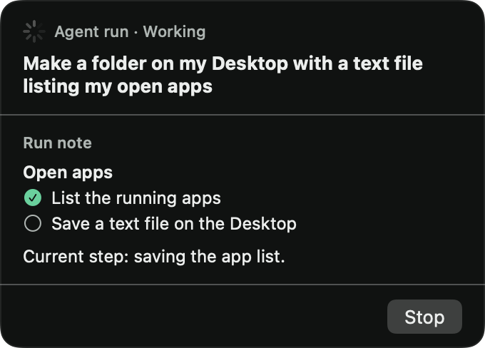
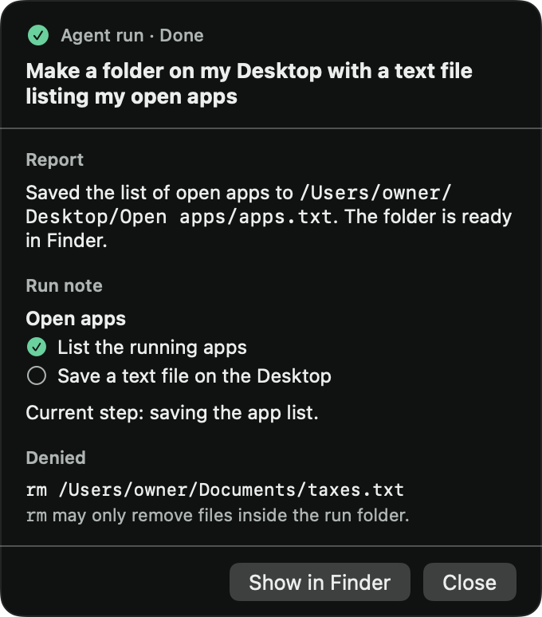

# Issue 24 verification

The `agent` prefix starts one background Claude run. Buddy confirms the request, shows its run note on a floating card, and saves its report when it ends.

## Acceptance evidence

| Criterion | Evidence |
| --- | --- |
| Agent prefix and confirmation | `AgentRunTests` drives the public engine through spoken and typed turns and checks the run, confirmation, voice and saved history. With Spoken replies off, the written confirmation finishes before agent beats replace it. Ordinary talk and a second run request have separate cases. |
| Run folder and brief | `ClaudeAgentHostTests` verifies brief text, capture bytes, note, report, output and scratch folders, including distinct folders after a relaunch. Profile and conversation summaries are not available in this revision. |
| Opus process and strict MCP | `ClaudeRunLaunchTests` checks the executable, model, tools, working folder, environment and exact CLI arguments. Recorded CLI output tests the stdio permission channel. |
| Capture screen, update run note, show beats | `AgentRunTests`, `MCPEndpointTests` and loopback tests cover tool calls, image responses, beat timing, bearer rejection and stopped-run behavior. |
| Approval policy and denial notes | `ApprovalPolicyTests` checks literal allowed and denied requests through the engine, including shell syntax, AppleScript, symlink escape and file replacement. |
| Floating card and Stop | Native fixture renders progress, denial, done, stopped and long-note states at 340 points wide. A click on the real Stop button reaches the stopped engine state. The process test verifies that a shell and its child stop in under one second. |
| Step and time caps | `AgentRunTests` checks both caps and ignores late events after the run ends. Defaults are 100 tool uses and 20 minutes. |
| Desktop example | Passed with installed Claude Code 2.1.316 on Opus through the production engine and app host after the usage window reset. The run created a new Desktop folder and `apps.txt` with 43 distinct app names; all 43 matched running app processes. It saved its completed checklist, denial notes and final report. |

## Automated checks

```sh
swift test --package-path BuddyCore
xcodebuild -project Buddy.xcodeproj -scheme Buddy -configuration Debug \
  -destination 'platform=macOS,arch=arm64' -derivedDataPath /tmp/buddy-issue24-ci \
  CODE_SIGNING_ALLOWED=NO COMPILER_INDEX_STORE_ENABLE=NO test
```

After integration with `main` at `68805e32a2e1a63e623626e65b83c3f650194769`, BuddyCore passes 194 tests in 21 suites. The app passes eight tests in five suites. This includes the text box, Dock app, provider picker and saved Spoken replies setting. Agent runs remain on the owner's direct Claude sign-in with Opus; the picker applies to talk. No automated test needs privacy permissions or a provider sign-in.

The integration regression `silentAgentBeatsReplaceTheFinishedWrittenConfirmation` first failed because the completed written confirmation left the turn in `.reading`, which `show_beats` rejected. Allowing completed written answers to be replaced makes it pass. Active turns still reject agent beats. `aTypedAgentRequestStartsTheSameBackgroundRun` verifies that a typed request follows the same run pipeline.

New regressions failed before the fixes. The policy allowed writes through a symlink, commands that changed the working directory or shell variables, and assignments to app properties inside AppleScript tell blocks. Stop left a child process running. The same tests pass after the fixes.

## Policy boundary

The run may read files, change files inside its folder and run approved read-only commands or AppleScript. To satisfy the ticket's explicit Desktop example, it may also create new visible files and folders on the Desktop. It cannot replace existing Desktop files, change other owner files, send messages, run network commands or take over the screen. Unsupported shell syntax is denied. This is an application approval policy, not an operating-system sandbox. Filesystem changes by another process between approval and execution remain outside this initial policy's guarantees.

Explicit `permissions.ask` rules send offered tools through Buddy's stdio permission channel before Claude's automatic approval. The run disables nonessential Claude traffic. The shell skips owner startup files and finds system programs first. Commands keep the run folder as their working directory. Formatted output requires `/usr/bin/printf`, and AppleScript assignments are denied inside tell blocks. Paths resolve existing and dangling symlinks before classification. Each run has a random bearer token that is revoked on stop. Shutdown cancels pending server startup before stopping the listener.

## Native card evidence

These images use fixture data and contain no owner screen captures.





## Live Desktop check

The first attempt hit Claude's five-hour usage limit and created no output. A retry on November 1, 2026 at 02:32 PST used the final reviewed source through the production `BuddyEngine` and `ClaudeAgentHost`, with the owner's installed Claude sign-in and default Opus model. It requested a uniquely named Desktop folder and a shell-based app list. The run completed and left `~/Desktop/Buddy-issue24-ED47F22D/apps.txt`.

```text
OUTCOME done
OUTPUT_EXISTS true
OUTPUT_LINES 43
DISTINCT_APPS 43
CURRENTLY_RUNNING_MATCHES 43
```

The app names were compared with a separate `ps -axo comm` result. The saved `note.md` contains a completed three-step checklist and four denied shell commands; `report.md` names the output and explains the restrictions. The run used supported read-only shell commands and Buddy's update-note tool to finish without those commands. Owner app names and process details remain local.

The harness omitted screen capture and simulated speech callbacks. Steven subsequently confirmed the actual voice, hotkey-to-run flow and screen privacy checks worked before approving head `160afba6b9b9e31affed9c13ae0d39812537d29e`. The later main integration required a new review and approval. To repeat the owner check, hold Control + Option and say “agent, make a folder on my Desktop with a text file listing my open apps.” Check the confirmation, card updates, Desktop file, saved run folder and Stop control. Run folders remain in Application Support until the owner removes them.
