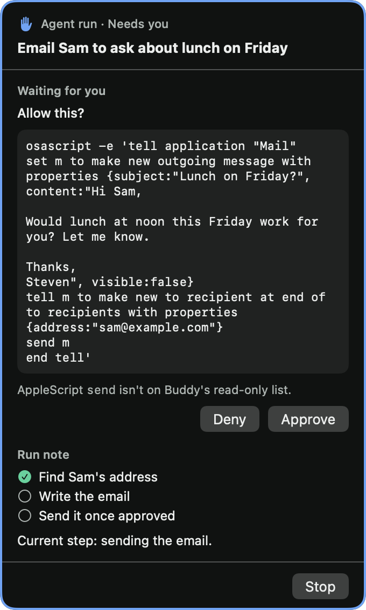
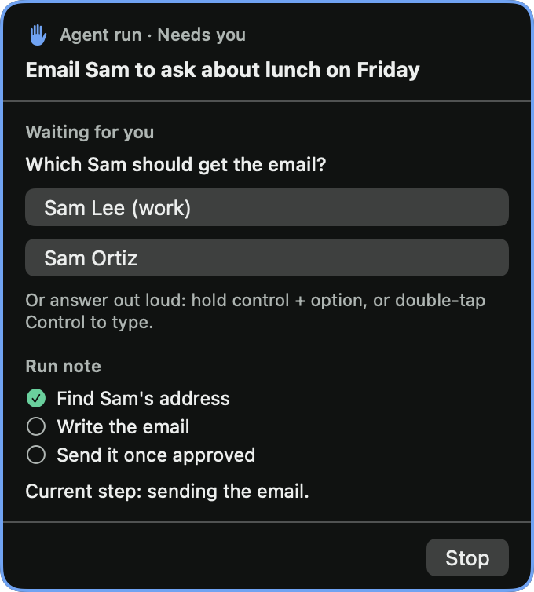

# Issue 25 verification

Agent runs now ask the owner before anything that sends, posts, buys or deletes, and they can ask the owner questions. A waiting run moves to needs-owner, plays Buddy's own cue and highlights its card. The owner approves or denies on the card. They answer a question by clicking a choice or with their next spoken or typed turn.

## Acceptance evidence

| Criterion | Evidence |
| --- | --- |
| Ask-owner class with approve and deny | `ApprovalPolicyTests` drives literal requests through the engine. A Mail `send` script, a `curl -X POST`, an `open` of a checkout URL, `rm` on a Desktop file and a Finder `delete` all wait for the owner, and so do the 76 commands and file requests the policy used to deny. `cd`, the shell's `printf` and unoffered tools are still denied, and a denial in a compound command wins over an ask. When an AppleScript sends, posts, buys, deletes or moves something, the card names that command first, so the live run's Mail script reads "AppleScript `send` isn't on Buddy's read-only list." The native card renders Approve and Deny for the waiting request, and a synthesized mouse click on each real button reached the engine. |
| `ask_owner` with choices or free text, answered by click or next turn | `MCPEndpointTests` checks the tool's schema, calls with and without choices, and bad arguments. `RunOwnerTests` answers a question with a clicked choice, a spoken turn and a typed turn. Neither turn reaches the provider, and a turn while only an approval waits stays an ordinary question. A live run held its question for 75 seconds and took the spoken answer. |
| Needs-owner state, highlight and cue | `RunOwnerTests` covers entering and leaving needs-owner, the cue on entry only, several waiting asks, stop and time cap while waiting, late or unknown answers, and closing or a second run while waiting. The card shows a raised-hand mark, **Needs you** and an accent border. `OwnerCue` synthesizes a 0.43-second, two-note 16-bit WAV. `AVAudioPlayer` reported it playing. |
| Brief asks for approval before irreversible actions | `RunInstructions.system` tells the run to get the owner's approval before anything irreversible and to write commands so the card shows exactly what will happen. It also describes `ask_owner`. `RunOwnerTests` checks these lines. |
| Tests | 279 BuddyCore tests in 28 suites and 10 app tests pass after merging `main` with the issue 28 run offers and the issue 10 Codex talk. A waiting question takes the next turn before a run offer, and the offer is still used up. New logic is tested through `BuddyEngine` and `MCPEndpoint` with literal expected values. |
| Manual check: an email waits for approval | Passed live through the production `BuddyEngine` and `ClaudeAgentHost` with installed Claude Code 2.1.316 on Opus. After the merge, approvals held for 150 seconds stayed open for both a denial and an approval. See below. |

## Live email check

The harness gave the production engine and host the turn "agent, send an email from Mail to sam@example.com asking whether lunch at noon on Friday works". It denied every approval, so nothing could be sent. The address is on the reserved `example.com` domain.

The run wrote the email as an `osascript` Mail script ending in `send m`. Buddy held it: the run moved to needs-owner and the cue fired. The denial reached the run as "Your owner said no. Don't retry it or work around it." The run did not retry. Its report said "I didn't send the email, because you turned down the send on your card," and its run note recorded the denial. A `date -j -f` command also waited for the owner, because the policy reads any `date` operand without `+` as setting the clock.

## Question timeout found and fixed

In a second live run, the run asked its question with `ask_owner`, and the harness answered by voice after 75 seconds. Claude Code had already given up. The run reported "The first try timed out" and asked again. Claude Code's documentation gives HTTP MCP calls a 60-second minimum first-byte budget next to the per-server `timeout` setting, and Buddy's server sent nothing until the owner answered. Buddy's MCP config now sets `timeout` to the run's 20-minute time cap. After that change, the same 75-second wait reached the run and the run went on to finish. `ClaudeRunLaunchTests` pins the setting.

Approvals travel a different path, so the MCP limit doesn't apply to them. In Claude Code 2.1.316, the `can_use_tool` request carries only an abort signal, which fires when a hook answers or the tool use is cancelled. It has no timer, unlike the CLI's own user dialogs. So a waiting approval stays open until the owner answers or Buddy's run time cap stops the run.

## Long waits after merging

After PR #55 merged, three more live runs used `main` at `826273d` with the same Claude Code and harness. Each one held the owner's answer well past a minute. In all three, the run sent no event while it waited, and nothing timed out.

| Run | Held | Answer | What happened |
| --- | --- | --- | --- |
| Send an email from Mail to sam@example.com | 150 s | Deny | The run's `osascript` Mail script ending in `send m` waited with the cue. After the denial the run reported "I didn't send the email because you denied the send. Nothing went out, and I didn't save a draft either." Its note recorded the denial. |
| Delete a temporary Desktop file with `rm` | 150 s | Approve | `/bin/rm` on the file waited because "`rm` may only remove files inside the run folder." After the approval, the command ran and the file was gone from the Desktop. A timed-out request couldn't have done that. |
| Ask what to name a new file, with no choices | 90 s | Spoken | The spoken answer "Call it lunch-plan.txt" reached `ask_owner`, Buddy said "Thanks, I'll pass that on to the agent run.", and the run made `output/lunch-plan.txt` containing `hello`. |

## Native card evidence

These images use fixture data and contain no owner screen captures. The first shows the exact Mail script from the live run. The card shows it in full and grows to keep Approve and Deny in view.





## Automated checks

```sh
swift test --package-path BuddyCore
xcodebuild -project Buddy.xcodeproj -scheme Buddy -configuration Debug \
  -destination 'platform=macOS,arch=arm64' -derivedDataPath /tmp/buddy-issue25 \
  CODE_SIGNING_ALLOWED=NO COMPILER_INDEX_STORE_ENABLE=NO test
```

The renders, the button clicks, the cue and the live runs used temporary fixtures that are not part of the repository. No automated test needs privacy permissions or a provider sign-in.

## Limits

Approvals take a click. Voice answers only questions, so a misheard word cannot approve an irreversible action. Waiting does not pause the time cap. The approval policy is an application policy, not an operating-system sandbox.
