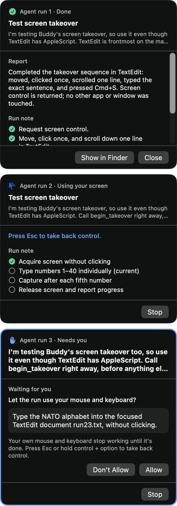
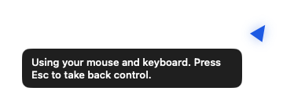
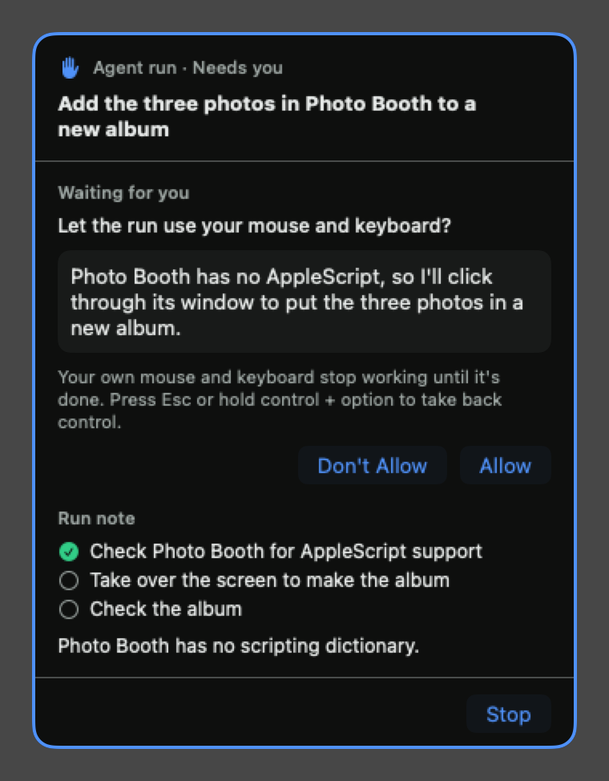
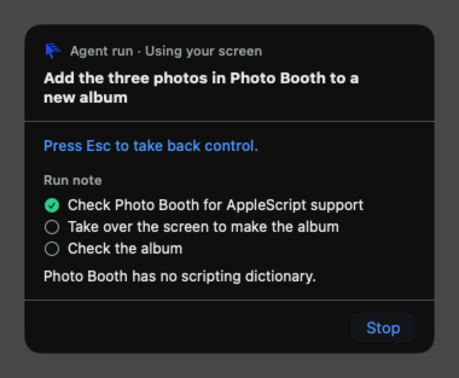

# Issue 26 verification

An agent run can now take over the screen for an app it can't drive with AppleScript or the shell. It asks with `begin_takeover`, and the run's card in the dock shows its reason with Allow and Don't Allow. Nothing moves until the owner clicks Allow. While the run holds the screen, an event tap blocks the owner's input, and Esc or push-to-talk gives it back at once. Only one run holds the screen at a time. Another run that asks waits on its card in needs-owner.

## Acceptance evidence

| Criterion | Evidence |
| --- | --- |
| Consent card, nothing moves before approval | `TakeoverTests` sends `begin_takeover` and expects only the needs-owner cue. Screen tools sent before the answer are refused, and Allow emits `beginTakeover` and the answer. A refusal lands in the run note. Without Accessibility, Allow gives no screen and shows a notice. `RunCardTests` calls the card's Allow and Don't Allow actions from `DockPanel` and checks the events they send. Live: no Buddy-posted event and no pointer move for 5 seconds before Allow, then a real click on Allow started the takeover, and a real click on Don't Allow put the refusal in `note.md`. |
| Input blocked except Esc and push-to-talk, which end it at once | `TakeoverTests` checks that Esc and push-to-talk emit `endTakeover` before their usual effects, and that the run's next tool call is told the owner took the screen back. Live: the owner's keys, clicks, pointer moves and scrolls didn't reach the session level during a takeover, Esc ended one in 29 ms and push-to-talk ended another in 51 ms, and input came back afterwards. |
| Click, type, key, scroll and move only during a takeover, overlay shows the buddy acting | `TakeoverTests` refuses each tool before consent, after a refusal, after `end_takeover` and after Esc. During a takeover it maps pixels in the latest screenshot to display points across two displays with different scales, refuses a missing screen or an out-of-bounds pixel, and answers each action once the app reports `acted`. `MCPEndpointTests` checks the seven tools' schemas and arguments. `KeyPressTests` checks every key name against Carbon's `kVK_` constants. `OverlayBubbleTests` checks that the takeover bubble wins over a reply, a notice and thinking. Live: a Codex run used move, click, scroll, type and Cmd-S in TextEdit, and the file it saved held the exact sentence. The overlay showed "Using your mouse and keyboard. Press Esc to take back control." and the card said **Using your screen**. |
| Only one run holds the screen at a time, others wait in needs-owner | The engine finds the run holding the screen among the dock's runs. Another run's `begin_takeover` waits on its card in needs-owner. Allow on that card while a run holds the screen leaves the request waiting and shows a notice, and the owner's clicks are blocked then anyway. `TakeoverTests.anotherRunWaitsInNeedsOwnerWhileOneHoldsTheScreen`, `twoRunsAskingAtOnceBothWaitAndTheOwnerChoosesOne` and `aRunStoppedMidTakeoverFreesTheScreenForAnotherRun` cover it, and every way a run leaves a takeover gives the screen back first. The owner's clicks are blocked during a takeover, so when the holder gives the screen back with `end_takeover`, Esc or a failed tap, the needs-owner cue plays again for a run still waiting. Push-to-talk skips the cue because the microphone is opening. A holder that ends plays its done cue instead, so the two don't overlap (`theScreenComingBackRemindsTheOwnerOfAWaitingRunUnlessTheyAreAboutToSpeakOrTheHolderEnded`). Live: two Codex runs asked at once, one held the screen while the other waited, a real click on the waiting card's Allow was blocked, and after Esc a real click on Allow gave it the screen. |
| Tests | After merging `main` at `3cceeb0`, 473 BuddyCore tests in 44 suites and 28 app tests in 11 suites pass. New logic is tested through `BuddyEngine.handle` and `MCPEndpoint.handle` with literal expected values. |
| Manual check | Run live in the signed app by the agent. A Codex run chose a takeover on its own to work out a sum in Calculator, which has no scripting dictionary, and finished after consent. Esc mid-takeover returned control in 29 ms. See below. The two physical-input notes under "Not covered live" can only be checked by hand. |

## Live checks in the signed app

These ran on November 2, 2026. A temporary Swift Testing probe ran inside a signed Debug build of the merged branch (`dev.steven.buddy`, Apple Development identity, hardened runtime, `-derivedDataPath /tmp/buddy-build`), like the checks for #11, #27 and #29. The probe was never committed.

- It made the app's real `CompanionManager` with history and profile in a temporary folder and its own defaults suite: spoken replies off, runs on Codex 0.166.0, Auto approvals. It called `start()`, so the real push-to-talk monitor, takeover tap and overlay were live.
- It didn't change `dev.steven.buddy`. An export taken before matched one taken after key for key, and the probe's suites were removed.
- Each request went in through the text box. Every run went through `AgentRunHost`, with its folder in `Application Support/Buddy/Runs`, the real `Codex run home` and Buddy's MCP server.
- Every takeover acted only on a TextEdit document under `/tmp/buddy-takeover-probe/docs`.
- The probe found the card controls through the accessibility tree. Before each click it checked that the dock was the topmost window at that point, then posted a real mouse click with `CGEvent`.
- To stand in for the owner, the probe posted keys, clicks, moves, scrolls, Esc and Control + Option at the HID level with its own marker, never Buddy's. A listen-only session tap behind the takeover's HID tap counted which of them got through.

The owner's own Buddy kept running throughout. It saw the probe's Esc and its brief Control + Option press like any key.

### Calculator, an app with no scripting support

`sdef /System/Applications/Calculator.app` fails with error -192, so Calculator has no AppleScript dictionary. The request didn't mention a takeover:

> agent, work out 47 × 86 in the Calculator app that's open on my main display, by clicking its buttons, so I can see it done there. Clear it first. Then tell me the result Calculator shows.

```text
10.0 s  run 1 asks: takeover(reason: "I'll clear Calculator and click its buttons to calculate 47 × 86, as requested.")
10.4 s  real click on Allow, topmost window = the dock -> run 1 takingOver
76.2 s  run 1 done; Buddy's own events that passed: 10 moves, 10 clicks; no approvals asked
        Calculator's accessibility tree: "47×86", "4,042"
```

The report read: "I cleared Calculator and clicked its buttons for 47 × 86. Calculator shows **4,042**."

### Run 1: consent, blocked input, a takeover that ends by itself

The run was asked to take over TextEdit, take a screenshot, move to the middle of the document, click once, scroll one line, type a sentence, press Cmd-S and call `end_takeover`.

```text
20.2 s  run 1 asks: takeover(reason: "Test screen takeover in TextEdit by typing the requested sentence into run1.txt and saving it.")
25.3 s  5 s later: needsOwner, pointer moved=false, Buddy-posted events=0, document still empty
25.9 s  before the takeover, the probe's move, F18 and scroll reached the session level: mouseMoved, keyDown, keyUp, scrollWheel
25.9 s  real click on Allow, topmost window = the dock -> run 1 takingOver
26.9 s  during the takeover the probe's move, Z key, click and scroll reached the session level: none
41.8 s  the run ended its takeover; Buddy's own events that passed: 3 moves, 1 click, 1 scroll, 3 key downs and ups
42.2 s  the probe's F18 reached the session level again: 2 events
44.9 s  run 1 done; run1.txt on disk: "Buddy typed this during a takeover."
```

The report read: "Completed the takeover sequence in TextEdit: moved, clicked once, scrolled one line, typed the exact sentence, and pressed Cmd+S. Screen control is returned; no other app or window was touched."

### Runs 2 and 3: one holds the screen, one waits; Esc and push-to-talk

Two runs started back to back. Each was asked to call `begin_takeover` at once and then type into the same TextEdit document one item per `type` call: run 2 the numbers 1 to 40, run 3 the NATO alphabet. If the owner took the screen back, each was told not to ask again.

```text
56.7 s  both wait: run 2 needsOwner (takeover), run 3 needsOwner (takeover)
56.9 s  real click on run 2's Allow -> run 2 takingOver, run 3 still needsOwner
84.1 s  the probe's click on run 3's Allow reached the session level 0 times; run 3 still needsOwner
84.3 s  Esc -> run 2 left the takeover after 29 ms; Esc itself passed the tap
85.1 s  the probe's F18 reached the session level again
85.2 s  real click on run 3's Allow -> run 3 takingOver
109.4 s Control + Option -> run 3 left the takeover after 51 ms, and the turn was held for listening
111.7 s released -> turn idle
TextEdit: "1\n2\n3\n4\n5\nalpha\nbravo"
```

- Run 2's report: "Typed 1–5 into run23.txt … You took back the screen before 6, so I stopped without requesting control again."
- Run 3's report: "Stopped when screen takeover ended, without requesting it again. In run23.txt, alpha was completed and bravo is visible, but its newline wasn't confirmed …". Push-to-talk had cut its `type` call between "bravo" and the new line, as `ScreenTakeover` stops typing when the takeover ends.

The dock at 84 seconds, with run 2 using the screen and run 3 waiting:



### Don't Allow, and the overlay bubble

- **Don't Allow.** A fourth run asked for the screen, and the probe clicked Don't Allow on its card. `note.md` then held "- `Take over the screen: …`: You said no." The run followed its instructions not to retry after a denial. It finished without touching the document and said so in its report.
- **A bug the live check found.** In run 1 the overlay still showed the run's start line, "On it. I'll work on that in the background.", because with spoken replies off a written reply stays up. The takeover bubble showed only when nothing else did. The overlay's bubble choice now lives in `BuddyPresence.bubble`, where the takeover bubble wins over a reply, a notice and thinking. `OverlayBubbleTests` pins it. In the next run the overlay showed the takeover bubble at the cursor on the external display, and the earlier reply came back once the takeover ended.
- **Wider gesture mask.** After review, the tap also drops rotate, begin and end gesture, swipe and smart magnify events. A final takeover on that code started, typed and saved "Allowed and typed." as before.
- **Secure input.** In that same run, some app on the Mac briefly had secure input on. The run's `type` was refused with the secure-input message. The run said "Buddy blocked typing because secure input was active" and gave the screen back.



## Card renders

These use fixture data and contain no owner screen captures.





## Not covered live

These need a physical mouse, keyboard or trackpad, so the probe couldn't run them. Neither blocks the criteria: owner input is blocked at the HID tap, where hardware events enter, and the probe's own input there was blocked.
- **Cursor.** A move the probe posted with its own marker was dropped before the session level, but the cursor still moved to its position. Whether a physical mouse or trackpad moves the cursor during a takeover needs a hand on it. Either way the run's clicks land where it aimed, because each one moves the pointer to its spot first.
- **Gestures and media keys.** The tap drops system-defined events and gestures, but a three-finger swipe and the media keys can't be posted faithfully.

These are known and expected:
- **Secure input.** While an app has secure input on, as in a password field, event taps don't see key events. The owner's typing then reaches that field and Esc can't end a takeover, but push-to-talk still can. The run's own typing is refused then.
- **Fn and Caps Lock.** Modifier changes pass the tap so push-to-talk works, so Fn alone and Caps Lock still reach macOS.
- **Esc.** Esc also reaches the app the run is driving, so it can close a dialog there.

## Automated checks

```sh
swift test --package-path BuddyCore
xcodebuild -project Buddy.xcodeproj -scheme Buddy -configuration Debug \
  -destination 'platform=macOS,arch=arm64' -derivedDataPath /tmp/buddy-ci26 \
  CODE_SIGNING_ALLOWED=NO COMPILER_INDEX_STORE_ENABLE=NO test
```

No automated test makes a real event tap or needs a privacy permission.
