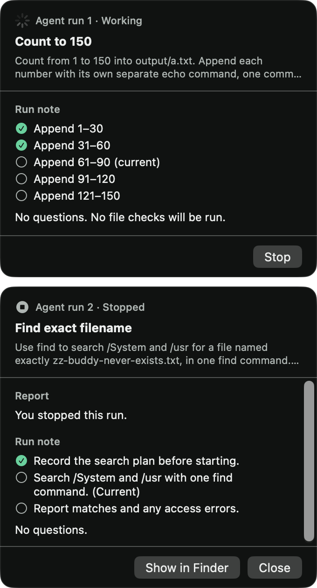
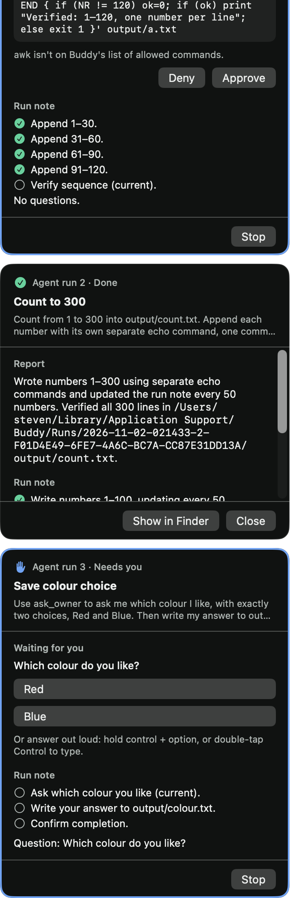

# Issue 27 verification

Agent runs now live in a dock at the right edge of the screen, with one card each. Several runs work at once, each in its own provider process. Every talk turn carries a short dock summary, so "how is the agent doing?" gets a real answer. Buddy plays its own launch and done cues.

## Acceptance evidence

| Criterion | Evidence |
| --- | --- |
| Dock with one card per run, replacing the single card | `DockPanel` and `DockView` in `RunCard.swift` replace `RunCardPanel`. Each card shows the run's number and status, its name, the request, what it waits for, the run note, denials, a Stop control while it runs and the report once it ends. A needs-owner card keeps its accent border, and the dock comes forward and scrolls to it. `RunCardTests.eachCardInTheDockStopsOnlyItsOwnRun` checks that each card names its own run and that Stop on the second card stops only that run. The live checks below drove the real dock with real clicks. |
| Several runs at once, each in its own provider process | `state.run` became `state.runs`, and the "already going" refusal is gone. Each run keeps the CLI and approval mode it started with. `DockTests.twoRunsWorkAtOnceAndOneStopsFromItsCardWhileTheOtherFinishes` routes notes, approvals, stops and late tool calls to the right run. `AgentRunTests.secondAgentTurnStartsASecondRunWithItsOwnProcess`, `RunOfferTests.aYesWhileAnotherRunIsGoingStartsASecondRun` and `RunOwnerTests.aWaitingRunCannotBeClosedAndASecondRunStartsBesideIt` replace the three tests that pinned one run at a time. `DockTests.aSpokenAnswerGoesToTheQuestionThatHasWaitedLongestAcrossTheDock` sends a spoken answer to the question asked first, even when a later run asked it, and Buddy's reply names that run. `RunCardTests.onlyTheCardWhoseQuestionTakesTheNextTurnInvitesASpokenAnswer` checks each card's hint: only the card whose question takes the next turn offers a spoken answer. `DockTests.aClaudeRunAndACodexRunWorkSideBySideAndEachKeepsItsOwnCLI` starts one run on each CLI and mode. `DockTests.aRunThatEndsLeavesTheMarksAnotherRunShowedOnScreen` checks that one run ending leaves another run's marks up. |
| Dock summary on talk turns | `TurnRequest` carries the dock's runs, and `content` puts the summary right after the profile, on warm and fresh providers alike. `DockTests.aTalkTurnCarriesASummaryOfEveryCardSoBuddyCanSayHowTheRunsAreGoing` pins the literal text for a run waiting on an approval, one done, one stopped and one failed. Other `DockTests` cases cover the empty dock, a clipped note and a missing report. `TalkInstructions` tells Buddy to answer from it. The live answers are below. |
| Launch and done cues | `RunCues` synthesizes three 16-bit WAVs: launch (0.27 s), needs-owner (0.43 s, unchanged) and done (0.68 s). The engine plays launch when a run starts, and done when a run finishes, fails or hits a cap. The owner's own Stop plays nothing. `DockTests.eachRunPlaysTheLaunchCueAndOnlyARunThatEndsByItselfPlaysTheDoneCue` and the updated `AgentRunTests` check this. `RunCardTests.eachRunCueIsItsOwnShortWaveThatNeverClips` checks each wave's length and peak. The app's effect log from the live checks is below. |
| Tests for concurrent run state and summary content | 445 BuddyCore tests in 43 suites and 23 app tests in 9 suites pass after merging `main`. The live tests in that count skip unless their variable is set. The new logic is driven through `BuddyEngine.handle` with literal expected values. |
| Manual check: two runs in parallel, one stopped from its card | Passed in the signed app with real clicks. See below. |

## Live checks in the signed app

A temporary Swift Testing probe ran inside a signed Debug build of the merged branch (`dev.steven.buddy`, Apple Development identity, hardened runtime, `-derivedDataPath /tmp/buddy-build`), like #29's and #11's checks. The probe was never committed.

- It made the app's real `CompanionManager`, with history and profile in a temporary folder and its own defaults suite: spoken replies off, runs on Codex, Auto approvals.
- It set `talkConnectionV1` to direct sign-ins on Codex, because Claude's 5-hour window was full. It saved the owner's `talkConnectionV1` and `talkPicksV1` first and restored them afterwards. An export of `dev.steven.buddy` taken afterwards matched the earlier one key for key, and the probe's suite was removed.
- It opened the text box with the Control double-tap events and submitted each request. The app captured the real screens.
- Every run went through `AgentRunHost`, with its folder in `Application Support/Buddy/Runs` and the real `Codex run home`, on Codex 0.166.0.
- It found the dock's controls through the system accessibility tree. Before each click it checked that the dock was the topmost window at that point, then posted a real mouse click with `CGEvent`.

The owner's own Buddy kept running throughout.

### Two runs, one stopped from its card

Run 1 counted to 150 with one `echo` per number. Run 2 searched `/System` and `/usr` with one `find`. Once run 2 had named itself and its `find` was running, the probe clicked Stop on run 2's card.

```text
before stop:  run 1 "Count to 150" running, run 2 "Find exact filename" running
              codex app-server processes under Buddy: 4 (talk, utility, run 1, run 2)
              find: 11288 find /System /usr -name zz-buddy-never-exists.txt
click:        Stop on run 2, topmost window = the dock
after stop:   run 1 running, run 2 stopped by the owner
              codex app-server processes: 3, the one for run 2 gone; find: gone
final:        run 1 done, a.txt has all 150 numbers; run 2 stopped by the owner
run 2 report: "Asked: …\n\nStopped by the owner."
```

The app's effect log showed the cues: `playCue.launch` for each run, `runStopRequested -> stopRun, saveRunReport` with no cue, and `run.finished -> stopRun, saveRunReport, playCue.done` for run 1.



Two earlier passes asked for counting runs to 40 and to 300 as the run to stop. Codex finished each before the click, so those passes didn't click Stop. The Stop check above uses a single long `find` instead.

### "How are my agent runs doing?"

Typed in the app while two runs were in the dock, on Codex. Each answer came from that turn's dock summary.

> “List open apps” is done and verified, with 19 app names saved in apps.txt inside Buddy-issue27-015812 on your Desktop.
> “Count to forty” has verified all 40 lines in output/count.txt and reports completion, though its card still says working.

> Count to 120 has finished 1 through 30 and is working on 31 through 60.
> Count to 300 is still in its first 100 numbers; both runs are working, and neither needs anything from you.

Each summary is taken when the question is asked, so a run that moves on while the reply is written isn't reflected in it. The first run in the first answer made `Buddy-issue27-015812/apps.txt` on the Desktop with 19 apps, which the probe checked and then removed. Before the merge, the opt-in Claude test `liveClaudeSaysHowARunInTheDockIsGoing` gave this answer about a rename run:

> The rename screenshots run is still working.
> It found 12 screenshots on your Desktop and has renamed 5 of them so far.
> After that it'll check the new names.

### A run that needs the owner, then closing the cards

A third run used `ask_owner` with the choices Red and Blue while two other cards were in the dock.

- The engine played `playCue.needsOwner`, and the card showed "Needs you" with the accent border.
- The three cards were taller than the screen, so the dock scrolled to the waiting card, which was entirely inside the dock's frame.
- The probe clicked Blue on that card. `runQuestionAnswered -> answerTool` followed, and the run wrote `Blue` to `output/colour.txt` and finished with `playCue.done`.
- The probe then clicked Close on each card. The dock stayed while cards remained and hid when the last one closed.

**A bug this found and fixed.** The owner's Mac has Show scroll bars set to Always. The first pass showed every card clipped by 8.5 points on the left when the dock scrolled, because the 17-point legacy scroll bar took its width out of the fixed 340-point dock. A scrolling dock now widens by the scroll bar's width whenever the system's scroll bars take space. `RunCardTests.aScrollingDockMakesRoomForAScrollBarThatTakesSpace` pins the rule. In the second pass the dock was 357 points wide, and the waiting card was entirely inside it:



**Two questions at once.** A spoken or typed answer goes to the question asked first. A fixture render of the real dock, with run 2 asking first and run 1 asking second, showed "Answer out loud: hold control + option, or double-tap Control to type." on run 2's card only. Run 1's card read "Click a choice. Another run asked first, so your next spoken or typed answer goes to it." The final wording is "Click a choice. An earlier question takes your next spoken or typed answer.", which is also right when one run has two questions waiting. Buddy's reply to a spoken answer now names the run, such as "Thanks, I'll pass that on to agent run 2."

In that pass run 1 also waited: Auto sent its `awk` check of its own file to the owner, and the card showed Deny and Approve.

## Automated checks

```sh
swift test --package-path BuddyCore
xcodebuild -project Buddy.xcodeproj -scheme Buddy -configuration Debug \
  -destination 'platform=macOS,arch=arm64' -derivedDataPath /tmp/buddy-ci27 \
  CODE_SIGNING_ALLOWED=NO COMPILER_INDEX_STORE_ENABLE=NO test
```

No automated test needs privacy permissions or a provider sign-in.

## What the probe couldn't cover

The probe checked that each cue was sent to `RunCues`, and the wave tests check the sounds. Whether the cues sound right is an ear check for the owner. The spoken path, holding Control + Option and saying the request, was covered for runs in #24 and is unchanged here.

## Limits

There is no cap on how many runs work at once. Each one spends the owner's provider usage. A waiting question takes the owner's next turn, so asking "how is it going?" while a run waits on a question answers that question instead. Talk can describe runs but can't stop or approve them.
