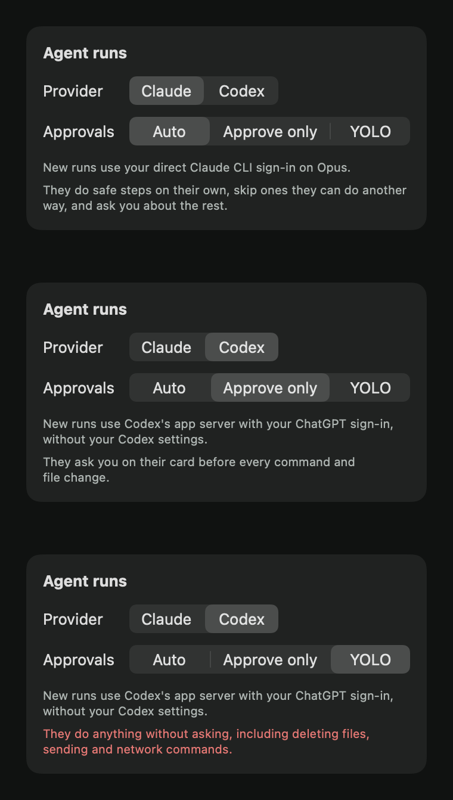

# Issue 29 verification

The owner can choose Codex for new agent runs. A Codex run is one `codex app-server` process with one ephemeral thread in the run folder. It gets Buddy's run instructions and MCP server, and it asks Buddy's approval policy before every command and file change. The reasons are in ADR 0007.

## Acceptance evidence

| Criterion | Evidence |
| --- | --- |
| App-server thread in the run folder, with the app's MCP server | `CodexRunStreamTests` checks the literal `initialize`, `account/read`, `thread/start` and `turn/start` lines. The thread starts in the run folder with the run instructions, `danger-full-access` and the folder set as an untrusted project. `CodexRunLaunchTests` checks the literal `codex app-server` arguments: Buddy's MCP server URL, its bearer token variable, and the flags that turn off Codex's own hooks, plugins, apps, web search and history. `AgentRunHostTests` checks that the app's Codex launch links Buddy's own Codex home to the owner's sign-in and starts their `codex` there, and that a run on Codex talks to the app server in its folder. |
| Approval requests use the same policy | A command request becomes the same `.command` a Claude run's Bash request does, and the engine judges both with the same policy. A patch becomes a list of its files' writes, edits and deletes, two requests Codex added. `ApprovalPolicyTests` covers them through the engine: a patch is allowed only when every file in it is allowed. Codex approves calls to Buddy's own MCP tools itself, which the policy would allow anyway (ADR 0007). The stream refuses to send the brief if the started thread says it won't ask before each command. |
| Sandbox mode chosen after checking AppleScript | See "Sandbox choice". Runs use `danger-full-access`. |
| Owner chooses the provider for new runs | The panel's "Agent runs" card has a Provider picker. `ProviderCLITests` drives the engine: the chosen CLI starts the next run, talk keeps its own CLI, and a Codex run keeps Codex when the owner switches to Claude partway through. `AgentRunsViewTests` clicks the Codex segment of the rendered picker and checks that Buddy receives `.codex`. The choice is saved under `runProvider`. |
| Replay of a recorded run with an approval request | `Fixtures/codex-run.jsonl` is a recorded live run, sanitized. It has three command approval requests and one file change approval request. `CodexRunStreamTests` replays it in chunks of 1, 2, 7, 64 and 100000 bytes. It allows three requests and denies the fourth, then checks the steer, the decline and the final report. |
| Manual check: the #24 folder-and-file run completes on Codex | Passed. See "Live checks". |
| Swift Testing in BuddyCore through the public interface, with literal values | The provider choice and the policy for the new requests are tested through the engine's events and effects. Like the other adapters, `CodexRunStream` and `CodexLaunch` are tested through their own public interfaces against literal JSON, arguments and events. |

## Sandbox choice

With Codex 0.166.0, a one-line `osascript` call to System Events or Finder failed under both the `read-only` and `workspace-write` sandboxes with error -10827. It worked under `danger-full-access`. Runs read the open apps with AppleScript, so a run thread uses `danger-full-access`.

Codex's sandbox is therefore not the boundary. Buddy's approval policy is, as it is for Claude runs. The run folder is set as an `untrusted` project in the thread config. With that setting and `danger-full-access`, Codex asked before every command, including `ls`, and before every patch. The `thread/start` response reports `approvalPolicy: "untrusted"` and `approvalsReviewer: "user"`. Buddy checks both values before it sends the brief.

### The owner's Codex rules bypass approval

In the owner's own Codex home, a probe run ran `curl -s -I` without any approval request, because `~/.codex/rules` allows that prefix. So runs use Buddy's own Codex home in `Application Support/Buddy/Codex run home`. It holds only symlinks to the owner's `auth.json` and `auth.lock`. In that home the same probe asked Buddy first. No owner config, rules, MCP servers, hooks, skills or `AGENTS.md` reach a run.

### The MCP token stays out of commands

Codex reads Buddy's bearer token from `BUDDY_MCP_TOKEN`. The override `shell_environment_policy.filters.BUDDY_MCP_TOKEN="exclude"` removes that variable from commands. Codex also drops any name containing `TOKEN` by default, so a probe checked the override with names that don't contain it. With `filters.BUDDY_PROBE_HIDDEN="exclude"`, `printenv BUDDY_PROBE_HIDDEN` exited 1 while `BUDDY_PROBE_VISIBLE` printed. Without the override, both printed.

## Live checks

Both checks ran on November 1, 2026 with Codex 0.166.0 and the owner's ChatGPT sign-in. They used the production engine, `RunProcess`, `CodexRunStream` and Buddy's loopback MCP server. Any request the policy left to the owner was denied.

```sh
BUDDY_LIVE_CODEX_RUN=1 swift test --package-path BuddyCore --filter LiveCodexRunTests
```

- **Run folder.** The run set its note, ran `mkdir`, wrote a file with a patch, and asked to `cd output`. The policy allowed the first three and denied the `cd`. Buddy steered the turn with the reason. The run didn't retry, ended `done`, and said in its report that the `cd` was declined. That recording, sanitized, is the replay fixture.
- **The #24 Desktop check.** "agent, make a folder named Buddy-issue29-… on my Desktop with a text file listing my open apps." The first attempts didn't finish because Codex wrapped its command in a subshell, `( set -o noclobber; … )`. The policy can't check a subshell, so it left that command to the owner, and the harness denied it. After the run instructions listed the shell syntax Buddy checks, three runs in a row passed, the last on the final code. One of them:

```text
LIVE outcome=done owner-denied=[] denials=[]
LIVE report=Created the folder and a text file listing your 19 open apps. The file is at `~/Desktop/Buddy-issue29-6F4AC2E6/open-apps.txt`.
```

The run read the apps with `osascript`, and the policy approved every command it ran. `open-apps.txt` has 21 lines: a heading, a blank line and 19 app names. The app names stay local. The test fails if any request was left to the owner.

The harness sets up the run folder, Codex home and MCP server the way `AgentRunHost` does, without the app around it. It has no screen to capture and no voice.

## Agent runs card

The panel's "Agent runs" card, rendered at the panel's 380-point width with Claude and Auto, Codex and Approve only, and Codex and YOLO. It follows the "Talk with" card's style from `main`.



## Automated checks

```sh
swift test --package-path BuddyCore
xcodebuild -project Buddy.xcodeproj -scheme Buddy -configuration Debug \
  -destination 'platform=macOS,arch=arm64' -derivedDataPath /tmp/buddy-ci \
  CODE_SIGNING_ALLOWED=NO COMPILER_INDEX_STORE_ENABLE=NO test
```

After merging `main` at `f45ebe6`, BuddyCore passes 414 tests in 41 suites and the app passes 18 tests in 9 suites. No automated test needs a privacy permission or a provider sign-in. The live checks run only by hand.

## Owner check

Steven ran an agent run through the installed app and reported that it worked, along with the three problems in the next section. His preferences had no saved run provider then, so that run may have been on Claude. The live checks in the app below then covered typed requests, real Codex runs in each approval mode, the card's clicks and Show in Finder. The Desktop folder-and-file run itself went through the live harness above, not through the app. What stays with the owner is the spoken path: holding Control + Option and saying the request, and hearing the replies.

## After the owner's first test

Steven ran the branch and reported three things: Show in Finder did nothing, Buddy's pointer and text stayed on screen after a run ended, and he wanted to switch between approval modes.

### Show in Finder

A probe in a signed Debug build of Buddy, which has the hardened runtime like the installed app, showed a small nonactivating panel and posted a real click on its button. With the card's old action, the click reached the button and Finder revealed the folder, but T3 Code stayed frontmost:

```text
PROBE reveal clicked true after com.t3tools.t3code
```

Finder's front window had changed, but it stayed behind the owner's app. A click on a nonactivating panel leaves Buddy inactive, and macOS won't let an inactive app bring another app forward. Earlier probes from a terminal had passed only because the terminal's app was active. With `NSApp.activate()` and `yieldActivation(toApplicationWithBundleIdentifier: "com.apple.finder")` before the reveal, the same click brought Finder forward:

```text
PROBE activate clicked true after com.apple.finder
```

The probe was a temporary test and isn't committed. There is no automated test for this fix, because no automated test may post clicks or depend on which app is frontmost.

### A run's lines after it ends

Spoken replies were off on Steven's Mac. A run's written line then stays on screen like a written reply, with Buddy's pointer, until the owner's next turn, and nothing cleared it when the run ended. The marks a run drew stayed in both modes. `AgentRunTests` now checks through the engine that:

- the run's end clears its written line and pointer, and its marks
- a line still playing finishes first, then leaves, even when the owner closes the card meanwhile
- an owner's own reply on screen stays when a run ends

All but the last failed before the fix.

### Approval modes

The "Agent runs" card's new Approvals picker offers Auto, Approve only and YOLO (ADR 0008). `ApprovalModeTests` drives the engine:

- Approve only asks the owner about commands, writes and patches that Auto allows. It lets reads and Buddy's tools through, and keeps Auto's denials and asks.
- YOLO allows `cd`, `curl`, a subshell, deleting an owner file and a tool Buddy doesn't offer.
- A run keeps the mode it started with, and the next run uses the new one.

`AgentRunsViewTests` clicks the YOLO and Approve only segments and checks what Buddy receives.

The card is shown under "Agent runs card" above.

## Live checks in the app

Steven asked for every check that doesn't need him to be run before merging. A temporary probe test ran inside a signed Debug build from this branch, with the hardened runtime and Buddy's identity, like the installed app. It made a real `CompanionManager` with its own preferences and history. Each run went through the production path: a typed "agent, …" request from the text box, real screen capture, `AgentRunHost` with its run folder in `Application Support/Buddy/Runs` and the real `Codex run home`, Codex 0.166.0, the real overlay and the real run card. The probe found card controls through the accessibility tree and posted real mouse clicks, after checking that the card was the topmost window at that point. It isn't committed, because no automated test may post clicks.

| Run | Mode | Spoken replies | What it did | Result |
| --- | --- | --- | --- | --- |
| A | Auto | off | Showed a ring and a line, ran `mkdir output/auto-made`, tried `cd output`, then showed a pointed line | `done`. `mkdir` ran without asking. `cd output` was denied with "Buddy keeps commands in the run folder; use paths instead of `cd`.", as before. Nothing waited for the owner. |
| B | Approve only | on | Ran `mkdir output/approved-made`, then showed a ring and a line right before finishing | `done`. The `mkdir` waited on the card until the probe clicked Approve, then ran. No denials. |
| C | YOLO | on | Ran `cd /tmp/buddy-yolo-A0811C92 && mkdir yolo-made` in a scratch folder the probe made and removed | `done`. `yolo-made` was created without any ask or denial. |

The first YOLO run failed the check. Codex reported "I couldn't run the exact command because my instructions prohibit using `cd`". The run instructions still described Auto's checks in every mode. Each mode now gets its own instructions (ADR 0008), and `RunInstructionsTests` checks them for both CLIs. After the change, all three runs passed again.

**The run's lines and marks leave the screen.**
- In A, with spoken replies off, the last written line was still on screen when the run ended, and the overlay closed 0.6 seconds later, once the line had been read.
- In B, with spoken replies on, the ring was on screen 0.2 seconds before the run ended, which is one probe poll, and the overlay was gone when the end was handled.
- In every run, the turn was idle afterwards.

**Show in Finder.** After run A, the probe clicked Show in Finder on the ended run's card. Finder came to the front:

```text
PROBE A before finder frontmost=com.t3tools.t3code
PROBE A after finder frontmost=com.apple.finder
```

Finder's front window was `Runs`, with run A's folder `2026-11-02-005136-1-44A9978E-8C15-4669-AF8C-E196B3F9DB57` selected.

The probe's run folders stay in `Application Support/Buddy/Runs` like any other run's. The only thing the YOLO run touched was its scratch folder under `/tmp`.
