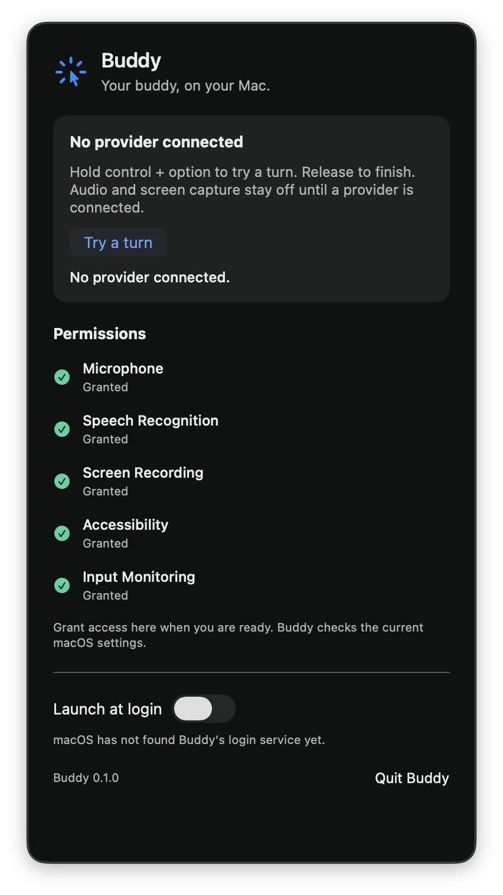

# Buddy baseline verification

Scope is issue 3, against the project spec.

## Automated evidence

| Acceptance criterion | Implementation and evidence |
| --- | --- |
| One pinned upstream snapshot, no upstream history, MIT attribution | Import commit `908de62`; `LICENSE` names farzaa/clicky and full commit `e71105ce091d71dff4d89cf5d8d37ea1df460961`. Both snapshot review axes checked all 85 entries against the archive. Root project guidance was preserved and upstream root documents were relocated for that commit, then removed during cleanup. |
| Remove telemetry, email/FormSpark, Mux/music, Sparkle, hosted clients, and worker | Those source files, assets, package references, and worker are removed. At that baseline no `URLSession`, hosted endpoint, or network-client entitlement remained in the app. [ADR 0005](../adr/0005-select-provider-accounts-through-cliproxy.md) later adds explicit requests to the owner's CLIProxy hub for account discovery and selection; the old no-network claim does not apply to that mode. The retained Apple Speech adapter requires on-device recognition. Since [issue 21](issue-21.md), FluidAudio's download client is linked into the app for `install-voice`, and Buddy's process loads the neural voice only from files already installed. |
| Remove dead code, stale assets, release/appcast, keyterms, per-user Xcode data, and stale agent docs | Final app contains the native shell, event tap, overlay, capture and local Speech adapters. `Buddy/AGENTS.md` and the root README describe this code. Only app icons and the accent remain in the app asset catalog. |
| Buddy identity, owner signing, macOS 26 | `Buddy.xcodeproj` uses Buddy, `dev.steven.buddy`, the owner's Apple Development team, and deployment target 26.0. Signed Debug build succeeded on this Mac. |
| Opt-in launch at login | Launch reads `SMAppService` only. Engine effects can register/unregister only after an owner request. Tests cover off by default, explicit opt-in, serialized changes, failure/readback, and cancellation of pending approval. |
| Menu-bar launch, no Dock icon, actionable live permissions | `LSUIElement` and accessory activation policy; five rows use current native authorization. Engine tests cover every permission kind and all request statuses. Native UI check remains separate below. |
| Surviving upstream tests pass; template UI tests removed | `BuddyTests` preserves all three upstream test functions and assertions, with the module import renamed. `xcodebuild test` passed all three. No UI-test target remains. |
| Added logic tested through the public BuddyCore engine | `swift test --package-path BuddyCore` passed 17 Swift Testing tests, including five parameterized tests with five cases each. No-provider, request/retry, login, and interruption slices were first observed failing, then passing. |

Commands run on macOS 26.6.2 with Xcode 26.6 and Swift 6.3.3:

```sh
swift test --package-path BuddyCore
xcodebuild -project Buddy.xcodeproj -scheme Buddy -configuration Debug \
  -destination 'platform=macOS,arch=arm64' -derivedDataPath /tmp/buddy-build clean build
xcodebuild -project Buddy.xcodeproj -scheme Buddy -configuration Debug \
  -destination 'platform=macOS,arch=arm64' -derivedDataPath /tmp/buddy-build test
```

## Native runtime checks

These checks require observed results. Build and test success alone does not establish them.

- Passed: inspected the rendered 380 × 710-point panel and its native accessibility tree on a 2056 × 1329-point display. The five permission rows and login toggle are readable. The app reports accessory activation policy and has no Dock icon. The panel's **Try a turn** action showed `No provider connected.` in the panel and cursor overlay. Button text uses the lighter blue token, with 6.29:1 contrast against the surface.
- Passed: launch at login started off. An explicit toggle registered Buddy successfully, and the opposite toggle unregistered it. It was left off. This worked from a task-created signed copy at `~/Applications/Buddy.app`.
- Passed: all five permissions were granted through native macOS dialogs and Settings, with the owner completing Touch ID and file selection. The live checklist showed five Granted rows before a clean signed rebuild. The app was quit, rebuilt, copied over the task-created `~/Applications/Buddy.app`, signature-verified, and relaunched from the same path. All five live grants survived, and launch at login remained off. The designated signing requirement was unchanged. No TCC database or permission bypass was used.
- Passed: with Finder in front, a posted Control+Option press and release drove the real global event tap and showed Buddy's cursor overlay. A second global turn, followed by reopening the panel, exposed the literal `No provider connected.` notice in the native accessibility tree. The screenshot below shows that notice, all five grants, and the login toggle off.
- Passed with a sampling limit: `nettop -n -L 45 -s 1 -p Buddy -J bytes_in,bytes_out` observed 45 samples from 2026-10-31 21:18:04 UTC through 21:18:48 UTC. Monitoring started before launch, covered the global shortcut from 21:18:23 through 21:18:24 UTC, and continued through idle. Its CSV contained 45 header rows and no Buddy process or socket rows. `lsof -nP -a -p 49063 -i` afterward returned 1 with no internet sockets. Earlier launch and panel-turn observations also found none. These are sampled observations, not a packet trace. Packet capture was unavailable because `tcpdump` returned `ioctl(SIOCIFCREATE): Operation not permitted`.

| Permission | Before clean rebuild | After replacement and relaunch |
| --- | --- | --- |
| Microphone | Granted | Granted |
| Speech Recognition | Granted | Granted |
| Screen Recording | Granted | Granted |
| Accessibility | Granted | Granted |
| Input Monitoring | Granted | Granted |



The baseline does not start listening or capture displays because no provider exists. The Microphone, Speech, and Screen Recording controls allow setup for later provider work. The event tap starts only when Input Monitoring is granted, and revocation cancels a held turn before the tap stops.

## Merge and rollback

Use a merge commit to preserve the separate snapshot commit `908de62` and its evidence link. Squashing would erase the requested import boundary. The app has no release/update mechanism or production deployment in this change. Reverting code does not revoke macOS grants or unregister an owner-enabled login item; those remain system settings the owner can change. Reverting only the cleanup commit restores the unstripped upstream app, so rollback must revert the whole feature.
