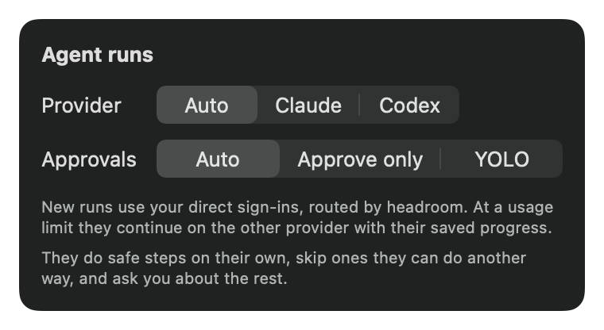
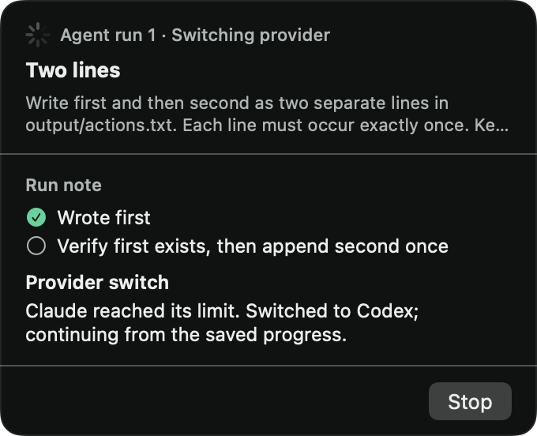
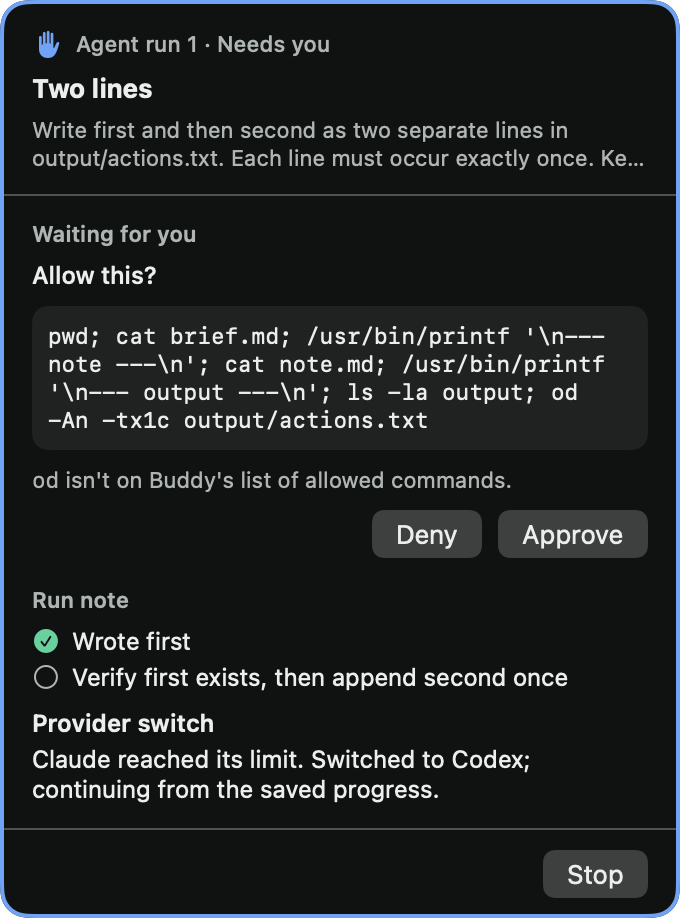

# Issue 30 verification

Issue #30 adds routed agent-run starts and provider-limit handoff.

## Acceptance map

| Criterion | Code | Actual evidence |
| --- | --- | --- |
| Router picks the provider at run start | `BuddyEngine.startRun`, `ProviderRouter` | `RunFallbackTests.newRunUsesTheProviderWithMoreHeadroom`: observed red exit 1, then green exit 0; default Auto chose Codex at 90% Claude utilization and 10% Codex utilization |
| Limit pauses and resumes using brief, run note and partial report; switch visible in note | `BuddyEngine.reachedLimit`, `resumeIfReady`, `RunContinuation`, both run streams, `AgentRunHost.resume` | Focused engine/wire batch passed, including literal full pause/resume effects and context, preserved asks/consent/caps, both switch directions and sticky visible switch note |
| Start choice and limit pause/resume tests | `RunFallbackTests.swift`, `ClaudeRunStreamTests.swift`, `CodexRunStreamTests.swift` | 37 focused tests in 3 suites passed with exit 0, including recorded wire fixture replays |
| Simulated-limit run finishes on the other provider without duplicate actions | `RunFallbackHostTests.swift` | Executed and passed in the full app gate: real host/child-process/MCP exchange, Claude limit → Codex completion, literal `first\nsecond\n`, same folder, rotated token, exactly one start and one resume. The coordinator inspected the fixture and logs and accepted it as simulated-limit functional evidence. |
| New logic covered through BuddyCore engine events/effects with literal expectations | `RunFallbackTests.swift` | Focused batch passed. Tests drive `BuddyEngine.handle` and check literal effects, statuses, continuation text, owner-question associations, mode and caps |

## Grounding and design

Starting base is `76d26de7a65d1bb8a1cc9f87e37b14f0443b092c`. Both prerequisites, #11 and #29, are closed. The issue worktree was clean before this task.

At the starting base, the engine creates an `AgentRun` and emits `startRun`; the app host makes its folder and launches the selected direct CLI. The run streams report limits as generic failures. The host keeps the run folder after stopping a process, but queued callbacks have no generation check. `stopRun` also cancels the wall-clock timer.

The implementation carries a continuation with the original brief, containing the run note and partial report. The engine owns the pause, pending owner decisions, provider selection and finite fallback. The host stops the old process, invalidates its MCP token and queued callbacks, and starts the replacement in the same folder. A separate `pauseRun` effect retains the wall-clock timer. Existing direct Claude and Buddy-owned Codex-home launch paths remain the account boundary.

New runs default to Auto. Existing saved Claude/Codex choices remain pinned, honoring the parent spec's manual override. Auto uses the shared router and its 15-point margin at start. A limit marks that direct provider's snapshot full and switches at once when the other provider is available. A run tries each provider at most once. The approval mode and step count stay with the same run. Pending owner asks remain on its card; answers are included in the continuation, with each question beside its answer. Old approval IDs and screen consent never authorize the replacement process. A takeover ends before the old process stops; the replacement must ask again.

Two designs were considered. Host-only retry would hide the switch from the engine and risk losing approval and takeover state. Engine-owned pause and resume keeps the state transition testable at the approved seam and lets the app retain the original wall-clock timer. The latter is the intended design.

Throughput checkpoint:

- Blocking first steps: live issue, parent, glossary, ADRs and source trace precede implementation. TDD runs need the exclusive lane.
- Independent workstreams: read-only review can proceed independently; there is one implementation owner.
- Shared mutable state: only this issue's worktree and evidence paths are written. All executable checks use the shared lane guard.
- Smallest safe decomposition: engine transition, stream translation and host replacement form one coupled behavior, owned together to preserve lifecycle ordering.

## Verification status

The first lane acquisition returned exit 75 while #60 owned it. The coordinator then granted #30 a focused batch. Both commands used the lane guard and `/tmp/buddy-frontier-issue-30/core` as the scratch path:

```text
swift test --package-path BuddyCore --scratch-path /tmp/buddy-frontier-issue-30/core --filter RunFallbackTests
exit 1: expected Codex, observed Claude in both the start effect and run state

swift test --package-path BuddyCore --scratch-path /tmp/buddy-frontier-issue-30/core --filter 'RunFallbackTests|ProviderCLITests'
exit 0: 6 tests in 2 suites passed after the routed-start change
```

Logs are `/tmp/buddy-frontier-issue-30/start-red.log` and `start-green.log`. The lane was released immediately after this batch. No probes or helper processes were started and no owner settings, audio or clipboard state changed.

The coordinator granted a second focused core/wire batch. This guarded command exited 0 with 37 tests in 3 suites passing:

```text
swift test --package-path BuddyCore --scratch-path /tmp/buddy-frontier-issue-30/core --filter 'RunFallbackTests|ClaudeRunStreamTests|CodexRunStreamTests'
```

The log is `/tmp/buddy-frontier-issue-30/fallback-focused-1.log`. This is the first executable run of the pause/resume changes; no failing pre-fix run is claimed for defects identified in source review. It covers pause and resume context, out-of-order owner answers with original questions, success after an earlier refusal, partial report on process exit, finite fallback, pinned choice, step/time caps, stopping while paused and fresh consent. It also replays both existing providers' recorded fixtures. The lane was released immediately afterwards with no helper processes or owner-state changes. The app-target host simulation and signed probe remain unexecuted; no manager/app work ran in this batch.

The coordinator cleared isolation commit `982ac3d53c29a7cbca15c5fffe05d221081cece7` from #60 for integration. Because #30 already had pending changes to `CompanionManager.swift`, its exact four-file patch was applied without staging, preserving both intents. `git apply --check` and the subsequent `git diff --check` exited 0. The new directory helper and isolation test files match source blobs `9696964` and `bde6632`. This is the shared fix, not another implementation.

The patch gives each manager a UUID screenshot directory, removes only that directory on release, adds an injected test root and two real-manager isolation regressions, and updates ownership docs. The later granted app gate must execute those regressions along with #30's checks. No manager test or probe ran before integration, and integration itself does not grant a test slot.

## Independent pending-work review

Fresh Standards review identified two P2 Claude wire defects: a successful result after a limit refusal must win over the refusal, and a limit followed by process exit without a result must retain the limit and partial report. Both are fixed with literal wire regressions that passed in the second focused batch.

Fresh Spec review identified one P2 handoff defect: answers to multiple pending questions lacked their original questions. The continuation now pairs each question and answer, with a literal out-of-order-answer engine regression that passed in the second focused batch. The reviewer confirmed Auto-only fallback honors the parent spec's manual override.

Fresh independent re-reviews of the complete intended pending work, including the shared isolation patch and all new files, reported zero Standards blockers and zero Spec source blockers. They confirmed the three fixes and retained the unexecuted functional checks as outstanding acceptance gates. No reviewer ran tests or apps.

These pending-work reviews precede publication. Fresh independent committed source reviews on integrated head `31da5eef6443837931f3af8001ea01496cb22776` versus main `c093439ec6849e81f7f59e54c7203cadb010e6d2` also reported zero Standards blockers and zero Spec source blockers. Final publication-head reviews and hosted CI are reported in the PR and issue report.


## Integrated full and functional batch

Fetched and merged main `c093439ec6849e81f7f59e54c7203cadb010e6d2` without conflicts, producing tested head `31da5eef6443837931f3af8001ea01496cb22776`, tree `d125097b996c8c971b1a5e23e4d7eec842bd705f`. The combined engine/manager/panel retains #33's pen-sound preferences, effects and Reduce Motion setup alongside #30. The shared screenshot helper and regression tests still match the exact source blobs `9696964114c844a19d7b8024115fa609df58ed7a` and `bde663238a581376407feef5be6beecc501e6588`.

The coordinator granted the bounded full/app/signed batch. The lease was acquired at 2026-11-03 03:01:27 UTC and released at 03:07:56 UTC. Every executable command used `test_lane.py run --issue 30 --thread issue-30 --`:

```sh
swift test --package-path BuddyCore --scratch-path /tmp/buddy-frontier-issue-30/core
# exit 0: 499 tests in 46 suites

xcodebuild -project Buddy.xcodeproj -scheme Buddy -configuration Debug \
  -destination 'platform=macOS,arch=arm64' -derivedDataPath /tmp/buddy-frontier-issue-30/ci \
  CODE_SIGNING_ALLOWED=NO COMPILER_INDEX_STORE_ENABLE=NO test
# exit 0: 39 tests in 16 suites
```

The framework summaries count nine opt-in live core tests and two unrelated opt-in pen-sound app tests as skipped. No live flags were enabled in either full gate; the relevant #30 and isolation tests executed.

The app gate executed and passed both exact real-manager screenshot-isolation regressions, the native provider/approval picker test, and `RunFallbackHostTests.simulatedLimitFinishesOnTheOtherProviderWithoutRepeatingTheFirstAction`. That functional fixture drives the real `AgentRunHost`, `RunProcess`, provider wire adapters and loopback MCP server with deterministic provider child processes. Claude writes the first line after engine approval, saves its progress through MCP, and reports a simulated limit. Codex receives the continuation in the same run folder, verifies the first line exists, and appends the second after approval. Literal assertions prove:

- The action file equals `first\nsecond\n`, with no duplicate line.
- Launches are exactly Claude then Codex, with one `startRun` and one `resumeRun`.
- Both processes receive the same run folder and different bearer tokens.
- The original brief remains unchanged; continuation input contains the saved note, partial report and no-repeat instruction.
- The final note retains the provider-switch text, the final report says both actions completed, and no owner asks/denials remain.

This is the issue's simulated-limit completion evidence. It exercises actual child-process and MCP I/O, while the providers' responses are fixtures. It does not claim a successful live-provider continuation.

### Signed UI and supplementary live-provider result

The temporary [probe source](issue-30-probe.swift.txt) was copied into `BuddyTests` only for this batch, then removed after the process exited. Its SHA-256 is `096ef15ff9deb33d35d339016584ec345d80bdfa004ccd387981ff3033e3b2a4`. It uses a simulated initial Claude process and one real Codex continuation, isolated run files and Codex home under `/tmp/buddy-frontier-issue-30/`, and Buddy's normal direct sign-in launch. It renders only its own native fixture views; it never requests screen capture, interacts with consent, answers an owner approval or changes the allowlist.

```sh
xcodebuild -project Buddy.xcodeproj -scheme Buddy -configuration Debug \
  -destination 'platform=macOS,arch=arm64' -derivedDataPath /tmp/buddy-frontier-issue-30/signed \
  COMPILER_INDEX_STORE_ENABLE=NO \
  -only-testing:BuddyTests/Issue30Probe -only-testing:BuddyTests/AgentRunsViewTests test
# exit 65: picker test passed; supplementary live probe timed out at 180 seconds

codesign --verify --strict /tmp/buddy-frontier-issue-30/signed/Build/Products/Debug/Buddy.app
# exit 0
```

The real Codex replacement reached `needsOwner` for a read command containing `od`, which is outside Auto's allowed command set. The product correctly kept that approval pending. The unattended probe had no handler for answering owner asks, so it timed out with three failed expectations: done status, the second output line and an empty asks list. The action file remained exactly `first\n`. This is a supplementary probe limitation, not a passing live-completion result. No second real turn was spent and product policy was not weakened to make the probe pass. The coordinator explicitly accepted the deterministic cross-wire evidence separately and required this limitation to remain disclosed.

The signed picker interaction passed. Rendered Auto settings at 380 points and run cards at 340 points were inspected: the provider switch, saved progress, needs-owner reason and controls are visible and legible. The historical local filename `done.png` contains a **needs-owner** state; the published artifact is accurately named `issue-30-needs-owner.png`.







## Integrity and isolation

Before and after each core, unsigned and signed batch, manifests recorded the Git head/tree/status, all 259 tracked-file hashes, probe hashes and built product hashes. Source and probe hashes remained identical within every batch. The [manifest summary](issue-30-manifest.json) records the 146 build source/config/test file digest and executable hashes; full local manifests and logs are under `/tmp/buddy-frontier-issue-30/manifests/`, `core-full.log`, `unsigned-full.log` and `signed-probe-1.log`. The initial publication commit `54124354e37c5f0f48822af849db0e12fb8d9d09` adds evidence only; its built product and test inputs are identical to the tested source. The later main integration below changes those inputs, so the recorded local gates are historical evidence, not final integrated-head passes.

The app retained `dev.steven.buddy` and its existing Apple Development identity. The probe used only its own fixture files/windows; no owner history, defaults, audio settings or clipboard were changed. Its real Codex home used the configured direct sign-in through the existing sign-in-link mechanism, without account reconfiguration. All own processes ended and the temporary test source was removed before releasing the lane. Existing picker-dialog visibility remains **UNKNOWN**: no owner's private windows were inspected and no capture or consent request was made.


## Main advanced after the full batch

At initial PR publication, main had advanced to `a2a0863832a3f0682d01d446025ed6b1807ca1b3` with #32's handwriting and paper cards. It was fetched and merged without conflicts as `22f563fff8aaf7a1186147a5effb69f407c4e391`. Shared manager/ports/engine code retains both paper effects and #30's run host, timers and approval handling. No #30 production/test delta changed in this merge. The source manifest above remains pinned to the earlier tested tree; it does not describe this new integration.

The lane was already released, and no new local test grant was held. No tests, apps or provider calls ran for this integration. Exact-head hosted CI, fresh committed reviews and affected local integration verification are tracked in PR #76 and the coordinator report. The supplementary live-provider limitation remains disclosed; another real turn is neither needed nor authorized to make that probe green.
