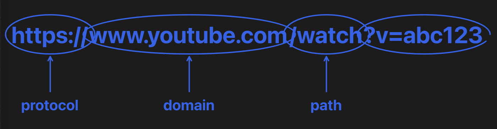

# Draw program tracer verification

Scope is issue 31, against the Draw programs section of the project spec.

## Acceptance mapping

| Acceptance criterion | Implementation and evidence |
| --- | --- |
| A proposal for our own draw program API, written from scratch, is in the PR: beats of one spoken line plus marks, with a first mark set of stroke, arrow, ring and text. The owner approves it before merge | `docs/draw-programs.md`. A program calls `beat(line)` for each spoken line, then draws that line's marks with `stroke`, `arrow`, `ring` and `text`. It measures with `measureText` and `measurePath` and sees the screen's size as `canvas`. The owner approved it on 2026-11-01. |
| Programs run in a sandboxed JavaScriptCore context with no file, network or app bridges, only host functions for measuring text and paths, and an execution time limit | `DrawSandbox` in `BuddyCore/Sources/BuddyCore/Draw/`. Each program gets a fresh context in its own context group. It has the language's built-ins and the draw API, with `console` and `WebAssembly` removed. No module loader is installed, so `import()` is refused. The time limit is 0.5 s through `JSContextGroupSetExecutionTimeLimit`. That function is looked up at run time because it isn't in the public headers, and if it's missing no program runs. |
| Recorded marks are redrawn natively with Core Animation on the click-through overlay, paced to the mouth's lines, and cleared on the next turn or interruption | When a line starts, the engine sends one `draw` effect with that line's marks. `DrawMarksView` in `OverlayWindow.swift` adds one `CAShapeLayer` per mark beneath the SwiftUI annotations. Strokes, arrows and rings animate `strokeEnd`, and text wipes in through a mask, one mark after another from the line's start. The windows are still the click-through ones at the `.screenSaver` level. `clearAnnotations` clears the marks, and the engine sends it on the next turn, on Esc and when history is cleared (`marksClearOnTheNextTurnEscapeOrClearingHistory`). The run below shows each stage. |
| Our system prompt teaches the API, and the model can choose a draw program or plain beats | `TalkInstructions` has a "Drawing a picture" section with the fence, every function, the limits and a worked example. `ReplyReader` reads plain beats until a ```` ```draw ```` line. `thePromptsDrawExampleRunsAndDrawsEveryMark` runs the prompt's own example through the engine. In the live run, Claude chose a program for "Draw how a URL is structured." The beat tests in `AnnotationTests` and `TurnTests` still pass unchanged. |
| Tests: programs produce the expected recorded marks, forbidden access fails, and a runaway loop hits the time limit | `DrawProgramTests` has 20 tests, with 54 cases counting arguments. `aProgramsBeatsAreSpokenInOrderAndEachLinesMarksDrawAsItStarts` checks every mark kind against literal display points. `forbiddenAccessFailsTheProgram` covers `fetch`, `require`, `XMLHttpRequest`, `console`, `WebAssembly`, `setTimeout`, `webkit` and `process`. `importingAFileIsRefused` covers `import()` of a path and of a file URL. `aRunawayProgramHitsTheTimeLimit` covers `while (true)`, an endless loop inside `try`, and recursion that catches its own stack overflow. `aBrokenProgramShowsANoticeAndDrawsNothing` covers 16 broken programs. |
| Manual check: asking Buddy to draw how a URL is structured produces a paced drawing | Passed live in a harness on the real `claude` process, on the final code. See below. **The owner should still try it once in the app itself** (see "Owner check"). |
| Logic added in this ticket is covered by Swift Testing tests in BuddyCore, driven through the engine's public interface with literal expected values | Every draw test drives `BuddyEngine.handle`. `DrawSandbox`, `ReplyReader`, `Beat` and `PixelPoint` are internal. Two tests check relations rather than exact values. `measuringHelpersReportPathsAndText` checks text measurement that way, because font metrics belong to the system. `thePromptsDrawExampleRunsAndDrawsEveryMark` checks that the example's marks all draw, so it holds as the prompt changes. |

Commands, run on macOS 26.6.2 with Xcode 26.6, Swift 6.3.3 and Claude Code 2.1.316:

```sh
swift test --package-path BuddyCore
xcodebuild -project Buddy.xcodeproj -scheme Buddy -configuration Debug \
  -destination 'platform=macOS,arch=arm64' -derivedDataPath /tmp/buddy-ci \
  CODE_SIGNING_ALLOWED=NO COMPILER_INDEX_STORE_ENABLE=NO test
```

After merging `main`, which added the Codex talk path, run offers, run approvals, profile notes, conversation summaries and target and type beats, `swift test` passed 362 tests in 34 suites, with the live tests skipped. A draw program's marks start with their line along with that line's annotations, target ring and typing. `xcodebuild test` passed the app's 13 tests with no Swift warnings. A REMEMBER or FORGET tag on a line before a program is kept even when the program fails (`aProfileEditBeforeTheFenceIsKeptWhetherOrNotTheProgramWorks`). Codex reads the same `TalkInstructions`, so it can choose a draw program too. Only Claude was tried live.

## URL drawing run

The owner's own Buddy was running, so this used a harness like the one for issue 8. It was a throwaway Swift executable outside the repo. It wired `BuddyEngine` to a real `ClaudeBrain` from `ClaudeLaunch.talk`, started in an empty temporary folder, and to a real capture of the screen. It compiled the app's `OverlayWindow.swift`, `DesignSystem.swift`, `PointerPose.swift` and `Ports.swift` unchanged. `AppleVoiceMouth.swift` was copied with each line's volume set to 0. `DisplayCapture.swift` was copied to leave out the harness's windows by process ID. The display was 2056 × 1329 points, captured at 1280 × 827 pixels.

The first live run found a bug. Claude ended its reply with the closing fence and no newline after it, so the reader ran the fence as JavaScript and the program failed with `SyntaxError: Unexpected EOF`. `aClosingFenceThatEndsTheReplyWithNoNewlineEndsTheProgram` now covers that, and the next live run drew the whole picture. Claude's reply in that run:

```js
const x = 250, size = 28;
const parts = [
  ["https://", "The scheme says how to talk to the server."],
  ["www.example.com", "The host is which server to visit."],
  ["/blog/post", "The path is which page on that server."],
  ["?id=7", "The query passes extra details to the page."],
  ["#intro", "The fragment jumps to a spot inside the page."]
];
const labels = ["scheme: the how", "host: the where", "path: the page", "query: the options", "fragment: the spot"];
let y = 110;
for (let i = 0; i < parts.length; i++) {
  beat(parts[i][1]);
  const m = measureText(parts[i][0], size);
  text(parts[i][0], x, y, size);
  ring(x - 8, y - 4, x + m.width + 8, y + m.height + 4);
  text(labels[i], x, y + m.height + 12, 18);
  y += 100;
}
```

After review, the renderer changed to take each line's marks as one effect. By then the owner's 5-hour Claude limit had been reached, so the final code was first checked by replaying that recorded reply through the same harness. Once the limit reset, the live run below replaced that replay.

### Live run on the final code

On the branch after the merge of `main` that brought conversation summaries, the same harness asked the real `claude` process "Draw how a URL is structured." with the screen captured. Claude chose a draw program again. It wrote this program, taking the example address from the page that happened to be on screen and making up the video ID:

```js
const size = 44, small = 28;
const parts = [
  ["https://", "protocol", "It starts with the protocol, which says how to talk to the site."],
  ["www.youtube.com", "domain", "Next is the domain, which is the website's name."],
  ["/watch", "path", "The path says which page on that site you want."],
  ["?v=abc123", "query", "And the query after the question mark passes extra details, like which video."]
];
let total = 0;
const info = parts.map(p => {
  const m = measureText(p[0], size);
  total += m.width;
  return m;
});
let x = (canvas.width - total) / 2;
const y = 300;
beat("A URL is a page's address, built from a few parts.");
for (let i = 0; i < parts.length; i++) {
  const w = info[i].width, h = info[i].height;
  const cx = x + w / 2;
  beat(parts[i][2]);
  text(parts[i][0], x, y, size);
  ring(x - 6, y - 6, x + w + 6, y + h + 6);
  const lw = measureText(parts[i][1], small).width;
  text(parts[i][1], cx - lw / 2, y + h + 90, small);
  arrow(cx, y + h + 82, cx, y + h + 16);
  x += w;
}
```

The harness log, with times from the push-to-talk press:

```text
   385 ms  sendTurn
 9,041 ms  completed -> speak line 1, no marks
13,160 ms  line 2 (protocol) -> draw 4 marks: text, ring, text, arrow
16,743 ms  line 3 (domain)   -> draw 4 marks
19,740 ms  line 4 (path)     -> draw 4 marks
22,246 ms  line 5 (query)    -> draw 4 marks
26,874 ms  last line ends -> hideBuddy
29,143 ms  Esc -> clearAnnotations
```

Nothing was spoken until the whole program had arrived, about 9 s after the question, as `docs/draw-programs.md` says. Each part's marks started with its own line. A screenshot 2.3 s after the reply ended showed all four parts ringed, labelled and pointed at, and one 2.1 s after Esc showed no marks. The panel below was taken 1.7 s into line 5. The query's words and ring are drawn, but its arrow and label haven't started yet, because a line's marks draw one after another. The rings overlap where the parts touch, because Claude drew each ring 6 pixels wider than its words. That is the program's layout, not the renderer's. The other panels aren't published, because the owner's own windows were behind the overlay.



## Owner check

These need the owner:

1. Approve the API in `docs/draw-programs.md`. Done on 2026-11-01.
2. In the signed app, ask "Draw how a URL is structured." Check that the drawing appears in open space as each line is spoken, that the marks draw one after another within a line, and that Esc or the next question clears them.
