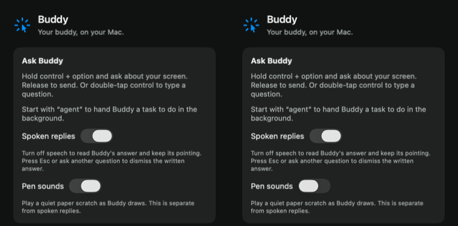

# Pen sounds verification

Scope is issue #33, with the existing mark vocabulary and reveal behavior from #31. Handwriting and cards belong to #32.

## Acceptance mapping

| Criterion | Code | Actual evidence |
| --- | --- | --- |
| Each stroke plays our own generated or recorded sound, timed to reveal | `PenSounds.swift` synthesizes filtered noise with a pressure envelope. `DrawMark.revealDuration` supplies both Core Animation durations and engine cue durations. The app uses one host-clock anchor for both. | Signed functional test passed using real output audio, two native Core Animation reveals and literal cue offsets `[0, 0.5]`. Mixer output is nonzero during both strokes and silent during the intervening text. |
| Settings toggle for pen sounds | `CompanionPanelView`, `CompanionManager`, engine `penSoundsChanged` and saved `penSounds` preference. Enabled by default, independent of spoken replies. | Ordinary persistence test passed across fresh managers with isolated defaults. Signed UI fixture presses the actual native pen switch, observes the saved false value, renders it off and verifies a new manager loads false. |
| Sound cue schedule follows mark timing | Engine emits `playPenSounds` only when the line starts, with offsets accumulated across the line's marks. | Focused RED exited 1 because the cue API was absent. GREEN verifies literal offsets `[0, 0.25, 0.75]` and durations `[0.25, 0.5, 1.2]` for three mapped strokes. All 8 engine tests pass, including text delays, arrow/ring timing, display scaling and independent overlapping lines. |
| Drawing sounds in sync and toggle silences them | Native overlay and audio adapter; disabling cancels playing and queued audio. | Signed test samples the actual mixer and animation presentation layers. It observes nonzero sound during the first/second reveals, disables while the second plays, and measures silence while the next stroke visibly draws. The rendered output was inspected at 1280×800 and settings at 380×710. |
| New logic has Swift Testing coverage through the public engine, with literal expectations | `PenSoundTests` feeds real events and draw programs through `BuddyEngine.handle`. | All 8 tests pass, including disabled startup/runtime, re-enabling, interruption, text delays, scaling, Reduce Motion and overlapping lines. Full BuddyCore passes 485 tests in 45 suites. |

## Sound provenance

The scratch is generated from a deterministic linear congruential noise sequence, filtered to emphasize paper grain and modulated by a slow pressure curve. Each stroke gets a short attack and release. There are no recordings, system sounds, downloaded assets or reference-app files. The source is the asset generator.

## Execution record

The first granted lane batch ran `swift test --package-path BuddyCore --filter PenSoundTests` through `test_lane.py run`. It established RED (exit 1, absent cue type/effect) and GREEN (exit 0, one Swift Testing test). Two interim failures corrected the fixture's turn lifecycle and an out-of-canvas coordinate expectation. The final fixture uses a 1,800-point round trip entirely inside the canvas. The lease was released on 2026-11-03 at 01:34:28 UTC. No app, provider or audio operations ran in that batch.

The later granted batch passed the remaining focused cases and full `swift test --package-path BuddyCore` (485 tests, 45 suites). The prescribed unsigned gate passed 38 tests in 15 suites, counting the two opt-in functional tests that are skipped without their flag. Both screenshot-isolation tests and the pen preference test executed and passed. Two earlier app compile failures (exit 65) caught missing explicit module imports; both were corrected before passing.

The unsigned command is:

```sh
xcodebuild -project Buddy.xcodeproj -scheme Buddy -configuration Debug \
  -destination 'platform=macOS,arch=arm64' -derivedDataPath /tmp/buddy-frontier-issue-33/ci \
  CODE_SIGNING_ALLOWED=NO COMPILER_INDEX_STORE_ENABLE=NO test
```

The signed functional command passed both tests with no skips:

```sh
TEST_RUNNER_BUDDY_LIVE_PEN_SOUNDS=1 BUDDY_LIVE_PEN_SOUNDS=1 \
xcodebuild -project Buddy.xcodeproj -scheme Buddy -configuration Debug \
  -destination 'platform=macOS,arch=arm64' -derivedDataPath /tmp/buddy-frontier-issue-33/signed \
  COMPILER_INDEX_STORE_ENABLE=NO -only-testing:BuddyTests/PenSoundsFunctionalTests test
```

All commands ran under the shared test-lane guard. The app kept `dev.steven.buddy` and the existing Apple Development identity. `origin/main` was fetched and merged before these checks; it remained `76d26de7a65d1bb8a1cc9f87e37b14f0443b092c`. Final-head gate results and CI identity are recorded in the PR and the issue report.

The coordinator cleared shared isolation fix `982ac3d53c29a7cbca15c5fffe05d221081cece7` from #60. Pending pen-sound edits in `CompanionManager.swift` precluded a clean cherry-pick, so its exact four-file patch was applied and reviewed, then committed separately with source provenance as `3438d20`. The staged binary patch was compared byte-for-byte against the source commit's patch before committing. This preserves the source's UUID directory owner, deinit cleanup, injected root, both real-manager regressions and ownership documentation. The three unmodified source files match the source commit's blob hashes. Both real-manager isolation regressions passed in this branch's unsigned app gate.

The opt-in `BuddyTests/PenSoundsFunctionalTests` fixture shows only original marks in its own window. It samples the actual audio engine's mixer and Core Animation presentation layers, measures sound/quiet/sound across the silent text reveal, disables during playback, and renders the next stroke silently. It writes its own audio and window images under `/tmp/buddy-frontier-issue-33/functional`. Its settings check uses a UUID defaults suite and isolated history/profile URLs, without starting providers, capturing the owner's screen, changing system audio or touching the clipboard. The ordinary app test verifies that the saved toggle survives new managers.

The functional audio checks require nonzero peaks above 0.005 during each stroke and peaks below 0.00001 over measured silent windows containing more than 1,000 actual output samples. Mixing 200 simultaneous short scratches also stays below a 0.100001 peak. The saved `output.wav` contains only Buddy's own generated sound. No live provider, owner-screen capture or subjective owner listening judgment is claimed. The pre-existing private-window-picker consent dialog was left untouched and did not block these fixtures.

`codesign --verify --strict` passed for the signed app. System audio settings captured before and after the signed fixtures compared equal. The fixtures never accessed the clipboard or changed owner privacy/provider preferences; all their windows belonged to their own test host and closed at test completion.

Fresh independent worktree reviews found no Standards violations or actionable smells. Spec review identified missing overlap coverage, which was added and passed in the full batch. Final committed-head reviews are reported separately in the PR.




