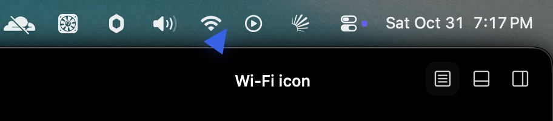

# First Claude talk turn verification

Scope is issue 5, against the project spec and [ADR 0003](../adr/0003-cli-providers-routed-by-usage.md).

## Acceptance mapping

| Acceptance criterion | Implementation and evidence |
| --- | --- |
| One long-lived `claude -p` stream-json process, from an empty Application Support folder, with `ANTHROPIC_*` removed and user settings skipped, never the proxy or `--bare` | Partly met. `ClaudeBrain` keeps one process for the whole launch rather than one per conversation, because Buddy has no conversation boundary until #12. It warms the process at launch and starts it again only after it ends or signs out. `ClaudeLaunch.talk` runs it in `~/Library/Application Support/Buddy/Claude`. It removes `ANTHROPIC_*` and the `CLAUDE*` variables a Claude Code shell sets. It keeps `CLAUDE_CONFIG_DIR` and `CLAUDE_CODE_OAUTH_TOKEN`, which locate the CLI's own login, and the owner's `CLAUDE_CODE_DISABLE_NONESSENTIAL_TRAFFIC` opt-out. It passes `--setting-sources ""` and never `--bare`. `talkUsesTheCLIsOwnLoginAndTheOwnersOptOutsFromAnEmptyFolderWithNoToolsOrUserSettings` asserts the literal executable, arguments and environment against the owner's real proxy variable names. On the real CLI, `--setting-sources user` loaded the owner's 6 plugins and the proxy, and no `rate_limit_event` arrived. `--setting-sources ""` loaded the 3 built-in plugins, reported `apiKeySource: none` and emitted `rate_limit_event`, which only first-party subscription auth does. |
| Our own system prompt that teaches the POINT tag, and no tools | `TalkInstructions.system` is written for Buddy and teaches the trailing `[POINT:x,y:label:screenN]` and `[POINT:none]` tags that `PointedReply` parses. Its examples deliberately avoid the Wi-Fi question used for the manual check. The launch passes `--tools ""`, `--strict-mcp-config` and `--disable-slash-commands`, and the recorded `init` line shows `"tools":[]` and `"mcp_servers":[]`. |
| A turn sends every display as image blocks plus the transcript; the reply is spoken with the Apple voice and a POINT flies the buddy there | `TurnRequest.content` labels each capture with its screen number, pixel size and whether the cursor is on it, in the order `screenN` counts, then adds the transcript. #4's limits asked for exactly this. `ClaudeStream` encodes each capture as a base64 `image/jpeg` block. `turnSentToTheProviderLabelsEachScreenInPointingOrder` drives the engine and asserts the literal content for one and two displays. The manual check below shows the spoken answer and the point. |
| A missing or signed-out `claude` gives a clear notice instead of a hang | No `claude` on `PATH`, in `~/.local/bin`, `~/.claude/local`, `/opt/homebrew/bin` or `/usr/local/bin` means "Claude Code isn't installed. Install it and sign in, then try again." The signed-out notice is "Claude Code is signed out. Run claude in Terminal to sign in." A process that quits fails the turn with its last stderr line. `missingClaudeFailsTheTurnOnceSendHasReturned`, `signedOutProcessIsReplacedForTheNextTurn`, `processThatQuitsFailsTheTurnAndTheNextTurnStartsAnother` and `providerFailureEndsTheTurnWithItsNotice` cover these. The signed-out run was recorded from the real CLI with an empty `CLAUDE_CONFIG_DIR`, which left the owner's login untouched. |
| Adapter tests replay a recorded, scrubbed stream-json transcript and assert the provider events, including usage | Three recordings in `BuddyCore/Tests/BuddyCoreTests/Fixtures/` were made from Claude Code 2.1.316 with the exact talk launch: a Wi-Fi question with a real screenshot, a long reply interrupted mid-stream followed by the next turn, and a signed-out run. The scrub replaced session, message and request ids, uuids, paths and timestamps, and removed the account's overage fields. `recordedTalkTurnReplaysIntoProviderEventsHoweverTheOutputIsSplit` replays the talk turn split into chunks of 1, 2, 7, 64 and 100,000 bytes. It asserts the literal list: the 5-hour and 7-day usage, 20 text deltas and `completed`. `recordedTurnReplaysThroughAProcess` replays the same recording through a real pipe from a stand-in process. `usageReportedAfterACancelStillArrives` keeps Claude's last figure for routing, as ADR 0003 needs. |
| An opt-in live smoke test runs one tiny real turn | `BUDDY_LIVE_CLAUDE=1 swift test --package-path BuddyCore --filter liveClaude` passed in 3.4 seconds. It was run from a shell that had the owner's `ANTHROPIC_BASE_URL` and `ANTHROPIC_AUTH_TOKEN` set. The reply contained "ready", a usage event arrived, and the working folder stayed empty. Without the variable, the test is skipped. |
| Manual check: the Wi-Fi question gets a spoken answer and a point, with key-release-to-speech time | Passed, and the release-to-speech time was 1.64 seconds (below). |
| Logic added here is covered by Swift Testing tests in BuddyCore with literal expected values | The engine's failure notices, usage pass-through and turn content are tested through `handle`. The adapter is tested through its public interface: `ClaudeLaunch.talk`, `ClaudeStream`, and `ClaudeBrain` against stand-in processes. A mutation sweep made 13 changes. They kept a cancelled reply's deltas, wrote the next turn before the interrupted reply ended, kept the proxy variables, loaded user settings, left tools on, ignored `PATH`, kept a signed-out process, dropped usage, dropped a waiting turn on exit, took the first stderr line, dropped the cursor flag, numbered screens from zero, and made the notice copy generic. After review, three more dropped usage after a cancel, delivered a missing-CLI failure inside `send`, and stripped the owner's nonessential-traffic opt-out. All 16 mutants failed at least one test. |

Commands run on macOS 26.6.2 with Xcode 26.6, Swift 6.3.3 and Claude Code 2.1.316:

```sh
swift test --package-path BuddyCore
BUDDY_LIVE_CLAUDE=1 swift test --package-path BuddyCore --filter liveClaude
xcodebuild -project Buddy.xcodeproj -scheme Buddy -configuration Debug \
  -destination 'platform=macOS,arch=arm64' -derivedDataPath /tmp/buddy-build-5 build test
```

`swift test` passed 50 tests, with the live test skipped. `xcodebuild test` passed the three upstream tests with no Swift warnings.

## Protocol facts the adapter relies on

These were observed on the real CLI before the adapter was written:

- With stream-json input, the process emits nothing until the first message arrives. It answers messages in order and ends each answer with exactly one `result` line.
- An interrupt is a stdin `control_request` with subtype `interrupt`. Mid-reply, it ends that reply with a `result` of subtype `error_during_execution`. While idle, it produces only a `control_response`. `ClaudeStream` holds the next turn's message until the interrupted reply's `result`, so an interrupt never reaches a queued message.
- Sonnet can stream `thinking_delta` blocks before its text. Only `text_delta` is spoken.
- `rate_limit_event` arrives either before `message_start` or after `message_stop`, once per process in these recordings.
- Signed out, the CLI sends a synthetic `assistant` line with `error: "authentication_failed"` and an error `result`, then stays alive. The adapter ends that process so the next turn starts one with a fresh login.
- The CLI starts no child processes, and its stdout closes as it exits (0.39 seconds after stdin closed, 0.35 seconds after SIGTERM). The host treats both pipes closing as the end of the process.
- `FileHandle.read(upToCount:)` waits for the full count, which a live process never sends, so the host reads its pipes with POSIX `read`.

## Native runtime check

The owner allowed the check while at the Mac. Their signed baseline in `~/Applications/Buddy.app` was quit, and this branch's signed Debug build ran instead. Its warm `claude` child had started before the first press. A posted Control+Option press was held while `say "Where is the Wi-Fi menu?"` played through the built-in speakers into the built-in microphone, and then released. The first attempt's timing log was lost to a shell function named `log`, so the turn was repeated. The timed turn was the second in that process. `Logger.turnTiming` recorded:

| Step | Time after release |
| --- | --- |
| `pushToTalkReleased` | 0 ms |
| `transcriptFinished` | 38 ms |
| `screensCaptured` → `sendTurn` | 126 ms |
| First `provider.textDelta` | 1,034 ms |
| `provider.completed` → `point, recordTurn, speak` | 1,626 ms |
| Apple voice `speech started` | **1,635 ms** |
| `speechFinished` → `clearOverlay` | 11,538 ms |

The buddy flew to the Wi-Fi icon in the menu bar and showed the label "Wi-Fi icon" while it spoke:



After the check, `Application Support/Buddy/Claude` was still empty, and `~/.claude/projects` had no Buddy session. Quitting the test build ended its `claude` child, and the owner's baseline app was relaunched. The log records case names only, so the reply's words are not kept here.

The first real capture showed macOS 26's prompt asking whether Buddy may bypass the private window picker, as #4 predicted. Capture went ahead regardless. The prompt was left for the owner.

## Limits

- One process lives as long as the app does, so every turn in a launch shares one Claude session, screenshots included. Conversations that end after idle time are #12.
- The whole reply is spoken after it finishes streaming. Speaking each line as it arrives is #6, which is where most of the 1.6 seconds can go. Holding the next turn until an interrupted reply ends is already done here, in `ClaudeStream`, so #6 doesn't need to redo it.
- Usage events reach the engine and are dropped. Routing and persisting them is #11. `rate_limit_event` came once per process in these recordings, so #11 can't count on a fresh figure every turn.
- A `claude` that starts but never answers has no timeout. The owner can still press push-to-talk or Esc, which cancels the reply, and the next turn replaces a process that has died.
- A missing `claude` is reported only after the owner speaks and the screens are captured, because the app always runs with a provider. The screenshots never leave the Mac in that case.
- The engine's notice copy names Claude Code. When Codex arrives in #10, a failure needs to say which provider it came from.
- `BuddyEngine(providerConnected:)` still has its no-provider path, which only the engine tests use now.
- Telemetry opt-outs set in the shell reach the CLI. An opt-out kept only in the `env` block of `~/.claude/settings.json` is skipped along with the rest of the user settings. The owner sets none today.

## Merge and rollback

This is a two-way door. Merging connects talk turns to the owner's own Claude Code, which spends a little of their Claude subscription per turn. Nothing is written outside `Application Support/Buddy/Claude`, which stays empty. Reverting the commits restores the no-provider app.
