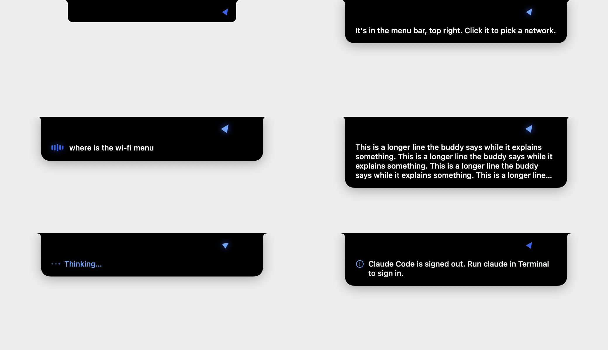
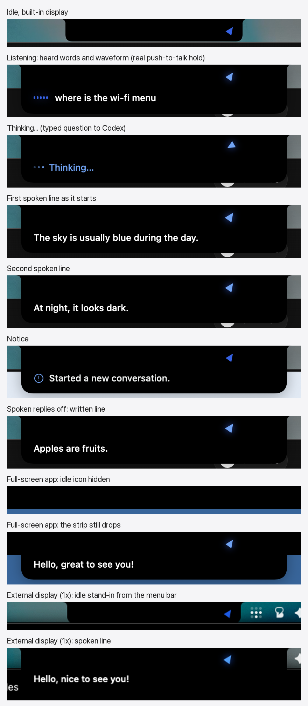
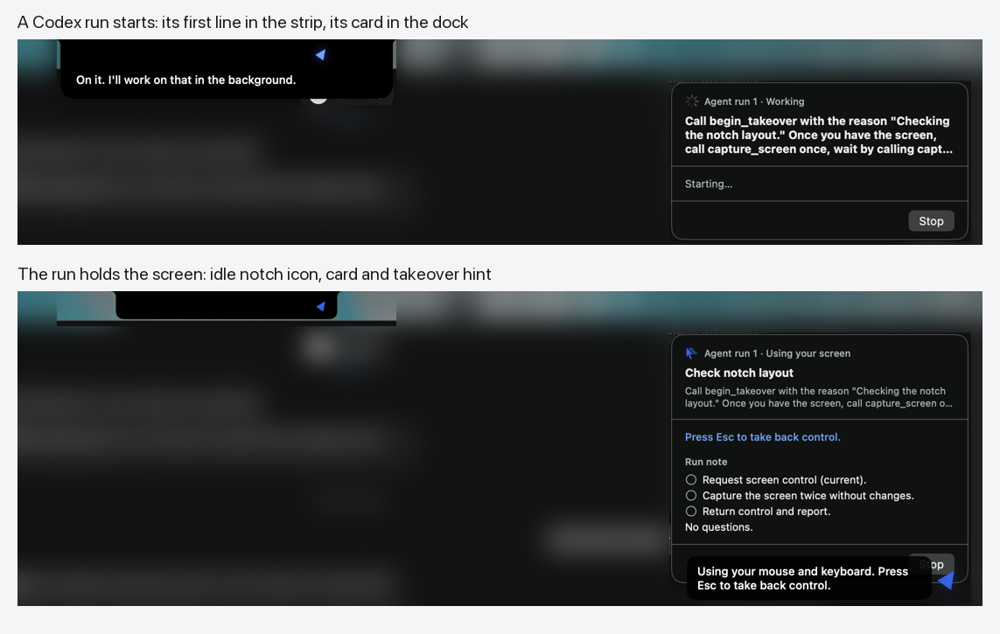
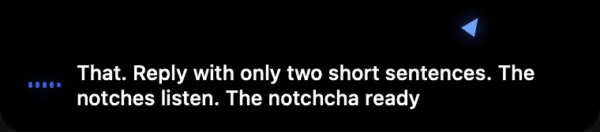
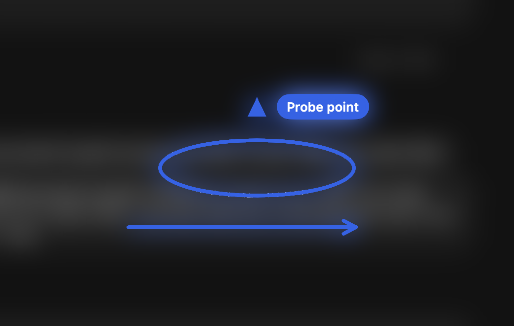

# Notch tracer verification

Issue #59 moves the buddy's text from the bubble beside the cursor into a notch at the top center of the cursor's screen. The buddy beside the cursor still points, and a point's label sits beside it in a pill. Annotations stay on the overlay.

## Engine

`BuddyEngine` sends `showNotch(Notch)` whenever what the notch shows changes. `NotchTests` drives the public `handle` interface and checks literal effects for each state:

| Notch | When | Test |
| --- | --- | --- |
| `listening(heard:)` | Push-to-talk press, then each transcript update | `aSpokenTurnShowsTheHeardWordsThenThinkingThenEachLineAsItStarts` |
| `thinking` | Release, a submitted text box, a click that asks again | the same, `aTypedQuestionThinksOnceItIsSubmitted` |
| `line` | Each line as the mouth starts it, or as it is read with spoken replies off | the same, `withSpokenRepliesOffTheStripShowsEachLineThenCloses` |
| `notice` | Failures, refusals and other notices | `aProviderFailureShowsItsNoticeUntilItExpires`, `aNoticeAtTheEndOfAReplyStaysUpWhileTheStripCloses` |
| `closing` | The reply ends on a line or a notice | `escClosesTheStripAtOnceAfterTheReply` |
| `idle` | Esc, an expired notice, an empty transcript or reply, a new text box, clearing history | `escClosesTheStripAtOnceDuringTheReply`, `anEmptyTranscriptClosesTheStripAtOnce`, `clearingHistoryClosesTheStrip` |

The bubble's effects `showListening`, `showNotice` and `showReply` are gone, as are `TurnPhase.reading` and `State.isThinking`. A written reply no longer stays up until Esc. Its last line stays in the strip for three seconds, and settings' **Latest answer** keeps the full text.

## Rendering

`Buddy/NotchPanel.swift` was compiled into a throwaway harness that put each state up on the built-in display (camera housing 220 × 38 points) over a light backdrop. From the top left down, then the top right down: idle, listening with words, thinking, a line, a long line cut at four lines, a notice.



## Full screen

The window server was probed on the built-in display while a test app was in full screen. Its window sits below the camera housing, at `(0, 39, 2056, 1290)`, and the only other windows on screen were the menu bar and a transparent 1 × 1 utility window. On the desktop, several zoomed apps have exactly the same bounds. The idle icon therefore hides when one other app alone has normal windows on the display and one of them fills it from the menu bar down. The same rule printed `false`, then `true` in full screen, then `false` again after it. `FullScreenAppTests` replays the recorded window lists.

A single zoomed app with nothing else on its display looks the same as full screen, so the idle icon hides there too. The strip still drops down during a turn in both cases.

## Live checks in the signed app

These ran on November 2, 2026, after merging `main` at `528ecd8`. A temporary Swift Testing probe ran inside a signed Debug build of the branch (`dev.steven.buddy`, Apple Development identity, `-derivedDataPath /tmp/buddy-build`), as for #26, #27 and #29. The probe was never committed.

- It made the app's real `CompanionManager` with history and profile in a temporary folder and its own defaults suite, then called `start()`, so the real shortcut monitor, notch, overlay, dock, text box and takeover tap were live.
- It briefly set `talkConnectionV1` to direct sign-ins with talk forced to Codex, and runs were on Codex with Auto approvals. An export of `dev.steven.buddy` taken after the probe matched the one taken before key for key, and the probe's suite was removed.
- Each question went in through the real text box, opened as the Control double-tap opens it and typed with posted key events. Codex 0.166.0 answered.
- The probe moved the pointer, clicked and pressed keys with real `CGEvent`s at the HID level, under its own marker. It sampled the notch's model and window every 25 ms and captured the screen with `screencapture`.
- The Mac's output was muted, and the probe didn't unmute it, so the voice spoke silently. The mouth still reported each line's start and end.
- Displays: the built-in Retina display at 1728 × 1117 points, whose camera housing measured 185 × 32, and a Sceptre K27 at 1920 × 1080 with a 30-point menu bar.
- The owner's own Buddy kept running throughout. It saw the probe's Esc and its silent push-to-talk hold like any key.

| Criterion | Live result |
| --- | --- |
| Idle icon beside the camera notch on the cursor's screen | The idle notch wrapped the camera housing with the icon in its right ear. Moving the pointer to the external display moved the window there within 0.5 s, and back again. |
| Heard words with a waveform | A real Control + Option hold opened the strip with the live microphone waveform in 0.1 s. The output was muted, so the heard words were sent as `transcriptUpdated` while the real hold ran. On release, the real ears returned an empty transcript and the strip closed 0.08 s later. |
| Thinking, then each spoken line as it starts | A typed question showed **Thinking…** at once. Line 1 showed at 14.58 s as the mouth started it, and line 2 at 17.06 s, as line 1 finished. |
| Closes a few seconds after the reply, at once on Esc | The strip closed 2.99 s after the reply ended. During a four-line reply, a real Esc closed it in 0.062 s and stopped the voice, and the turn went idle. |
| Notices | Typing "new conversation" showed "Started a new conversation." It expired after 3.98 s. |
| Spoken replies off | With spoken replies off, the strip showed each of three lines in turn, at 46.66, 49.67 and 52.67 s, then closed 3 s after the last. |
| No camera notch | On the external display a 180 × 30 stand-in hung from the menu bar with the same shape and icon, and the strip dropped from it during a turn. |
| Full screen | While a test app was in full screen on the built-in display, `overFullScreen` became true and the idle icon was hidden. A turn's strip still dropped over the app. After the app quit, the flag cleared. |
| Never takes focus, clicks pass | In all 88 state samples the notch window was never key or main, and it ignored the mouse. The frontmost app before and after a turn was the same. A test window sat under the notch's 460 × 200 window, below the menu bar. Real clicks reached it in four places: below the closed notch, beside the open strip, below it, and on the strip itself, because the whole panel is click-through. The test app became frontmost each time. |
| Alongside the dock, run cards and takeover hint | A typed "agent, …" request started a Codex run. Its first line showed in the strip at top center while its card appeared in the dock at the top right, with no overlap. The probe found the card's Allow button through the accessibility API and clicked it with a real click, and the run took the screen. The idle notch icon, the card saying **Using your screen** and the takeover hint beside the buddy all showed together. A real Esc ended the takeover in 0.063 s, and the run then finished. The overlay, which carries the hint, sits above the notch's level, so the hint is never hidden behind the notch. |





The layout pictures blur everything except the notch and the run card.

### Follow-up after review

A second temporary probe ran in the signed Debug app on November 2 at 16:02 with the notice-expiry fix. It used the same real manager, its four-second notice timer, and temporary history, profile and defaults. The probe source remains locally at `/tmp/notch-resume/NotchResumeProbe.swift`; it is excluded from the repository and CI.

- **Notice expiry.** A notice arriving while the text box was open stayed up indefinitely because expiry checked the idle notice field, which was unset. The new public-engine regression failed twice before the fix and passed afterward. In the signed app, the real timer cleared the notice both with the text box still open and after it closed. Each check waited 4.3 seconds and observed an empty strip.
- **Overlay.** The real overlay rendered a point with its label, a ring annotation and a draw-program arrow. The screenshot below preserves their pixels and blurs the surrounding content.
- **Real speech.** The probe briefly unmuted the built-in speakers at volume 42 and played a known phrase after allowing the microphone to start. On the built-in screen, the actual recognizer produced the phrase with transcription errors, and the notch showed those words and its waveform. On release it showed Thinking, then two spoken lines at 2.23 and 3.57 seconds, and closed at 7.72 seconds. On the external screen, real recognizer text appeared, followed by Thinking and two spoken lines at 2.24 and 4.03 seconds, closing at 9.35 seconds. The external run did not reliably transcribe the scripted phrase, so it proves the UI path from the real recognizer, not acoustic transcription accuracy.
- **Restoration.** The owner's `dev.steven.buddy` defaults matched the pre-probe export key for key. Output volume returned to 27 and output was muted again. The probe's defaults suite was removed.





### Remaining qualification

Voice timing was observed through the real mouth callbacks, not judged by ear. Recognition accuracy in the external-display acoustic loop is also unproven. This change does not alter the ears, the mouth, audio playback or their callbacks. The tested behavior is the new text destination: real heard updates, Thinking and each mouth-started line reach the notch, and the strip closes afterward. These qualifications do not identify a regression in this change or require repeating the unchanged speech components' acceptance work.

## Automated checks

After merging `main` at `528ecd8` and fixing notice expiry, 477 BuddyCore tests in 44 suites and 33 app tests in 12 suites pass. Both commands below exited successfully with Xcode 26.6, build 17F113. The signed live probe also passed, separately from these privacy-permission-free suites.

```sh
swift test --package-path BuddyCore
xcodebuild -project Buddy.xcodeproj -scheme Buddy -configuration Debug \
  -destination 'platform=macOS,arch=arm64' -derivedDataPath /tmp/buddy-ci \
  CODE_SIGNING_ALLOWED=NO COMPILER_INDEX_STORE_ENABLE=NO test
```
