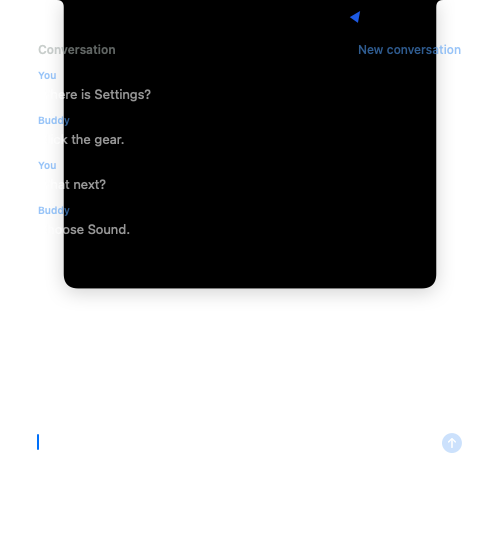
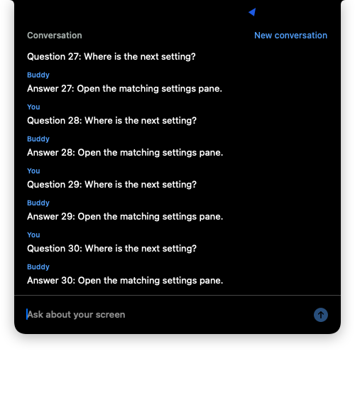
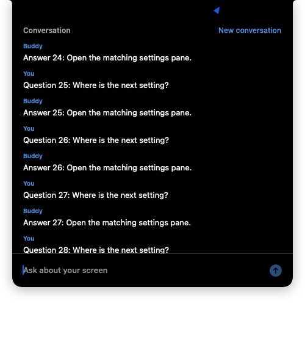

# Open notch conversation verification

Live spec: #60, under #1.
Starting head and fetched `main`: `76d26de7a65d1bb8a1cc9f87e37b14f0443b092c`.
Branch: `t3/frontier-issue-60`.
Later integrated main: `c093439ec6849e81f7f59e54c7203cadb010e6d2` (#33, PR #74).
Prior incoming main: `a2a0863832a3f0682d01d446025ed6b1807ca1b3` (#32, PR #75), tree `cb2f504c40b674afe0718298f81d15af0c5292ac`.
Latest integrated main: `f67d4087ee0d90830b4c05d6ecaf98c139e95dde` (#30 and #20), tree `1740132e19b71e0d10dc05db2bc1857683196670`.

The combined-main integration below is not yet executed locally. Earlier passes in this map retain their recorded source attribution; they are historical for changed engine, manager, and test paths. Owner-only signed-app acceptance remains pending and unchecked.

## Acceptance map

| Criterion | Code | Actual evidence |
| --- | --- | --- |
| Hover for about 0.15 seconds opens; leaving closes unless focused or holding text; Esc closes | `NotchConversation`, `BuddyEngine`, `NotchPanel` | `hoverOpensAfterTheDelayWithoutTakingFocusAndLeavingCloses`, `focusOrDraftKeepsTheNotchOpenButEscAlwaysClosesIt`, and `clearingABlurredDraftClosesAndEscDoesNotImmediatelyReopenUnderThePointer` pass. Signed probe moved the real pointer over the icon for 250 ms, observed open without a key window, then moved away and observed close. |
| Current conversation scrolls newest at the bottom; spoken reply appears line by line | Engine thread entries and notch scroll view | Literal voice/typed/repeated-line tests pass; the earlier signed probe observed actual Apple mouth callbacks. After integration, a signed capture-free probe rendered all of the newest answer in a 60-entry thread, asserted the bottom sentinel was in the viewport, and sent a native wheel event directly to its own scroll view. Viewport y moved from 2355 to 2115 and the second render showed older rows. |
| Control double-tap focuses the inline field; cursor field removed | Semantic `ShortcutSlot.textBox` and notch input | Existing Control timing tests pass. App regression sends text and Return through the real inline field after opening and reopening. `TextBoxPanel.swift` and its port are removed. |
| Enter captures the screen and uses the existing spoken-beat pipeline | `textBoxSubmitted`, `ask`, existing capture/brain/mouth adapters | The native-field regression asserts Enter emits exactly `[.hideTextBox, .showBuddy, .showNotch(.thinking), .captureScreens]`, then injects JPEG bytes and display metadata and asserts the exact `sendTurn` request with the prior spoken turn. This is fixture routing evidence at the engine seam. Signed probe exercised the actual Apple mouth callbacks with deterministic provider text. The real capture call completed without throwing; exact image count was not recorded and the consent dialog persisted after host exit. No live provider was called. |
| New conversation ends history, requests summary, and empties the thread | Engine conversation boundary | `newConversationEndsHistoryAndRequestsItsSummaryWhileEmptyingTheThread` checks the ended history and literal summary request. `endingByIdleTimeAlsoStartsAnEmptyThread` passes. Signed probe clicked the actual New conversation button and observed empty entries and ended history. |
| Run offers and notices appear as text | `presentInThread`, `showNotch` and chronological entry rows | `repeatedLinesAndRunOffersRemainPlainTextAndReadingDoesNotDuplicateASpokenLine` checks the literal plain-language run offer and notice, with repeated spoken lines retained separately. |
| Hover preserves app focus; explicit input takes keyboard and closing returns it | Nonactivating notch panel | Signed probe began with another app frontmost, checked the same frontmost process after hover, verified no key window on hover, verified a field editor on explicit focus, and verified key focus released after Return. Pointer and previous app restored in teardown. |
| Literal Swift Testing coverage through the public engine interface | `NotchConversationTests` | All eight new tests pass. Full BuddyCore gate passed 485 tests in 45 suites. |
| Owner signed-app hover, spoken question, typed follow-up, spoken answer, New conversation | Signed app | Pending owner check. Agent functional checks will be reported separately. |

## Design and execution

`NotchConversation` holds interaction state, draft text, and typed thread entries. The existing `Notch` enum still drives the compact speech strip. Hover changes only the conversation view. A focused field uses the existing typed-turn slot and pipeline. The thread records a reply line when its mouth callback starts, rather than when the provider has finished producing it.

The single issue owner edits the coupled engine and AppKit adapter. Reviews run independently and read-only. Local execution is serialized with the shared lane guard. All app build and probe output belongs under `/tmp/buddy-frontier-issue-60/`.

The first hover slice initially failed to compile because the events and state did not exist. That attempt also contained a test-clock typo and an input edit during compilation, so it is not counted as a clean behavior-red run. The next focused run passed. The focus/draft slice has a clean assertion-red log at `/tmp/buddy-frontier-issue-60/focus-red.log`.

## Screenshot isolation prerequisite

Scoped commit `982ac3d53c29a7cbca15c5fffe05d221081cece7` replaces shared temporary-directory deletion with a UUID directory owned by each manager. Releasing a manager removes only that directory. The default shared root and existing images remain untouched.

The unsafe baseline app host was never launched. An extracted copy of the baseline deletion body, parameterized with a task-owned fixture path under `/tmp/buddy-frontier-issue-60/`, demonstrated that a second initialization erased the first fixture image. That helper completed with exit 0. This is helper-based baseline proof, not an app-host red test.

After the fix, the two `CodexScreenshotIsolationTests` passed in the real app host. They cover existing root-file preservation, images belonging to two managers, and cleanup after each manager is released. Independent fresh Standards and Spec reviewers each reported zero blockers. The focused unsigned `xcodebuild` test exited 0, with results at `/tmp/buddy-frontier-issue-60/ci/Logs/Test/Test-Buddy-2026.11.02_17-51-29--0800.xcresult`.


## Signed functional evidence

A temporary Swift Testing probe ran in the signed app at the stable `dev.steven.buddy` identity using `/tmp/buddy-frontier-issue-60/signed`. The probe used the real notch, window, native text field, keyboard event dispatch and Apple mouth. Voice/question and provider text were deterministic injected data. No owner provider/account selection, defaults, history, profile, audio volume or clipboard was changed. The pointer and original frontmost app were restored; each probe host exited. The probe is kept locally under `/tmp/buddy-frontier-issue-60/` and excluded from CI.

The first signed attempt called the real `DisplayCapture.captureAll()`. It completed without throwing and the test passed. The exact image count was not instrumented, so it is unknown; the unchanged adapter throws on an empty result, which establishes at least one returned image. Inspection of the artifact revealed macOS asking “Buddy is requesting to bypass the system private window picker and directly access your screen and audio.” No consent button was clicked or permission granted.

After our signed test-host PIDs 4924 and 6368 exited, a read-only accessibility inspection confirmed that the same Buddy/private-window-picker dialog **remained visible** in UserNotificationCenter (PID 25019). It was left untouched. The owner's separate Buddy process was neither stopped nor controlled. No additional capture request was made to recover the missing count. This establishes a system-consent limitation; it does not satisfy the owner-only acceptance check.

Capture implementation comparison against the authoritative baseline is empty:

```sh
git diff 76d26de7a65d1bb8a1cc9f87e37b14f0443b092c -- Buddy/DisplayCapture.swift
# no output
```

The changed path is native inline field/Enter → `textBoxSubmitted` → existing `ask` → `captureScreens` → `screensCaptured` → `sendTurn`. The native-field regression supplies `Data([1, 2, 3])`, a 1440×900 display, 1280×800 image dimensions and the prior “Where is Settings?” / “Click the gear.” turn, and checks the complete resulting request. It does not execute the manager's capture adapter. TalkConnections still reads standard defaults despite an injected manager suite; no owner provider/account or selection was changed to obtain live evidence.

A second render-only probe avoided another capture request and passed. Its AppKit view-rendered artifact contains only the injected conversation:



Signed render-only result: `/tmp/buddy-frontier-issue-60/signed/Logs/Test/Test-Buddy-2026.11.02_18-04-22--0800.xcresult`, exit 0. This proves callbacks and view/input behavior, not recognition quality, live-provider behavior, audible speech quality, or the owner-only acceptance check.

The initial full unsigned app run failed because SwiftUI deferred text-field focus. That real failing regression was fixed by mounting a native `NSTextField` beside the SwiftUI view in a common AppKit container. The opening/reopening regression passed afterward.

## Historical full required gates

After removing the temporary probe from the repository, the complete intended source passed both gates, with real exit status preserved:

```sh
swift test --package-path BuddyCore
# exit 0; 485 tests in 45 suites
xcodebuild -project Buddy.xcodeproj -scheme Buddy -configuration Debug \
  -destination 'platform=macOS,arch=arm64' \
  -derivedDataPath /tmp/buddy-frontier-issue-60/ci \
  CODE_SIGNING_ALLOWED=NO COMPILER_INDEX_STORE_ENABLE=NO test
# exit 0; 35 tests in 13 suites
```

Logs: `/tmp/buddy-frontier-issue-60/core.log` and `app-final.log`.
Final unsigned result: `/tmp/buddy-frontier-issue-60/ci/Logs/Test/Test-Buddy-2026.11.02_18-06-57--0800.xcresult`.
These full results belong to the source subsequently committed as `da5d698010040619874617d74f2a25686d49569e`, before integration of #33. Its exact-head hosted CI also passed at run `41564640197`. They are historical, not CI for the later integrated head. The batch's test-host/helper processes exited, pointer/frontmost-app state was restored, and the shared test lane was released.

## Capture-free integration batch

The granted integration batch tested a stable pending merge: HEAD `da5d698010040619874617d74f2a25686d49569e`, MERGE_HEAD `c093439ec6849e81f7f59e54c7203cadb010e6d2`, reviewed product/index tree `1fae1ecce2b98461547785d1f91d28eb29045099`. No product source changed during the batch. The notch view/model/field tests were unchanged by integration; #33 pen toggle, reduced-motion and synchronized audio wiring remained intact. Screenshot isolation implementation/tests matched the incoming main exactly.

All commands ran through `test_lane.py run --issue 60 --thread issue-60`, with output under `/tmp/buddy-frontier-issue-60/`:

- `swift test --package-path BuddyCore --filter 'NotchConversationTests|TextBoxTests|PenSoundTests'`: exit 0, **26 tests / 3 suites** (`integrated-core-focused.log`).
- Signed `xcodebuild` at derived data `signed`, `-only-testing:BuddyTests/NotchPanelTests`: exit 0, **1 test / 1 suite**. Native input/Return/capture-effect/injected-image-context regression executed after the initial probe compile cancellation (`integrated-native-field.log`, result `Test-Buddy-2026.11.02_18-53-52--0800.xcresult`).
- Signed `xcodebuild`, same configuration/path, `-only-testing:BuddyTests/Issue60ScrollProbe`: exit 0, **1 test / 1 suite** (`integrated-native-scroll-visible.log`, result `Test-Buddy-2026.11.02_18-54-29--0800.xcresult`). This temporary probe only mounted its own notch and used deterministic 30-turn/60-entry history. It made no screen capture, provider request or global pointer/input operation.

The native scroll document was 2715 points high, viewport 346 points high. Initial viewport y was 2355; its maxY was 14 points before document end because the existing bottom sentinel precedes `.padding(.bottom, 14)`. The probe asserted the sentinel point was contained in the visible rect. The before-render visibly shows the complete newest “Answer 30”. Native AppKit wheel handling moved y to 2115, exposing earlier rows. Both own-view renders were visually inspected:





Two earlier probe failures are preserved: `integrated-native-scroll.log` exited 65 because the temporary helper used the obsolete `scrollWheel` method name; `integrated-native-scroll-fixed.log` exited 65 because its incorrect zero-padding assertion rejected the expected 14-point gap. Only the temporary probe was corrected; no product change was made to satisfy either failure. `integrated-native-scroll-green.log` passed before the additional sentinel/before-render proof. These are probe corrections, not product red/green evidence.

Each executable batch wrote actual before/after SHA256 manifests and result JSON. All pairs matched. Product/test/config inventory was 144 files, or 145 while the temporary probe was copied in. Representative hashes:

| File | SHA256 |
| --- | --- |
| `Buddy/NotchPanel.swift` | `211eee91187b4e25ab516001cc5bcad4949fc49adfab0066cda6cb1b3cb574c2` |
| `Buddy/CompanionManager.swift` | `672204738e10066916453a0bc3808e5196701684ef7300bbaaa5d80364f34d35` |
| `BuddyCore/Sources/BuddyCore/BuddyEngine.swift` | `d8e2ae5709315c5cd18a043a001b63969db9c9ad370f76db7fe0d9a8bd4fa8b7` |
| `BuddyTests/NotchPanelTests.swift` | `41a8643c4d47dd2fbe4c2681d4482b450b83588e67fe518b3c32acb10599ce8b` |

The temporary copied probe was removed, preserving `/tmp` source/evidence. All own test-hosts exited and own notch windows closed; no remaining task-owned hosts required termination. Previous focus was restored by probe teardown. The lane was released before documentation/publication. No owner provider/account/history/settings/audio/clipboard state was changed. Capture consent was untouched; dialog visibility in this batch is **unknown**, separate from the earlier confirmed persistence. The explicit owner signed-app manual acceptance criterion remains pending.

## Later handwriting/paper integration qualification

Main `a2a0863832a3f0682d01d446025ed6b1807ca1b3` adds #32 handwriting/paper events, native panels, bundled Patrick Hand resources and updated scratch offsets. One engine merge conflict placed independent event cases at the same switch location; resolution retains both sets of cases. The manager's paper callback/update/remove effects coexist with notch event/update/focus wiring. New conversation still clears unpinned paper and scheduled pen audio through `clearAnnotations`; main's pinned-paper rules, Esc/clear-history cleanup, drawing clock and resources are retained.

The previous integration was committed as `5b510071bfdb620a1dd3148d25e7d5fac09eb0c5`, and its exact-head hosted CI passed (run `41570458677`). Its focused 26-engine/1-field/1-scroll results above remain historical for the changed engine/manager/draw paths. Notch view and field/thread test bytes are unchanged, so those renders still describe the unchanged view, but they are not new-head execution evidence.

The paper integration was committed as `0963e27f4af995a439e70e4254e1a10a11ff24d2`, tree `acf70f134016c87714d4ee9ff1dfe2332daf75a8`. Its hosted CI passed (run `41572729186`). In the later explicitly granted bounded batch, `swift test --package-path BuddyCore --filter 'NotchConversationTests|TextBoxTests|PenSoundTests|DrawProgramTests'` passed **60 tests / 4 suites**, exit 0. The signed `NotchPanelTests` command at derived data `signed` passed **1 test / 1 suite**, exit 0, checking actual native field opening/reopening and Enter through the capture-effect/injected-image/context seam. Before/after manifests covered all 267 tracked and intended new/untracked files plus the external runner helper, and matched exactly for each command. Actual logs/manifests/results are `paper-integrated-core-focused-*` and `paper-integrated-native-field-*` under the issue's `/tmp` directory; the signed result is `Test-Buddy-2026.11.02_19-34-13--0800.xcresult`. No full local rerun was performed solely for commit creation.

That granted native-field build refreshed `/tmp/buddy-frontier-issue-60/signed/Build/Products/Debug/Buddy.app` from the paper-integrated source. `paper-integrated-artifact-continuity.json` records its head/tree, all 267 source-file hashes, executable/debug-library and bundled Patrick Hand hashes. The app executable SHA256 is `5cab1b52066727b4bd5b78bf4ee2e80c582bed266aa64c5de3e93dff69f7bbc6`; its debug library is `e13abb37666a11ed30cd0f6a084d1ae1975a7e93d0349c4314d79a13acf2ebcd`. Subsequent evidence-documentation edits do not change product/config/test source bytes; their final-head qualification is recorded in PR #73 and the report.

Own host PID 59798 exited, own notch windows closed, and no remaining task-owned hosts required termination. The lane was released before review/CI/report work. No provider turn, capture call, consent interaction, private-window inspection, global input, owner flow or account/history/settings/audio/clipboard mutation occurred. Normal startup and the explicit owner signed-app acceptance remain unverified; no waiver is inferred, and current picker visibility remains **unknown**.

## Independent review

Fresh read-only worktree Standards and Spec reviews covered baseline `76d26de7a65d1bb8a1cc9f87e37b14f0443b092c` through isolation commit `982ac3d53c29a7cbca15c5fffe05d221081cece7` and every intended pending source/test/document/image change. Both found zero blocking implementation findings. Standards noted repeated layout dimensions as an optional maintenance concern; current dimensions agree. Spec retained the long-thread scroll and owner-only evidence gaps. Neither reviewer ran local executable checks. The later capture-facts documentation correction records the observed persistent dialog and unknown exact image count.

Fresh committed reviews of `da5d698010040619874617d74f2a25686d49569e` also found zero implementation blockers. The later integration worktree Standards/Spec reviews verified tree `1fae1ecce2b98461547785d1f91d28eb29045099`, preservation of both features and byte-identical screenshot isolation, with zero blockers. Its committed head `5b510071bfdb620a1dd3148d25e7d5fac09eb0c5` passed both committed review axes and hosted CI run `41570458677`. Historical reviews/CI are not transferred to later changed source.

Fresh paper-integration worktree and committed Standards/Spec reviews of `0963e27f4af995a439e70e4254e1a10a11ff24d2` against main `a2a0863832a3f0682d01d446025ed6b1807ca1b3` found zero implementation blockers. They verified both event groups, paper/notch cleanup, callbacks, shared pen timing, unchanged incoming resources and actual manifests. Current bounded checks are recorded above. Owner-only acceptance is the remaining manual criterion; final-head CI/review status after documentation updates is recorded in PR #73/report.


## Combined run-fallback and shortcut integration

Fetched main `f67d4087ee0d90830b4c05d6ecaf98c139e95dde` once after the #20 merge relay, incorporating #30 and #20 together. The pending merge starts at `d3ad179efe53c7900fe21317617743647ff4ddc5`. Three conflicts were resolved by preserving both intents:

- `BuddyEngine` keeps main's four-argument modifier event, semantic `ShortcutMatcher`, `shortcutChosen` persistence, cancellation and run-question `answerQuestion` helper. Its `toggleTextBox` now also opens/focuses the notch and clears the hover deadline on explicit close.
- `CompanionManager` keeps main's `.startListening` generation invalidation, optional/inert ears, `shortcutsV1` restoration, and dock shortcut hints. New conversation still cancels the prior generation; notch state updates and inline input effects remain wired.
- `Buddy/AGENTS.md` documents configurable semantic slots and the new inline destination. The cursor panel and its port remain removed.

Incoming Auto/pinned run selection, pause/resume, stale-token and waiting-state guards, retained owner asks/caps/takeover consent, paper callbacks/lifecycle, pen clock, and font resources remain present. `DisplayCapture.swift` is unchanged. No provider turn, capture request, consent action, global input, normal owner-app launch, or owner settings mutation is part of this integration.

The incoming `ShortcutTests` now also asserts that a rebound held Text box trigger opens/focuses the notch and a subsequent gesture closes it. `NotchPanelTests` opens its real native field first through default Control double-tap and then through a rebound held Shift+Command trigger. Its existing native Return, injected-image/context request, and key-window release assertions remain. These updated assertions are prepared, not claimed as executed until the later granted batch.

The coordinator granted a conditional final batch only after reviewed publication/readback: full BuddyCore (including `NotchConversationTests|TextBoxTests|ShortcutTests|PenSoundTests|DrawProgramTests|RunFallbackTests`), the prescribed full unsigned app gate, and scoped signed `NotchPanelTests`. Each command records tracked and intended untracked input hashes before/after. Hosted exact-head CI supplies the full core/app gates as well. Actual post-publication results belong in the live PR body and own report, so this planned-check record is not a claim of passing execution. No redundant long-scroll rerun is requested: `NotchPanel.swift` remains byte-identical to the signed scroll evidence, including its 14-point padding.

The same conditional permit includes an app-only signed artifact build under `/tmp/buddy-frontier-issue-60/owner-app`, without temporary probe source, verification of the stable `dev.steven.buddy` Apple Development signature, and saved source/binary hashes. That artifact must not be launched by this thread. The prior `/tmp/buddy-frontier-issue-60/signed/Build/Products/Debug/Buddy.app` remains historical at product head `0963e27f4af995a439e70e4254e1a10a11ff24d2`. No current combined-main owner artifact or owner-flow completion is claimed. Picker visibility remains UNKNOWN.
