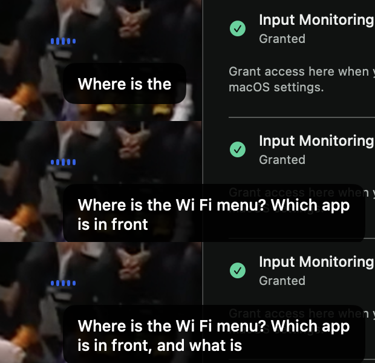
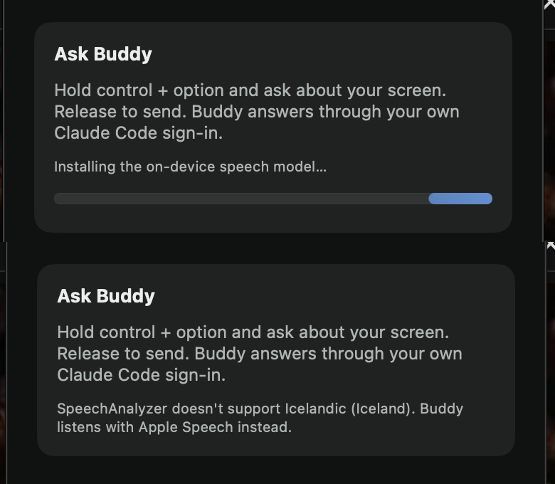

# On-device ears verification

Scope is issue 7, against the project spec.

## Acceptance mapping

| Acceptance criterion | Implementation and evidence |
| --- | --- |
| The ears use SpeechAnalyzer with a streaming transcriber, install the language model through the system's asset inventory when it is missing, and show progress | `SpeechAnalyzerTranscriptionProvider` runs one `SpeechAnalyzer` per push-to-talk with a `SpeechTranscriber` that reports volatile and fast results. It keeps the model loaded for the life of the process. At launch, `prepare` finds the model for the owner's first preferred language with `SpeechTranscriber.supportedLocale(equivalentTo:)`. It releases models reserved for other languages, then calls `AssetInventory.assetInstallationRequest(supporting:)` and `downloadAndInstall()`. While that runs, the panel shows "Installing the on-device speech model…" with a bar. A failed download is tried again on the next push-to-talk. A language SpeechAnalyzer doesn't support is not checked again until the next launch. Launched with `-AppleLanguages '(de-DE)'`, the app downloaded the German model. The panel showed the install at 3 and 7 seconds, and the note was gone at 29 seconds (image below). |
| Partial results show beside the waveform while push-to-talk is held, and the final transcript is what the turn sends | The engine's new `transcriptUpdated` event emits `showListening(heard:)` only while push-to-talk is held. Pressing emits `showListening(heard: "")`, which replaced the old "Release to finish" bubble. The overlay swaps the buddy's triangle for upstream's five-bar waveform, which follows the microphone level. It shows the heard words in a bubble that updates in place and keeps the last three lines. Release still emits `showBuddy`, and only `transcriptFinished` starts the turn. The screenshots below show the words growing beside the waveform on the real overlay. |
| Upstream's Apple Speech provider remains as a fallback when SpeechAnalyzer is unavailable | `OnDeviceEars` listens with Apple Speech until the model is ready, or for good when SpeechAnalyzer can't run. Launched with `-AppleLanguages '(is-IS)'`, the panel said "SpeechAnalyzer doesn't support Icelandic (Iceland). Buddy listens with Apple Speech instead." The push-to-talk that followed logged `listening with Apple Speech`. A normal launch logged `listening with SpeechAnalyzer`. The fallback takes the first of the owner's language and US English whose recognizer runs on device (see the facts below). After the review fixes, a launch with `-AppleLanguages '(pl-PL)'` said "SpeechAnalyzer doesn't support Polish (Poland).", downloaded nothing, and both push-to-talks listened with Apple Speech without failing. |
| Tests: partial and final transcript events produce the expected overlay and turn effects | `recordedResultsShowBesideTheWaveformAndTheTurnSendsTheFinalTranscript` replays 21 SpeechTranscriber results recorded on this Mac through `HeardSpeech` into the engine. It asserts 15 literal `showListening` effects while held, none after release, then `captureScreens` and a `sendTurn` carrying "Open the settings. Then find the battery section. What does low power mode do?". `wordsHeardOutsideAHeldPushToTalkAreNotShown` covers idle, transcribing, capturing, thinking, speaking and after Esc. It also covers trimming. |
| Manual check: the transcript is final within about half a second of key release | Passed. Across 18 real push-to-talks, `pushToTalkReleased` to `transcriptFinished` took 21 to 92 ms (table below). |
| Logic added here is covered by Swift Testing tests in BuddyCore with literal expected values | `HeardSpeech` and the engine's `transcriptUpdated` handling are tested through their public interfaces. A mutation sweep made 8 changes. It kept the guess after a final result, appended guesses, ignored finality, replaced settled words, dropped the guess from the text, showed words outside a held push-to-talk, skipped trimming, and showed no waveform on press. All 8 mutants failed at least one test. |

Commands run on macOS 26.6.2 with Xcode 26.6 and Swift 6.3.3:

```sh
swift test --package-path BuddyCore
xcodebuild -project Buddy.xcodeproj -scheme Buddy -configuration Debug \
  -destination 'platform=macOS,arch=arm64' -derivedDataPath /tmp/buddy-ci \
  CODE_SIGNING_ALLOWED=NO COMPILER_INDEX_STORE_ENABLE=NO test
xcodebuild -project Buddy.xcodeproj -scheme Buddy -configuration Debug \
  -destination 'platform=macOS,arch=arm64' -derivedDataPath /tmp/buddy-build-7 build
```

`swift test` passed 53 tests. The unsigned `xcodebuild test` passed the three upstream tests. The signed Debug build, which ran on the Mac below, had no Swift warnings.

## Facts the ears rely on

These were observed with SpeechAnalyzer on this Mac before and while the adapter was written:

- A final result settles its words. Each volatile result replaces the previous one and covers the audio after the last final result. Segments after the first begin with a space. `HeardSpeech` is built on this, and the test fixture is one such recording.
- While someone speaks, results arrive in bursts about once a second. After the input ends, `finalizeAndFinishThroughEndOfInput` delivered the last final result 31 to 95 ms later in four file-fed runs.
- SpeechAnalyzer needs no Speech Recognition authorization. A command-line probe transcribed with that status still `notDetermined`.
- `AssetInventory.status` reports `supported`, not `installed`, for an English model already on the Mac until the app reserves the locale. `assetInstallationRequest` reserves it, and `downloadAndInstall` then returned in 0.14 seconds.
- A real download's `Progress` read 0 of 1 until it finished. French took 19.2 seconds and Spanish 14.0. The panel's bar is therefore indeterminate until a fraction above zero arrives. Both test reservations were released afterwards.
- `bestAvailableAudioFormat` is 16 kHz mono Int16. The built-in microphone is 48 kHz mono Float32, so each tap buffer is resampled. The app's converter was fed both test recordings at the microphone's format, and both came back word for word.
- SpeechTranscriber supports 30 locales on this Mac, fewer than Apple Speech. Launched with `-AppleLanguages '(is)' -AppleLocale is_IS`, Buddy still picked an English model, while a command-line tool given the same arguments resolved Icelandic and found none. Buddy's English-only interface appears to set the language of `Locale.current` (inferred). The ears use the owner's first preferred language instead, as `Locale.spoken`.
- `SpeechTranscriber.supportedLocale(equivalentTo:)` also returns `pl_PL` and `uk_UA`, which aren't among those 30. Before review, a Polish owner's launch tried to download `pl_PL`, failed with "asset unavailable after attempted download", and tried again on every push-to-talk. The ears now also require the locale to be in `supportedLocales`.
- Many Apple Speech recognizers run only on Apple's servers. On this Mac, en-GB, de-DE, fr-FR, pl-PL, cs-CZ, uk-UA and others don't support on-device recognition, which upstream's session refuses. Before review, the fallback took the first recognizer that existed. For an en-GB, German or Polish owner, every push-to-talk that fell back to Apple Speech ended with "On-device speech recognition is unavailable on this Mac." It now takes the first recognizer that runs on device. A probe of both versions picked en-GB, de-DE and pl-PL before (all refused) and en-US after.
- Finalizing before the analyzer has started is safe. A probe asked `finalizeAndFinishThroughEndOfInput` to finish while `prepareToAnalyze` was still running, and also with `start` held back 300 ms. Each time it waited for the analyzer to start and returned the whole transcript, so a release right after the press needs no extra ordering.

## Native runtime check

The owner's signed baseline in `~/Applications/Buddy.app` was quit, and this branch's signed Debug build ran in its place. Push-to-talk was a posted Control+Option press. Questions were played with `say` through the built-in speakers into the built-in microphone. The baseline was relaunched after each run.

In the screenshot run, the posted release was lost, so both questions landed in one long hold. The overlay showed the words growing beside the waveform. Read from top to bottom, the frames come just after the first question finished playing, during the second, and just after the second finished:



The lost release came from the test harness, not Buddy. A standalone event tap showed that posting from a process that exits right away dropped 2 of 12 modifier transitions. After the helper waited 40 ms per event, 20 of 20 arrived. Later runs used the fixed helper.

Timing from `Logger.turnTiming`:

| Run | Ears | Words heard | Release to `transcriptFinished` |
| --- | --- | --- | --- |
| Holds of 2.5 s | SpeechAnalyzer (model ready, no panel note) | yes | 54, 53, 62 ms |
| Holds of 0.6 s | SpeechAnalyzer (logged) | no, then yes | 82, 51 ms |
| Holds of 0.6 s | SpeechAnalyzer (logged) | no | 85, 51, 35 ms |
| Hold of 0.6 s, `-AppleLanguages '(is-IS)'` | Apple Speech (logged) | no | 32 ms |
| After the review fixes, holds of 0.3 s, then Esc | Apple Speech (`is-IS`), then SpeechAnalyzer | no | 43; 91, 35 ms |
| Holds of 0.6 s, then Esc, Polish download attempted (before the `supportedLocales` check) | Apple Speech, then SpeechAnalyzer | no | 27, 21; 78 ms |
| Holds of 0.6 s, then Esc, after all fixes | Apple Speech (`pl-PL`), then SpeechAnalyzer | no | 59, 23; 92 ms |

The holds were silent on purpose, but the microphone also heard sound in the room, so four of the first nine sent short turns to Claude. Later runs posted Esc right after each release, so they sent nothing. The log keeps case names only, so those words aren't recorded here.

The panel while the German model installed, and with Icelandic as the preferred language:



## Limits

- While the owner speaks, the words beside the waveform trail by up to about a second, because results arrive in bursts. Release flushes them within the times above.
- macOS 26.6 reports no fraction for the model download, so the bar sweeps rather than filling.
- Releasing a model reserved for another language wasn't observed, because nothing outside Buddy can read its reservations.
- A model that finishes installing during a hold applies from the next press. That hold stays on Apple Speech.
- If SpeechAnalyzer fails after the press, that turn ends with its error as a notice. It isn't retried with Apple Speech, and later presses still use SpeechAnalyzer until Buddy relaunches.
- While the model installs, an owner whose language has no on-device Apple Speech recognizer is heard as US English.
- The waveform's level math is upstream's and stays in the app target, so BuddyCore doesn't test it.
- The resampler keeps its last few milliseconds of audio when the input ends. In the longer test recording that was 137 of 108,430 frames.
- The Apple Speech fallback still needs the Speech Recognition permission.

## Merge and rollback

This is a two-way door. Merging moves talk's ears to SpeechAnalyzer and puts the heard words beside a waveform. On first launch, Buddy reserves the owner's speech model through the system's asset inventory, which downloads it if it isn't already on the Mac. The download comes from Apple's servers through the system, not Buddy's process. Reverting the commits restores the Apple Speech ears and the "Release to finish" bubble. A reserved model stays reserved for Buddy until the system reclaims it.
