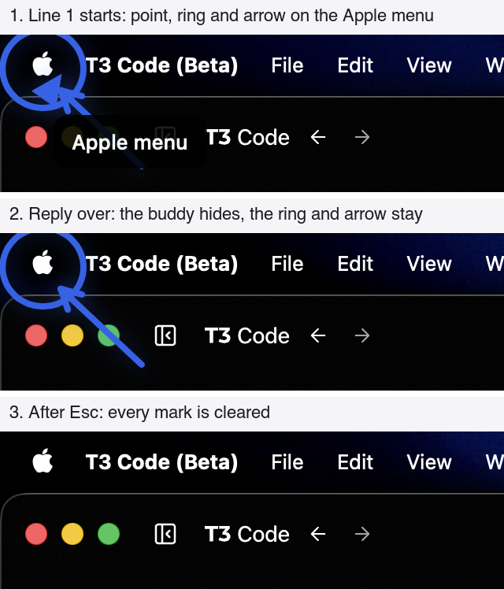
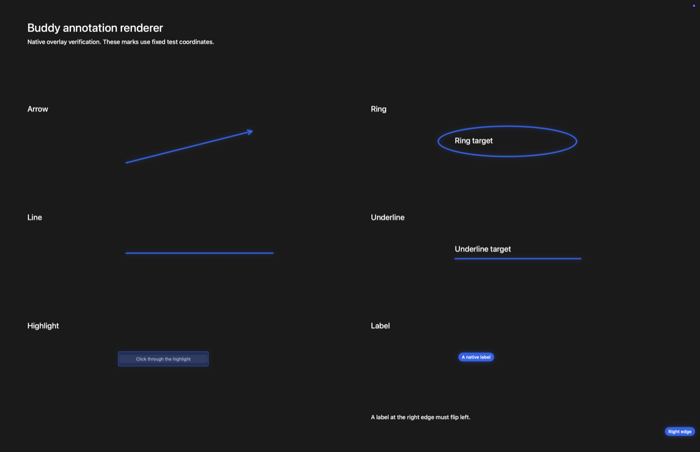

# Annotation beats verification

Scope is issue 8, against the Beats section of the project spec.

## Acceptance mapping

| Acceptance criterion | Implementation and evidence |
| --- | --- |
| The beat grammar extends POINT with arrow, ring, line, underline, highlight and label tags in screenshot pixel space, with an optional screen number, and the system prompt teaches them | `BeatParser` in `Beat.swift` reads every `[KIND:fields]` tag in a line. ARROW, RING, LINE, UNDERLINE and HIGHLIGHT take four whole pixel coordinates. LABEL takes a spot and its text. Any tag can end in `:screenN`. `TalkInstructions` teaches each tag, the pixel space, the screen number, and a ring and an arrow on anything visible that the owner should click. `everyTagKindDrawsItsMarkAsItsLineStarts` covers the six new kinds with literal display points. `everyTagInThePromptsExamplesFiresAndNoneIsSpoken` runs each prompt example through the engine and checks that every tag fires and none is spoken. |
| Marks render natively on the click-through overlay with a short draw-on animation, and the overlay stays click-through | `AnnotationMark` in `OverlayWindow.swift` draws each mark in SwiftUI, in the buddy's accent ink with a glow, inside the existing overlay windows. Those windows still set `ignoresMouseEvents = true` at the `.screenSaver` level. Strokes trim on over 0.35 s, a highlight wipes in over 0.3 s and a label fades in over 0.2 s. With Reduce Motion a mark appears at once. Each window draws only the marks whose centre is on its own display, beneath the buddy. The live run below drew them over a real screen. |
| A reply can carry several marks, each firing when its line starts, and all marks clear when the next turn starts or on interruption | On `lineStarted` the engine returns the line's point and then one `annotate` effect per mark, in reply order. `eachLinesMarksFireWhenTheMouthStartsThatLine` streams three lines: a point, a ring and an arrow fire when line 1 starts, nothing fires for line 2, and line 3's label fires on the second display. `marksClearOnTheNextTurnEscapeOrClearingHistory` covers 10 states, including a press, Esc and clearing history mid-reply and after it. `clearAnnotations` is sent only when marks are up. Marks stay after the reply (`marksStayAfterTheReplyUntilTheNextTurnStarts`), and a provider failure leaves them up. Esc while idle clears them without restarting the conversation's idle clock. `marksWaitForTheVoiceToStartIncludingAfterNeuralFallback` checks that a mark waits for whichever voice actually starts the line. |
| Marks land in the right place on secondary displays | Each mark is mapped through its own capture: the one its `:screenN` names, else the cursor's. `marksLandOnTheScreenTheyNameElseTheCursorScreen` covers a mark on a monitor to the left of the laptop and offset upward, either capture order, a screen number with no such screen falling back to the cursor's display, clamping at a display's edge, and a point and a ring on different displays in one line. Only one display was attached, so the live run could not check a second display. |
| Tests: every tag kind parses, malformed tags are skipped without breaking speech, multi-display mapping is correct, and marks clear on the next turn | The rows above, plus `malformedTagsAreSkippedAndTheRestOfTheLineStillWorks`. In 18 of its 19 cases a bad tag is cut from the words while the line's good ring still fires: unknown kinds, wrong counts, decimals, negative numbers, empty labels, extra fields and bad screen numbers. The last case keeps bracketed words that aren't tags, such as `[Return]` and the lower-case `[esc:now]`, spoken as written. `cuttingATagLeavesOneSpaceBetweenWords` covers 9 spacing cases. `annotationTagsSplitAcrossDeltasProduceTheSameEffects` splits a reply into chunks of 1 to 1,000 Unicode scalars. |
| Manual check with screenshot: asking how to change the wallpaper produces at least an arrow and a ring in the right places | Passed in a harness on the real `claude` process at `de47840`, below. Claude ringed the Apple menu and drew an arrow to it, and the app's overlay code drew both on the real screen. Five earlier replies drew no arrow, which led to the prompt change in `302d88d`. |
| Logic added here is covered by Swift Testing tests in BuddyCore through the engine's public interface, with literal expected values | Every annotation test drives `BuddyEngine.handle`. All but one compare literal effects. `everyTagInThePromptsExamplesFiresAndNoneIsSpoken` checks a relation instead, that every tag in each prompt example fires and none is spoken, so it holds as the prompt's wording changes. `BeatParser`, `Beat` and the tag types are internal. Each review fix's test was checked to fail with its fix reverted. |

Commands run on macOS 26.6.2 with Xcode 26.6, Swift 6.3.3 and Claude Code 2.1.316:

```sh
swift test --package-path BuddyCore
xcodebuild -project Buddy.xcodeproj -scheme Buddy -configuration Debug \
  -destination 'platform=macOS,arch=arm64' -derivedDataPath /tmp/buddy-ci \
  CODE_SIGNING_ALLOWED=NO COMPILER_INDEX_STORE_ENABLE=NO test
```

At `de47840`, `swift test` passed 99 tests in 10 suites, with the live test skipped, and `xcodebuild test` passed the three upstream tests with no Swift warnings.

## Wallpaper check

The owner's own Buddy was running, so this used a harness instead of the app. It was a throwaway Swift executable outside the repo. It wired `BuddyEngine` to a real `ClaudeBrain` started by `ClaudeLaunch.talk` in an empty temporary folder, and to a real capture of the screen. It compiled the app's `OverlayWindow.swift`, `DesignSystem.swift` and `Ports.swift` unchanged. Three more pieces of the app were copied:

- `AppleVoiceMouth.swift` sets each line's volume to 0, so nothing played aloud at 2 AM. Line starts and ends still came from the synthesizer.
- `DisplayCapture.swift` leaves out the harness's own windows by process ID instead of bundle ID, because the harness has no bundle.
- `MicrophoneLevel` was copied out of `OnDeviceEars.swift` on its own, so the overlay compiled without the ears.

The harness sent a question as the transcript, started each line's speech as the engine asked, and took full-screen screenshots about 1 s after each line started, 1.5 s after the reply ended, and 1 s after an Esc. Only one display was attached: 2056 × 1329 points, captured at 1280 × 827 pixels.

The final wallpaper run, at `de47840` at 10:20 UTC:

```text
340 ms    screensCaptured -> sendTurn
3,310 ms  line 1 finished streaming -> speak
3,371 ms  lineStarted -> point(25.7, 1308.1, "Apple menu"),
            ring (9.6, 1324.2) to (45.0, 1290.4),
            arrow (90.0, 1245.4) to (38.6, 1293.6)
3,711 ms  provider.completed
6,552 ms  line 2 -> speak, no marks
10,594 ms line 3 -> speak, no marks
14,286 ms last line ends -> hideBuddy
16,143 ms Esc -> clearAnnotations
17,192 ms overlay windows left: 0
```

Claude's reply:

```text
[POINT:16,13:Apple menu] [RING:6,3,28,24] [ARROW:56,52,24,22] Click the Apple menu at the top left of your screen.
Choose System Settings, then click Wallpaper in the sidebar on the left.
Pick any picture or color you like, and it changes right away.
```

The Apple logo sits at about 16, 11 in the capture. The ring's box surrounds it, and the arrow's head ends at its lower right. Across, the display has 1.60625 points per capture pixel. Down, it has 1329 / 827, about 1.607, with y flipped to count from the bottom. The screenshot is cropped to the top-left corner of the screen:



In panel 1 the arrow's tail runs under the buddy's dark label, because marks draw beneath the buddy. Panel 2 shows the marks outlasting the reply after the buddy hides.

Two other questions ran on the same commit, to check that the prompt didn't only fit the wallpaper:

| Question | Claude's reply | Marks drawn |
| --- | --- | --- |
| What's a haiku? | Two lines with no tags | None, and Esc had nothing to clear |
| How do I turn off Wi-Fi? | `[POINT:1105,12:Wi-Fi icon] [RING:1096,3,1114,21] [ARROW:1060,45,1104,22] Click the Wi-Fi icon in your menu bar at the top right.` and then a line about the switch in its panel | A point, a ring and an arrow on the Wi-Fi icon, which sits at about 1105, 11 in the capture. The switch wasn't on screen yet and got no tags. |

### How the prompt got its arrow

| Prompt | Replies | Marks drawn |
| --- | --- | --- |
| At `af97fef`: "Usually that's a ring around the thing to click and an arrow to anything small or easy to miss", with an example that points at and rings the File menu, then draws an arrow to New Folder in a menu that isn't open yet | 2 | A point and a ring each time, no arrow |
| First rewording: "To show where to click, ring the thing and draw an arrow to it from open space nearby", with the arrow moved onto the File menu line and the New Folder line left without tags | 3 | Two replies drew a point and a ring. One put its POINT on a line by itself after the words, and the parser skipped that line, so nothing was drawn |
| Second rewording, later amended into `302d88d`: "Whenever you tell your owner to click something on the screen, ring it and draw an arrow to it from open space nearby", plus why marks outlast the buddy | 4 wallpaper replies | A point, a ring and an arrow on the Apple menu each time |
| `302d88d`: "something you can see in the screenshot" instead of "something on the screen", so the untagged New Folder step follows the rule | The 3 questions above | As above |

An attempt before these hit Claude's 5-hour usage limit and got no reply. One run on the first rewording failed at capture, probably because another harness was capturing the screen at the same moment.

The first run at `af97fef` opened Wallpaper settings first. Claude ringed the Tahoe thumbnail with `[RING:888,351,956,397]` and pointed at Add Photo with `[POINT:921,464:Add Photo]`, and both matched the capture. Before the ring drew, a Finder window for a finished download had covered System Settings, so its screenshots showed the ring over other windows. The first limit below comes from this.

## Owner's in-app check

These need the signed Debug build in place of the owner's Buddy, with its permissions, real displays and voice:

1. Ask "How do I change the wallpaper?" from the desktop. As the first line starts, Buddy flies to the Apple menu, a ring draws around it, and an arrow draws to it.
2. When the reply ends, the buddy hides and the ring and arrow stay. Click the Apple menu through them, which shows the overlay is click-through.
3. Press Esc. The marks disappear.
4. Ask again with a second display attached, about something on that display. The marks land on it.
5. Turn on Reduce Motion in System Settings > Accessibility > Display and ask again. The marks appear without drawing on.

## Limits

- A mark stays at its screen position until the next turn, Esc or clearing history. If a window moves or the screen changes after the capture, the mark stays where the thing was.
- A line with only tags is skipped, as in #6, so a POINT on its own line after the words is dropped. The prompt says to keep tags in the line that talks about the thing.
- TARGET and TYPE tags are cut from speech and skipped until #9 gives them meaning.
- Marks appear on every Space, because the overlay windows join all Spaces.
- A second display and Reduce Motion rendering were not run live.
- The ring-and-arrow rule was tried on three questions on one screen. A crowded screen and a reply with several visible steps were not tried.

## Merge and rollback

This is a two-way door. It changes the talk prompt, how tags are read and what the overlay draws, and stores nothing new. Reverting the commits restores POINT-only beats.


## Integration with current main

The branch integrates main through `5ef112f12db8f8403721b834e880bbaba9bcf243`, the merge of #49 (agent runs), including typed questions, provider/account selection, text-box focus, silent replies and thinking feedback. The first integration commit is `58d7ff7bd720876d0818503475f6707790f86def`; the subsequent merge keeps both `state.run` and annotation state. `hideBuddy` retains marks independently of the reply bubble and the run card.

The same two commands above passed after the final integration: **209 BuddyCore tests in 22 suites**, with live provider smoke tests disabled, and **8 app tests in 5 suites**. Logs are retained locally at `/tmp/issue8-merge-repair/core-final.log` and `/tmp/issue8-merge-repair/xcode-final.log`.

Three regression tests exercise the shared public engine boundary:

- `silentRepliesDrawTheirMarksAndClearThemBeforeATypedQuestion` proves silent text draws its marks and the text box clears them before a new question.
- `mutingASpokenLineDrawsItsMarksExactlyOnce` covers muting before and after speech starts. Both cases failed before the first integration repair because annotation effects were missing.
- `agentBeatsDrawOnTheLatestCapturedScreenAndClearWithoutStoppingTheRun` covers spoken and silent `show_beats` output. A ring maps to the run's latest second-display capture with literal coordinates; Esc clears it while the background run remains active, and those beats do not enter conversation history.

A fresh temporary renderer compiled the current production `OverlayWindow.swift`, `PointerPose.swift`, `Ports.swift` and `DesignSystem.swift` unchanged, against the integrated BuddyCore. It drew every mark on a neutral full-screen fixture using fixed coordinates. Early and settled screenshots showed the stroke/wipe animation. A real synthetic click through the highlighted button reached the underlying AppKit window exactly once. All overlay windows were click-through and non-key; marks persisted after `hideBuddy`, then `clearAnnotations` left no visible overlay windows. The screenshot below was captured after animation settled; it is renderer evidence, separate from the earlier real-provider wallpaper check.



The renderer's source, full screenshots and assertion log remain in `/tmp/issue8-merge-repair/Renderer/` and `/tmp/issue8-merge-repair/renderer-final.log`. Only one physical display was attached. Secondary-display mapping is covered by engine tests; Reduce Motion and a new signed-app/provider run were not repeated. The earlier live wallpaper screenshot remains evidence for the original provider response, not a claim that a new live turn ran after the merge.
