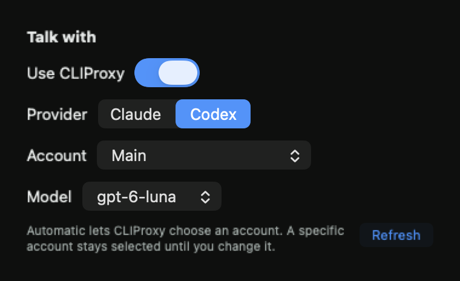

# CLIProxy provider and account selection

This follows Steven's request to switch subscription accounts and providers through his existing CLIProxy setup. It builds on PR #42's Dock and cursor-following text box. It does not incorporate or alter the separate draft direct-Codex PR #45.

## Behavior

Settings now contains **Talk with**. Enable **Use CLIProxy**, choose Claude or Codex, then an account and model. Automatic delegates account rotation to CLIProxy. Selection persists. A specific account gets an exclusive model route; a missing account blocks the turn instead of switching to another sign-in. Turning CLIProxy off restores direct Claude.

Changing selection interrupts the current turn and restarts the provider process. Recent conversation text stays in Buddy's history and is supplied to the new process. Cursor following, Dock lifecycle, permissions, speech, and pointing continue through the existing pipeline.

## Evidence

- Before: PR #42 at `fe5a076ee6a7c43feedac152d462f914f2dc31d8` always launched the direct Claude login. Its settings had no provider/account controls.
- Before adding proxy support, the new `ClaudeLaunchTests` case failed to compile because there was no explicit proxy connection argument. It now passes and checks the selected model, explicit endpoint/token, removal of the local OAuth token, and absence of secrets from process arguments.
- The live hub responded to authenticated account/model discovery and reported CLIProxy 8.0.48. Two Claude accounts and three Codex accounts were visible. Credentials and account identities were omitted from saved evidence.
- A tiny Codex request through the existing Claude CLI transport returned `OK`, establishing that CLIProxy can translate the talk transport before implementation. No screenshot or owner content was sent.
- Production `ClaudeLaunch` and `ClaudeBrain` then received `OK` from two separately pinned live Codex accounts. Each selected account's unique alias was published, and every account's pre-existing unprefixed model set stayed unchanged. Two account aliases were added on the hub; no account status, global routing strategy, or CLI profile was changed. The first, uninstrumented pinned probe did not meet its exact-text assertion and could not distinguish a different reply from a provider failure. Both subsequent instrumented account probes passed.
- A native fixture compiled the production connection controller, HTTP client, and SwiftUI controls against an isolated local HTTP server. It verified provider/account/model changes, unique-alias creation, persistence, account removal without fallback, duplicate-prefix rejection, refusal to change forced-prefix routing, safe hub failure messages, and redirect rejection. Preferences contained no credentials. All account labels in the render below are synthetic.
- The production settings window and content were rendered at 710 and 460 points tall with the fixture connection. Close, reopen, minimization, and scrolling to lower settings passed. Verification left the owner's foreground app unchanged.
- The installed signed app exposed all five connection controls through native Accessibility. Selecting the Codex radio button persisted Codex with CLIProxy enabled and Automatic account rotation. All five permission grants remained present. This check sent no question or synthetic keyboard/pointer input.
- Independent Standards and Spec reviews found one stale-route issue: an account's changed prefix on refresh could leave a warm process using its old model argument. Refresh now compares the effective connection and restarts for a changed route. The native HTTP fixture verifies both changed-route restart and unchanged-refresh retention. The parent reviewed the repair and reran the adapter checks.



```sh
swift test --package-path BuddyCore
# 103 tests passed.

xcodebuild -project Buddy.xcodeproj -scheme Buddy -configuration Debug \
  -destination 'platform=macOS,arch=arm64' -derivedDataPath /tmp/buddy-issue15-dock-ci \
  CODE_SIGNING_ALLOWED=NO COMPILER_INDEX_STORE_ENABLE=NO test
# Three app tests passed; TEST SUCCEEDED.

xcodebuild -project Buddy.xcodeproj -scheme Buddy -configuration Debug \
  -destination 'platform=macOS,arch=arm64' -derivedDataPath /tmp/buddy-build-15 build
# Signed Debug build succeeded.
```

Temporary native fixture sources, sanitized logs, and additional renders are under `/tmp/buddy-accounts-verify/` on the implementation Mac. These are manual adapter checks, not new persistent test seams. CI never contacts the hub or spends provider usage.

## Limits and owner check

Quota exhaustion is still enforced by the subscription. Choosing another available account or Codex avoids depending on the exhausted Claude login; Buddy cannot increase an account's limit. The current Claude accounts were not sent an additional live inference request during this work.

Open Buddy from the macOS Dock. Under **Talk with**, choose Codex and an available account, then double-tap Control and ask a question about the screen. Move the pointer while typing, press Return, and check the spoken answer and point. Switch to another account and repeat; reopen Buddy to check persistence. Foreground keyboard behavior and the original question/Return/spoken-answer/point acceptance checks remain owner checks.
