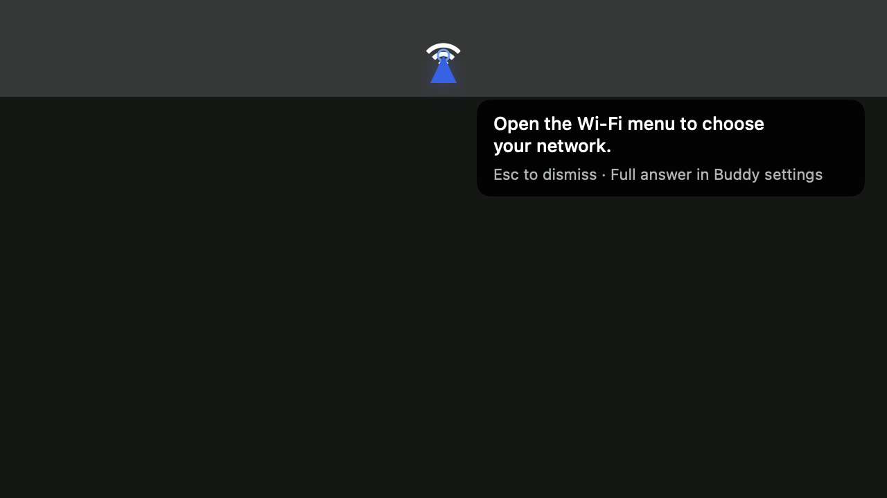
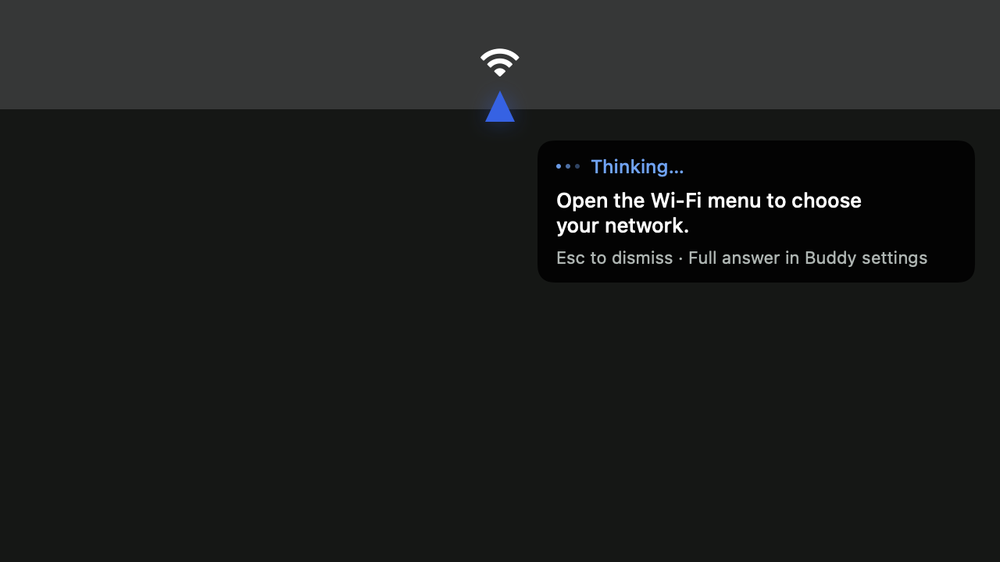
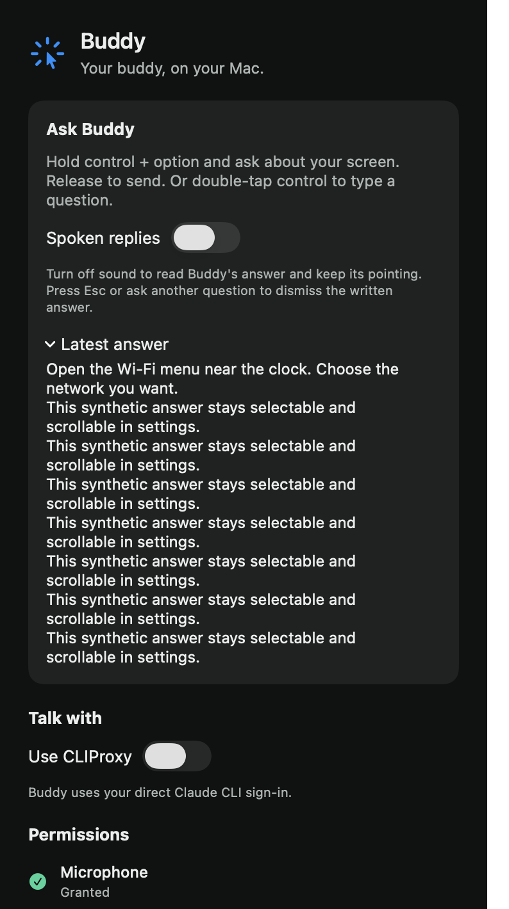

# Turn feedback verification

The owner requested a narration switch, visible activity during voice questions, and clearer pointing. The owner confirmed that narration off must show the written answer and keep pointing. This change builds on the text box focus fix at `7f4cf43`, targeting `t3/text-box-focus`.

## Acceptance evidence

| Requirement | Implementation | Observed verification |
| --- | --- | --- |
| Disable narration and keep text with pointing | Saved **Spoken replies** switch, explicit reading effects in `BuddyEngine` | Public event/effect tests show text, point, and reading timer without speech. Native installed switch saves its value and remains off after restart. |
| Mute a reply already in progress | Stop audio and present its current line | Tests cover starting audio, playing audio, and muting between lines, while keeping the point and rejecting stale callbacks. |
| Read the complete answer | Accumulated overlay text and **Latest answer** from existing local history | Native renders show bounded long answers. Installed disclosure reveals answer text. Settings text is selectable and uses a bounded scroll view. |
| Dismiss or replace a written answer | Esc and new questions clear the reading state | Tests cover interruption, a new question, history clearing, provider failure, and late timers. |
| See voice activity | Triangle remains beside the waveform, with **Listening…**, persistent **Thinking…**, and **Speaking…** feedback | Native renders show listening, waiting, a partial written answer, and pointing. Public engine tests keep activity through partial chunks and line gaps, then stop it on provider completion independently of queued speech or reading. A process-local adapter fixture checks that activity updates preserve text and points. |
| Point without covering the item | `PointerPose` aims the tip toward the unchanged target from an 18-point gap and turns the body inward at display edges. The target ring is removed. | Native geometry regressions check literal target and tip positions, aim, clearance, display bounds, and exclusion of a 24-point menu icon. |

The narration preference defaults on. Enabling it during a written line starts speech on the next line. A completed written answer remains until Esc or another question. Reading advances one line every 3–20 seconds, according to line length. Long overlay text ends with an ellipsis and directs the owner to the complete answer in settings.

## Local checks

These commands passed with the final implementation:

```sh
swift test --package-path BuddyCore
xcodebuild -project Buddy.xcodeproj -scheme Buddy -configuration Debug \
  -destination 'platform=macOS,arch=arm64' -derivedDataPath /tmp/buddy-issue15-dock-ci \
  CODE_SIGNING_ALLOWED=NO COMPILER_INDEX_STORE_ENABLE=NO test
xcodebuild -project Buddy.xcodeproj -scheme Buddy -configuration Debug \
  -destination 'platform=macOS,arch=arm64' -derivedDataPath /tmp/buddy-build-15 build
```

BuddyCore passed 125 tests. The app test run passed 7 tests, including preference persistence, pointer geometry, and existing text box regressions. The initial narration tests failed to compile because the feature API did not exist. Review then reproduced a runtime defect when muting between spoken lines. The new regression failed with missing text and an unwanted overlay clear, then passed after the fix.

The first implementation corrected a 14.254–38.172-point tip offset. Owner testing then showed that landing directly on the icon still covered it. A native render reproduced that overlap. The updated pointer leaves an 18-point gap and removes the ring over the target:

```text
Before: clearance=0.0pt iconIntersection=true
After:  clearance=18.0pt iconIntersection=false
```

The updated native geometry tests check 14 literal cases, including menu icons, negative origins, corners, and 30-point bottom insets. A temporary probe also checks 675 edge and threshold placements. The target coordinates remain exact; only the triangle's visible position changes.

The initial **Thinking…** message was replaced or covered by the first spoken line, point label, or written reply. `State.isThinking` now derives activity from preparation phases and the provider's existing streaming state. A separate header remains visible during partial text, points, speech, and gaps between chunks. Completion removes the header while queued speech or reading can continue. Error, Esc, and a replacement question also clear it. The dots animate at 12 Hz and remain static with reduced motion.

Capture-coordinate conversion is unchanged. Existing core tests cover screenshot scaling and display origins. The cropped owner screenshot does not establish whether the provider selected the correct coordinates.

## Native rendering and installation

The following images show production SwiftUI views rendered in owned, offscreen native windows with synthetic content. The overlay uses a neutral fixture background and a synthetic Wi-Fi icon. These are rendered fixtures, not screenshots of a live provider reply.







Settings were inspected at 380-point width with 710-point and 460-point viewport heights, collapsed and expanded. The expanded render sets the disclosure binding in a fixture copy to expose the long-answer layout. Installed native accessibility interaction separately verifies the real disclosure and narration switch. Listening, waiting, pointing, and a long answer at the bottom-right edge were inspected in native overlay renders. The follow-up also renders activity with written and spoken point labels, completion, and reduced motion. The reduced-motion render substitutes only the read-only environment value in its fixture copy; the system preference remains unchanged. The initial transparent baseline captures had compositing artifacts and are excluded.

A signed build was installed at `~/Applications/Buddy.app` with the same designated signing requirement and `dev.steven.buddy` identifier. Strict signature verification and file/symlink manifest comparison passed. A backup remains at `/tmp/buddy-thinking-followup/previous/Buddy.app`.

Installed native control checks passed for narration off, persistence after restart, switching back on, and expanding **Latest answer**. All five permission grants remained. The original narration preference and existing provider, account, and model selection were preserved. No question, screen capture, global key, pointer move, or provider inference was sent during these checks.

## Owner interaction checks

1. Open Buddy from the Dock and turn off **Spoken replies**.
2. Hold Control + Option and ask where a visible item is. Confirm Buddy stays visible beside the waveform and shows **Thinking…** after release.
3. Confirm the reply is silent, the written answer stays visible, and the triangle points toward the item with a gap. Confirm **Thinking…** remains while the response is generating and disappears when generation finishes. Open **Latest answer** to select or read the full answer.
4. Press Esc, then ask another question by double-tapping Control. Confirm the old written answer clears and typing still has immediate focus.
5. Turn **Spoken replies** on, start a spoken answer, and turn it off while Buddy speaks. Confirm sound stops while the text and point remain.

Physical microphone input, live provider targeting, perceived audio, and crossing multiple physical displays remain owner checks. Reduced motion uses the same tested resting pose; the system preference was not changed during verification. Notch animations and a notch text box are outside this PR. The parent spec explicitly excludes the notch UI. Annotation and draw-program work remains tracked separately in #8 and #31–32; this build does not claim illustration loading support. No merge or release is part of this verification.
